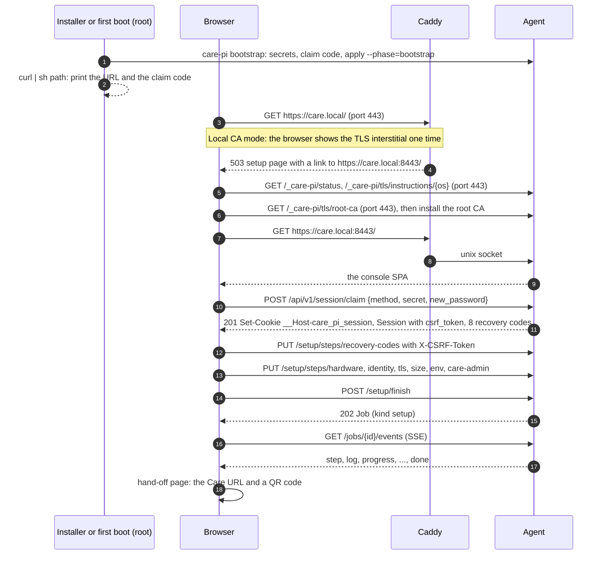
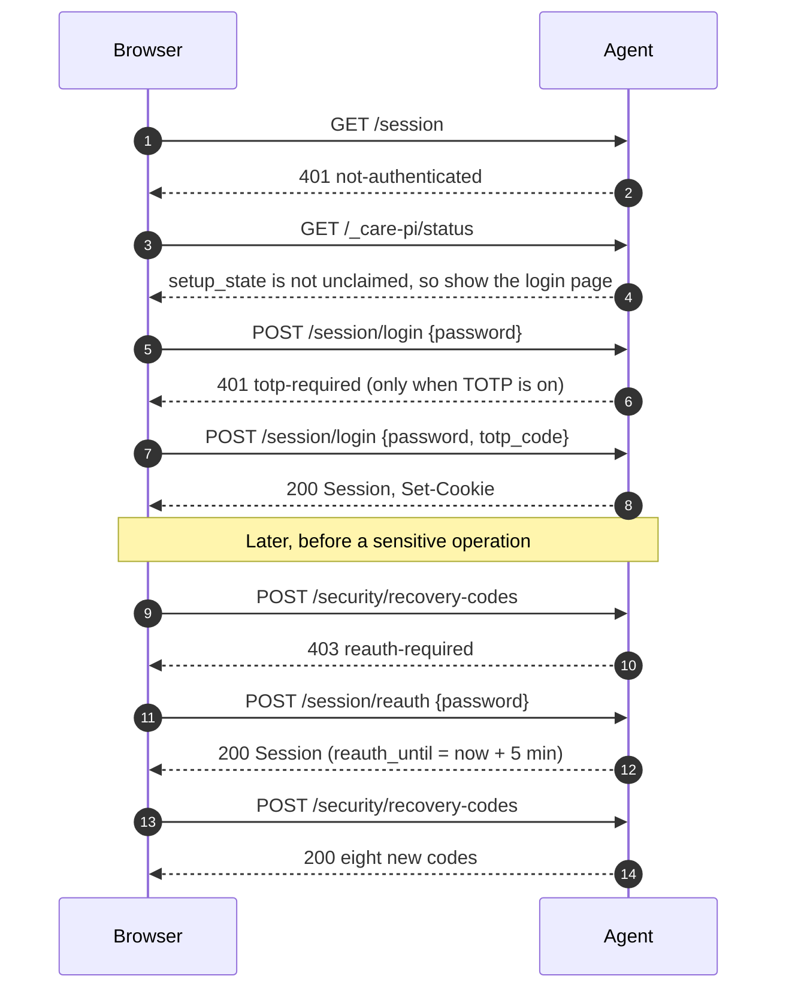
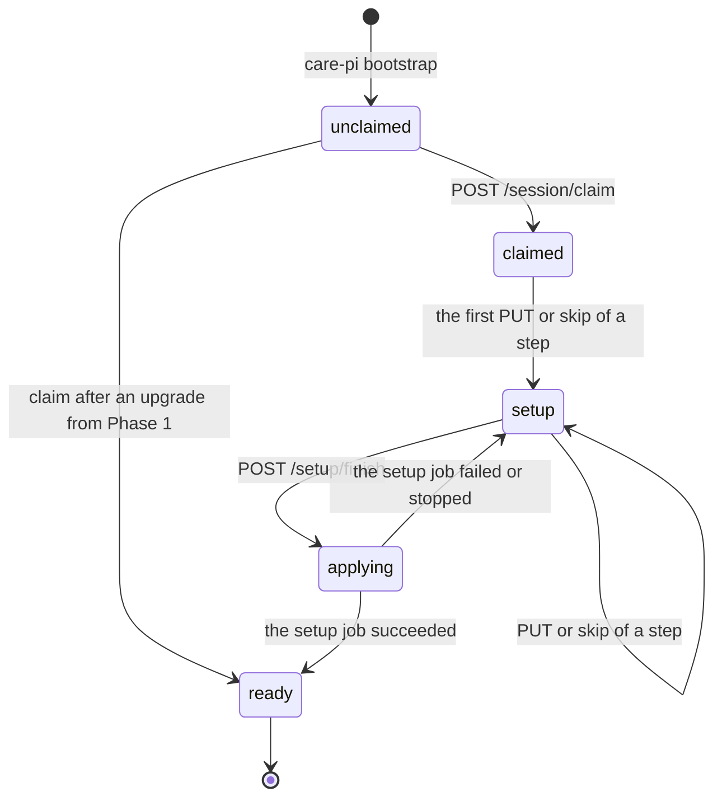
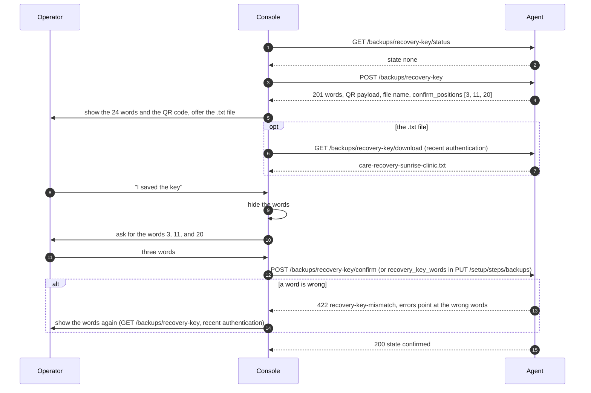
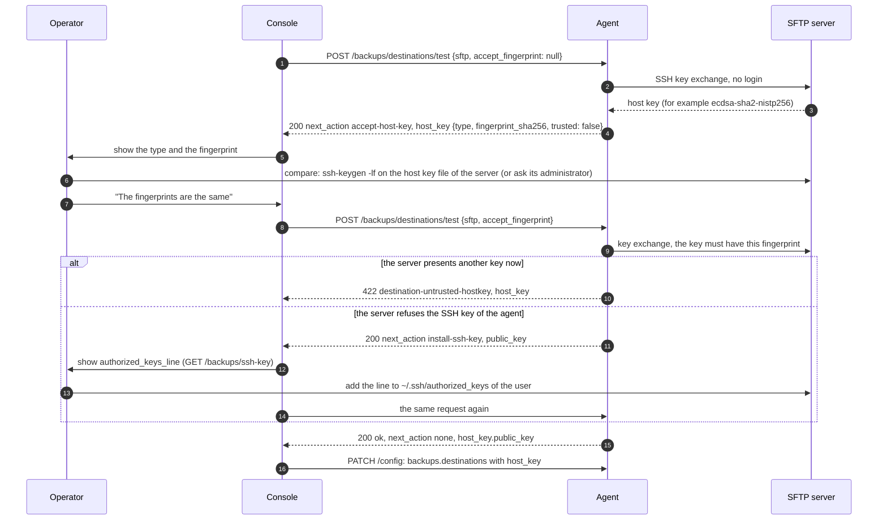
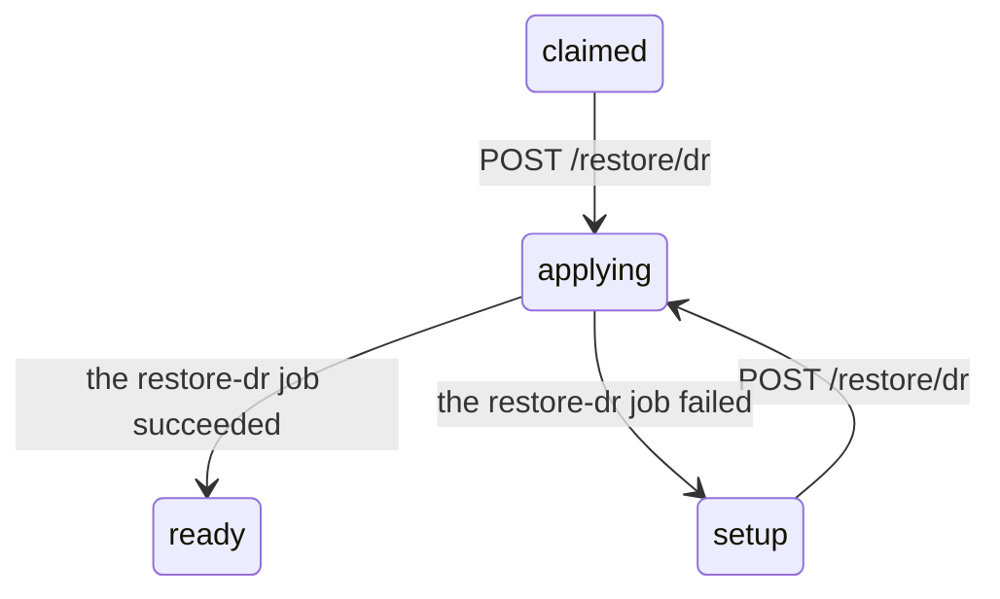
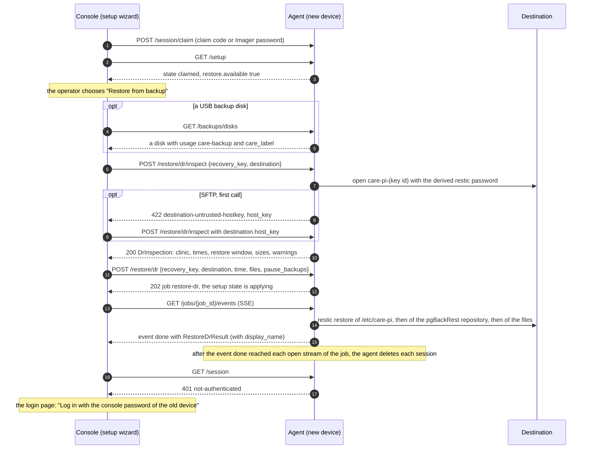
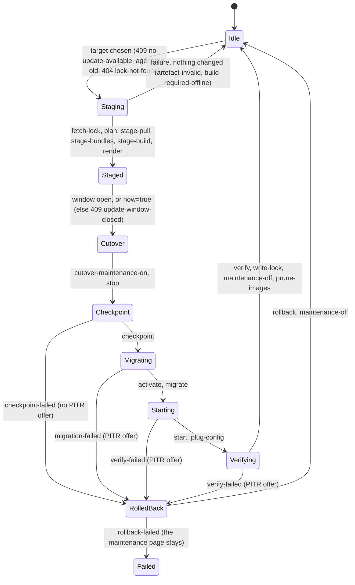

# The console API (design note)

This directory holds the contract between the care-pi agent and the console.

| File | Content |
|---|---|
| `openapi.yaml` | The contract: OpenAPI 3.1.0. Each operation, schema, header, and problem type. |
| `README.md` | This note: the auth flow, the setup state machine, the SSE format, the policies. |
| `openapi_test.go` | The Go test of the contract (kin-openapi and JSON Schema 2020-12). |
| `validate.sh`, `.redocly.yaml`, `.redocly.lint-ignore.yaml` | The lint. Run `make api-lint` or `sh docs/api/validate.sh`. |

The server (`care-pi serve`) and the console implement this document. When the document and the code
disagree, the document wins. Change the document first, then the code.

## 1. Transport and origins

The console has its own origin (decision S48). Care stays on port 443. The console and its API are on port 8443.

| Origin | Serves |
|---|---|
| `https://<host>/` (port 443) | Care, the plug bundles, the S3 buckets, and the status pages. `/_care-pi/*`: the public operations of the agent. `/console` and `/console/*`: `308` to `https://{host}:8443/`. |
| `https://<host>:8443/` | The console SPA at `/`. The API at `/api/v1/`. The public operations also at `/_care-pi/*`. Caddy sends each request on this port to the agent. |

`<host>` is each host name and each LAN address that Caddy serves (for example `care.local` and `192.168.1.10`).

Why: a script on the Care origin (an XSS bug in Care or a malicious FE plug) must not reach the console API,
because the agent runs as root. A different port is a different origin, so the browser does not let a script on
port 443 read a response of port 8443. The CSRF token and the `Origin` check (section 3) block the requests
that a script can send without the response.

The public operations are on both ports:

| Operation | Port 443 | Port 8443 |
|---|---|---|
| Public status | `/_care-pi/status` | `/_care-pi/status` |
| Agent health | `/_care-pi/health` | `/api/v1/health`, `/_care-pi/health` |
| Root CA (DER or PEM) | `/_care-pi/tls/root-ca` | `/api/v1/tls/root-ca`, `/_care-pi/tls/root-ca` |
| Root CA (Apple profile) | `/_care-pi/tls/root-ca/mobileconfig` | `/api/v1/tls/root-ca/mobileconfig`, `/_care-pi/tls/root-ca/mobileconfig` |
| Install steps for each OS | `/_care-pi/tls/instructions/{os}` | `/api/v1/tls/instructions/{os}`, `/_care-pi/tls/instructions/{os}` |

On port 443 the health path is `/_care-pi/health`, because Care has the routes `/health/*` on that origin.
In `openapi.yaml`, each of these operations lists its servers. The status pages and the installer use port 443.
Each other operation is only on port 8443, below `/api/v1`.

Architecture changes for Phase 2 (`plans/01-architecture.md` §5, §12):

- The pod publishes `8443` on each LAN address, the same way as `80` and `443`.
- The firewall allow-list (S42, `care-pi-firewall.service`) also allows `8443/tcp`.
- Caddy serves port 8443 with the same certificates as port 443 (`tls internal`, the same host names and addresses,
  `default_sni`). It sends no HSTS on the local CA names, on both ports.
- On port 443, Caddy sends `/_care-pi/*` to the agent socket and replaces the Phase 1 placeholder of `/console/*`
  with the `308`. Port 80 stays a `308` to port 443.

Other transport rules:

- The agent listens on the unix socket `/run/care-pi/api.sock`. Caddy is the only client.
- Caddy sets `X-Forwarded-For` to the client address. Caddy removes that header from a client,
  so the agent can trust it. The rate limits and the session records use this address.
  Caddy keeps the `Host` header with the port (for example `care.local:8443`). The `Origin` check uses it.
- CORS: none. The agent sends no `Access-Control-*` header on any response.
- Bodies are JSON. Errors are `application/problem+json` (section 7). The agent rejects a body larger than 1 MiB.
- Each response has `Cache-Control: no-store`, except the two root CA downloads.

## 2. Authentication and the claim

### 2.1 One operator account

The agent has one operator account. It is separate from Care (S22). It has:

- a console password: argon2id, m = 19 MiB, t = 2, p = 1 (OWASP minimum). The agent hashes one password at a time,
  because its memory cap of 128M also holds its child processes (`01` §8);
- 8 one-time recovery codes (S46), stored as hashes;
- an optional TOTP secret (RFC 6238: SHA-1, 6 digits, 30 s; the step before and after are valid; no replay).

All of them are in `/etc/care-pi/secrets/` (root 0600). No response contains a secret, with three exceptions:
the recovery codes in the response that makes them, the TOTP secret in the enrolment response, and the
root CA certificate (public data).

The password rules: 12 to 128 characters, Unicode NFC, not in the list of common passwords of the agent.
The Care superuser password must not be the console password.

### 2.2 The claim

A new device has no account. The state is `unclaimed`. The first operator **claims** the device with a
claim secret and sets the console password in the same request (`POST /session/claim`).
The claim also makes the 8 recovery codes and starts a session.

| Method | When | Secret |
|---|---|---|
| `os-password` | The Pi image, flashed with Raspberry Pi Imager and OS customisation | The password of the user that Imager created (07 §4.2). The agent reads the user name from the cloud-init `user-data` of Imager and checks the hash in `/etc/shadow`. |
| `claim-code` | Always, until the claim | A one-time code of 12 Crockford base32 characters (60 bits) in 3 groups, for example `4F7K-Q2MX-9PDA`. |

The claim code:

- `care-pi bootstrap` makes it when the device is not claimed and no code exists.
  On the image path, bootstrap runs at first boot, so the code is never in the image.
- It is in `/etc/care-pi/secrets/claim_code` (root 0600). The claim deletes it.
- The installer (`curl | sh`) prints it after bootstrap, with the URL: open `https://<name>:8443/` and enter the code.
- `sudo care-pi auth claim-code` prints it again. `--rotate` makes a new code.
- Anyone who can read the file is root on the host, so the code adds no new risk.

`GET /_care-pi/status` lists the methods in `claim_methods`. The console shows the field for the first method
and a link for the other one. Contract 0.7.1: when the first boot of the image could not use the pre-seed
(`docs/image.md` section 5), the first boot starts setup mode, and `firstboot_error` tells why until the setup is
finished. The claim page of the console and the setup page on port 443 show it. Without OS customisation, `os-password` is not available. Then the operator reads the
claim code with SSH, or from another channel that a later phase adds (USB export, status TTY: 07 §6).

This keeps 07 §6: no plaintext page, HTTPS only, the Imager password is the claim credential on the image path.
In local CA mode the first visit to port 443 shows the TLS interstitial one time. The setup page on port 443
then offers the root CA (`/_care-pi/tls/root-ca`, with the fingerprint) and the steps for each OS
(`/_care-pi/tls/instructions/{os}`). Some browsers keep a certificate exception for each port (Firefox).
When the device installs the root CA first, port 8443 shows no second interstitial. Spike SP7 checks this on each browser.
The root CA with name constraints (07 §4.1) comes in Phase 7. Until then the root is the root that Caddy makes.

When `care-pi bootstrap` makes the claim code, `claim_methods` lists `claim-code` first, and the
console shows the claim code field first. The console also switches to the claim code field when the
operator types `XXXX-XXXX-XXXX` in the Imager password field.

Contract 0.7.1 (S52): the claim body has `client_time`, the time of the browser (`new Date().toISOString()`). A device
without internet has no NTP, so its clock gate does not pass. When the claim secret is correct and NTP did not
synchronize the clock, the agent sets the clock one time from `client_time` before it makes the session. Section 16
tells the rules.

### 2.3 The first-contact flow



### 2.4 Login, recovery, reauthentication



- **Recover** (`POST /session/recover`): a recovery code and a new password. The agent uses the code one time,
  sets the password, turns TOTP off, deletes the other sessions, and starts a session.
- **Last fallback** (S46): `sudo care-pi auth reset --password-stdin` on the host. It sets the password,
  makes 8 new codes, turns TOTP off, and deletes each session. It does not change the setup state.
- **Reauthentication**: an operation with `x-reauth: true` needs a credential check in the last 5 minutes
  (`Session.reauth_until`). A login, a claim, or a recover counts. Else the agent returns `403 reauth-required`.
  These operations need it: new recovery codes, TOTP enrol and disable, shutdown, and later SSH, Tailscale,
  CA rotation, the recovery key, restore, and rollback (04 §2).
  A reboot does not need it: the host comes back without a person. A shutdown needs a person at the Pi.
- The password change takes the current password in the body, so it needs no reauthentication.
  It deletes the other sessions and gives the current session a new id.
- The console goes to the login page only for the problem type `not-authenticated`.
  `bad-credentials` and `totp-required` also have the status 401, so check `type`.

### 2.5 Sessions

| Item | Value |
|---|---|
| Cookie | `__Host-care_pi_session=<id>; Path=/; Max-Age=86400; HttpOnly; Secure; SameSite=Strict`, no `Domain` |
| Id | 256 random bits, base64url (43 characters) |
| Store | Server side. The agent keeps the SHA-256 of each id in memory and in `/var/lib/care-pi/state/sessions.json` (root 0600). A restart of the agent keeps the sessions. |
| Idle timeout | 2 h (S49). Each request moves it. |
| Absolute timeout | 24 h (S49) |
| Reauthentication window | 5 min |
| Sessions for each account | 10. A new session deletes the oldest. |
| Public reference | `ref`: the first 16 hex digits of the SHA-256 of the id. `DELETE /security/sessions/{ref}` uses it. |

A login always makes a new id (no session fixation). The cookie is for one host name.
After a host name change, the browser must log in again at the new name.

The cookie and the two ports:

- The `__Host-` prefix makes the browser enforce `Secure`, `Path=/`, and no `Domain`.
- A cookie is not specific to a port. The browser also sends the cookie to Care on port 443.
  Caddy strips it before Care: the routes to Care and to the S3 buckets remove it from the `Cookie` header.
  Care uses bearer JWTs. The public operations of the agent on port 443 ignore it.
- A script on port 443 cannot read the cookie (`HttpOnly`) and cannot replace it: a script cannot overwrite an `HttpOnly` cookie (RFC 6265bis).
- `SameSite=Strict` does not separate the ports: they are the same site. Section 3 tells what separates them.

### 2.6 Operations without a session

| Operation | Why it is public |
|---|---|
| `GET /_care-pi/status` (ports 443 and 8443) | The status pages and the installer read it before a login can exist. It gives no address, no version, and no unit detail. |
| `GET /health` (port 8443 `/api/v1/health`; both ports `/_care-pi/health`) | Liveness for Caddy and the installer. The console also uses it to test the trust of the root CA on another host name (section 2.7). |
| `POST /session/claim` | The first operator has no account yet. The claim secret is the credential (07 §4.2). |
| `POST /session/login` | It makes the session. |
| `POST /session/recover` | The operator lost the password or the TOTP device. The recovery code is the credential. |
| `GET /tls/root-ca`, `GET /tls/root-ca/mobileconfig` (both ports) | The root CA is public data. Each staff device must install it, and staff have no console password (07 §6). The setup page on port 443 offers it before the device opens port 8443. The fingerprint is in a header and in the instructions. |
| `GET /tls/instructions/{os}` (both ports) | The setup page on port 443 and the public "install the certificate" page of the console show these steps to staff devices. |

Section 1 gives the paths on each port. Claim, login, and recover are only on port 8443.
All other operations need a session. The tests `TestOperations` and `TestSeparateOrigin` check these rules.

### 2.7 Trust check of the root CA

07 §4.3 asks the console to confirm that a device trusts the root CA. A page cannot read its own certificate (07 F1),
and the browser keeps a certificate exception for the host of the page. So the console tests another host name:
on `https://care.local:8443/` it runs `fetch("https://<LAN IP>:8443/api/v1/health", {mode: "no-cors"})`.
The request needs no CORS header, because the console does not read the response.
The promise resolves only when the browser trusts the certificate of that host. Spike SP7 must confirm this on each browser.

## 3. CSRF

- Each unsafe request (`POST`, `PUT`, `PATCH`, `DELETE`) with a session must have the header `X-CSRF-Token`.
- The value is `Session.csrf_token`: 256 random bits that the agent keeps with the session.
  The agent compares the header with the stored value in constant time.
- The console gets the token from `GET /session`, or from the response of claim, login, or recover.
  It keeps the token in memory. After a page reload, it calls `GET /session` again.
- Each unsafe request, also claim, login, and recover, must have the header `Origin: https://<served host>:8443`.
  `<served host>` is a host name or a LAN address that Caddy serves. The agent rejects each other origin,
  also `https://<served host>` (port 443, the Care origin). Then the agent returns `403 csrf`.
- CORS: none. A script on port 443 cannot read a response of port 8443, so it cannot read the token
  (`GET /session`). The browser sends the cookie with its requests to port 8443 (same site), but the `Origin`
  check and the token reject them.
- An unsafe operation with a body needs `Content-Type: application/json` (`415` else). An unsafe operation
  without a body needs no `Content-Type`. A cross-origin request with that content type needs a CORS
  preflight, and the agent never allows one.
- `GET` never changes state, so an `EventSource` (which cannot send headers) needs no token.
- Each request to an operation with a session, also a `GET` and an `EventSource`, must not have
  `Sec-Fetch-Site` with a value other than `same-origin` or `none`. Else the agent returns `403 csrf`,
  and the idle timeout does not move. A request without the header (for example `curl`) passes.
- For an operation with a session, the agent checks the session and the CSRF token before it reads
  the body. Body limits: 8 KiB for claim, login, recover, reauth, and TOTP verify; 1 MiB for
  `PUT /config`, `PATCH /config`, `PUT /setup/steps/env`, and `PUT /setup/steps/tls`; 64 KiB for each
  other operation. Caddy rejects a body larger than 1 MiB. A body that does not arrive in 10 s gives
  `400 malformed-request`.

## 4. Rate limits and lockout

| Limit | Scope | Value | Response |
|---|---|---|---|
| Credential requests: claim, login, recover, reauth, TOTP verify | client address | 10 each minute | `429 rate-limited` |
| Failed credentials (same operations) | client address | 5 in 15 minutes: the address is locked for 15 minutes | `429 locked-out` |
| Failed claims | all addresses together | 5: the claim is locked for 15 minutes (07 §4.2) | `429 locked-out` |
| Failed passwords of the account: login, reauth, password change | operator account | 10 failures in a row: the account is locked for 1 minute; each next failure doubles the lock, up to 60 minutes; a success resets the count | `429 locked-out` |
| Public reads: `/_care-pi/status`, `/health`, the public `/tls/*` operations | client address | 60 each minute | `429 rate-limited` |
| Requests with a session | session | 300 each minute | `429 rate-limited` |
| Open SSE streams | session, agent | 4 for each session, 16 in total | `429 rate-limited` |

Rules:

- Each `429` has `Retry-After` (seconds) and the same value in `retry_after_s`.
- During a lock, the agent does not check the credential, so the response tells nothing about the credential.
- The account lock does not block `recover`: a recovery code has 50 bits, and the address limits apply.
  So the owner can always recover from an attack on the password.
- `sudo care-pi auth unlock` removes each lock.
- The journal of `care-pi.service` records each auth event (claim, login, failure, lock, recover, password change)
  with the address and the user agent. It never records a secret.

The agent keeps the address locks, the claim lock, and the failed attempts in a file
(`state/auth-locks.json`), so a restart of the agent does not remove them.

## 5. The setup state machine



| State | Description | Setup operations |
|---|---|---|
| `unclaimed` | No account. | none (no session is possible) |
| `claimed` | The account exists. No other step is done or skipped. | each step |
| `setup` | Steps are in progress. | each step, in any order |
| `applying` | The finish job runs. | `GET /setup` only; a change gives `409 job-running` |
| `ready` | Setup is finished. | `GET /setup` only; a change gives `409 setup-finished` |

The steps, in list order:

| Step | Required | Can skip | Phase | What the `PUT` does |
|---|---|---|---|---|
| `account` | yes | no | 2 | Done by the claim. No `PUT`. |
| `recovery-codes` | yes | no | 2 | The operator types one of the codes again. The agent checks it but does not use it. |
| `hardware` | yes | no | 2 | The operator saw `GET /host/check`. A failed required check gives `422 host-check-failed`. |
| `identity` | yes | no | 2 | Writes `identity.display_name` and `identity.hostname`. |
| `tls` | yes | no | 2 | Writes `tls.*`. Phase 2 accepts only the local CA mode. |
| `size` | yes | no | 2 | Writes `size.*`. `busy-counter` on less than 3 GiB RAM gives a warning. |
| `env` | no | yes | 2 | Writes `env.backend`, `env.frontend`, and `fe.*` (the advanced path). |
| `backups` | yes | only in a dev build | 3 | Phase 3. In Phase 2 the `PUT` gives `501`. |
| `care-admin` | yes | no | 2 | Keeps the user name and email in the setup record and the password in memory only. |

Rules:

- **The draft is `config.yaml`.** Each step `PUT` validates its values and writes them into `config.yaml`.
  Nothing is applied before the finish. The agent keeps the step states in `/var/lib/care-pi/state/setup.json`.
- `current_step` is the first step in list order that is not `done` and not `skipped`. The agent does not enforce an order.
- The easy path skips `env`. The advanced path shows it.
- The wizard has no solution step: v1 has only the CARE Clinic solution (S32). A later phase can add the step.
- **Dev builds.** `dev_build` is `true` when the agent version is not a release tag (`vX.Y.Z`).
  Only a dev build can skip `backups` in Phase 2 (`06` Phase 2). So a release build of Phase 2 cannot finish setup.
  This is intentional: no release build exists before Phase 3.
- **Finish** (`POST /setup/finish`) needs each required step `done` or allowed `skipped`.
  Else `409 setup-incomplete` with `missing_steps`. The job validates, checks the host, runs a full apply
  (lock, images, units, buckets, stanza, FE build), waits until Care is healthy, and creates the Care superuser.
  On success the state becomes `ready`. On failure it becomes `setup` again, and `GET /setup` gives the failed `job_id`.
- **Host name change.** The finish job applies a new host name. The browser must open the new URL
  (the job result has it, and the IP URL works too) and log in again. The cookie is for one host name.

### 5.1 `apply --phase=bootstrap` and the page at `/`

Phase 2 changes `care-pi bootstrap` (first boot and installer, `05` §3): it runs `apply --phase=bootstrap`.
That renders and starts only `care.pod` and `care-caddy`. The agent runs on the host as `care-pi.service`.
Care does not start before the finish.
No FE build exists, so Caddy serves `status/setup.html` (503) at `/` (`docs/apply.md`, "Status pages and modes").
The setup page reads `GET /_care-pi/status`, offers the root CA (`/_care-pi/tls/...`), and links to
`https://<host>:8443/` with the host of the page (`console_port`).
An upgrade from Phase 1 (a lock exists, no setup record) records setup as finished. After the claim, the state is `ready`.

### 5.2 Resume

| Event | What happens |
|---|---|
| The browser closes during setup | The cookie stays (24 h at most, 2 h without a request). Open `https://<host>:8443/` again: `GET /session`, then `GET /setup`, then the console opens `current_step`. After a timeout, log in again. |
| Setup continues on another device | Log in with the console password. Setup needs a session; each session comes from the account that the claim made. |
| The operator did not save the recovery codes | `POST /security/recovery-codes` makes new codes. A fresh login counts as reauthentication. |
| The agent restarts during setup | The step states and `config.yaml` are on disk. The Care superuser password is lost: `care-admin` is `current` again with the code `password-needed`. |
| The browser closes during `applying` | `GET /setup` gives `job_id`. The console follows `GET /jobs/{job_id}/events?after=0`. |
| A power loss during `applying` | At start, the agent finds the job `running` with no holder of the apply lock. It marks the job `failed` ("interrupted"), and the state becomes `setup`. The operator finishes again. The apply is idempotent. |

## 6. Jobs and the event stream

### 6.1 The job model

`Job`: `id`, `kind`, `state` (`queued`, `running`, `succeeded`, `failed`, `cancelled`), `source`, `reason`,
`created_at`, `started_at`, `finished_at`, `cancellable`, `steps[]` (`index`, `name`, `action`, `state`,
`started_at`, `finished_at`, `detail`), `error` (a `Problem`), `result` (by kind), `last_event_id`.

A job is the journal file `/var/lib/care-pi/state/jobs/<id>.json` of Phase 1, with members added.
The id is the file name without `.json`, for example `20261030T101500.123Z-apply`.
The events are in `<id>.events.jsonl` next to it. The CLI and the console write the same files,
so `GET /jobs` lists the jobs of both.

| Phase 1 journal | API |
|---|---|
| file name without `.json` | `id` |
| `kind` | `kind` |
| `reason` | `reason` |
| `started` | `created_at` and `started_at` |
| `finished` | `finished_at` |
| `result: running` | `state: running`; `failed` with detail "interrupted" when no process holds the apply lock |
| `result: ok` | `state: succeeded` |
| `result: failed` | `state: failed` |
| `error` | `error.detail` (problem type `internal`) |
| `steps[].name` | `steps[].name`; `steps[].action` is the first word of the name when it is a plan kind |
| `steps[].started`, `steps[].finished` | `steps[].started_at`, `steps[].finished_at` |
| `steps[].error` | `steps[].state: failed`, `steps[].detail` |
| (none) | `source: cli`, `cancellable: false`, `result: null`, `last_event_id: 0` |

An apply of the agent (the setup job, `POST /apply`, `PUT /config?apply=true`) that resolves a lock entry over the
network starts with the step `resolve-lock`. Its `log` events are the `resolve … <first 12 hex>` lines of
`care-pi apply`. The console shows it as "Resolve the versions of the images".

Only one job that changes the host runs at a time: kinds `apply`, `setup`, `fe-build`, `fe-prune`, and later
`restore`, `update`, `rollback`, `tls`. They hold the apply lock `/run/care-pi/apply.lock`, as the CLI does.
The agent waits 5 s at most for the lock (state `queued`). Then it returns `409 job-running` with `job_id`:
the newest journal with `state: running`, or `null` when a CLI command without a journal holds the lock.
`GET /apply/plan` also holds the lock, as `care-pi apply --dry-run` does.

Cancel: in Phase 2 only `fe-build` and `support-bundle` are cancellable. An apply stops only at its end.
The agent keeps the last 100 jobs and each job of the last 30 days.

### 6.2 SSE

`GET /jobs/{id}/events` with `Accept: text/event-stream`:

- The stream starts with `retry: 3000`.
- Each event has `id:` (an integer; 1 is the first event of the job), `event:`, and `data:` (one line of JSON).
- Event types: `step` (a `JobStep` after a change), `log` (one output line), `progress` (a long step),
  `error` (a `Problem`; the job can continue, for example after a failed FE build), `done` (the final `Job`).
- After `done` the agent closes the stream.
- `heartbeat` comes every 15 s. It has no `id:`, so it does not change `Last-Event-ID`.
- Resume: the browser sends `Last-Event-ID` when it connects again. After a page reload, the console uses
  `?after=<id>`, because an `EventSource` cannot set headers at the first connect. `0` gives each event.
- Without `Accept: text/event-stream`, the same URL gives JSON: `JobEventPage` with up to 1000 events after `after`.
  Use it for tests and for clients without SSE.
- The agent keeps up to 20000 events for each job. Then it drops `log` events and sends one `log` line that tells how many.
- Caddy sends SSE responses at once (no buffer).
- When the session ends, the agent closes the stream. The next connect gets `401`.

Example (an apply that restarts care-api):

```text
retry: 3000

id: 1
event: step
data: {"index":0,"name":"write-files: 1 file(s)","action":"write-files","state":"running","started_at":"2026-10-30T10:15:00.200Z","finished_at":null,"detail":null}

id: 2
event: step
data: {"index":0,"name":"write-files: 1 file(s)","action":"write-files","state":"succeeded","started_at":"2026-10-30T10:15:00.200Z","finished_at":"2026-10-30T10:15:00.300Z","detail":null}

id: 3
event: step
data: {"index":1,"name":"restart: care-api.service","action":"restart","state":"running","started_at":"2026-10-30T10:15:02Z","finished_at":null,"detail":null}

id: 4
event: log
data: {"time":"2026-10-30T10:15:03Z","step_index":1,"stream":"agent","line":"waiting for care-api.service to become healthy"}

event: heartbeat
data: {"time":"2026-10-30T10:15:15Z"}

id: 5
event: step
data: {"index":1,"name":"restart: care-api.service","action":"restart","state":"succeeded","started_at":"2026-10-30T10:15:02Z","finished_at":"2026-10-30T10:15:24Z","detail":null}

id: 6
event: done
data: {"id":"20261030T101500.123Z-apply","kind":"apply","state":"succeeded","source":"console","reason":null,"created_at":"2026-10-30T10:15:00.123Z","started_at":"2026-10-30T10:15:00.200Z","finished_at":"2026-10-30T10:15:24Z","cancellable":false,"steps":[{"index":0,"name":"write-files: 1 file(s)","action":"write-files","state":"succeeded","started_at":"2026-10-30T10:15:00.200Z","finished_at":"2026-10-30T10:15:00.300Z","detail":null},{"index":1,"name":"restart: care-api.service","action":"restart","state":"succeeded","started_at":"2026-10-30T10:15:02Z","finished_at":"2026-10-30T10:15:24Z","detail":null}],"error":null,"result":{"kind":"apply","changed":true,"lock_changed":false,"fe_build_id":null},"last_event_id":6}

```

`GET /logs/{unit}?follow=true` uses the same format with `event: log` (a `LogLine`) and `heartbeat`.
The event id is the journal cursor. After a reconnect, the stream continues after that cursor.

## 7. Errors

Each error is RFC 9457 `application/problem+json` (schema `Problem`): `type`, `title`, `status`, `detail`, `instance`,
and these extension members when they apply: `errors[]` (`pointer`, `message`, `code`, `parameter`), `job_id`,
`retry_after_s`, `missing_steps`, `failed_checks`, `phase`.
The type URI is `https://care-pi.rithviknishad.dev/problems/<slug>`. A client must branch on `type`.
Each operation lists its own types in `x-problems`. Each operation can also return the general types
(`malformed-request`, `payload-too-large`, `unsupported-media-type`, `rate-limited`, `internal`, `unavailable`).
An operation with a session can also return `csrf` (403); see §3.

| Slug | Status | When |
|---|---|---|
| `malformed-request` | 400 | The body is not JSON, or a header is malformed. |
| `invalid-request` | 422 | A body member or a parameter fails the schema or a rule. `errors[]` tells which. |
| `invalid-config` | 422 | The config fails `config.schema.json`. `errors[]` points into the config. |
| `unsupported-config` | 422 | The config is valid, but this version cannot apply a value (`apply` exit code 2). `phase` tells when. |
| `weak-password` | 422 | The new password breaks the password rules. |
| `host-check-failed` | 422 | A required host check fails. `failed_checks` lists them. |
| `not-authenticated` | 401 | No session, or the session ended. |
| `bad-credentials` | 401 | The password, claim secret, or recovery code is not correct. |
| `totp-required` | 401 | TOTP is on and the login has no code. |
| `csrf` | 403 | The `X-CSRF-Token` or the `Origin` is not correct. |
| `reauth-required` | 403 | The operation needs a credential check in the last 5 minutes. |
| `not-found` | 404 | The resource does not exist. |
| `job-not-found` | 404 | The job does not exist. |
| `unit-not-found` | 404 | The unit has no journal on this host. |
| `not-claimed` | 409 | Login or recover before the claim. |
| `already-claimed` | 409 | A claim after the claim. |
| `setup-incomplete` | 409 | Finish, apply, or a Care operation before setup is finished. `missing_steps` for finish. |
| `setup-finished` | 409 | A setup step change after `ready`. |
| `step-not-skippable` | 409 | The step cannot be skipped. |
| `job-running` | 409 | Another job holds the apply lock. `job_id` tells which. |
| `job-not-cancellable` | 409 | The job cannot be cancelled, or it ended. |
| `care-user-exists` | 409 | The Care user name exists. |
| `state-conflict` | 409 | Another state conflict, for example a TOTP enrolment when TOTP is on. |
| `config-changed` | 412 | `If-Match` is not the ETag of `config.yaml` now. |
| `payload-too-large` | 413 | The body is larger than 1 MiB. |
| `unsupported-media-type` | 415 | The `Content-Type` is not the one of the operation. |
| `precondition-required` | 428 | `If-Match` is not there. |
| `rate-limited` | 429 | A rate limit (section 4). |
| `locked-out` | 429 | A lockout (section 4). |
| `internal` | 500 | An error of the agent or a host command. The journal of `care-pi.service` has the detail. |
| `not-implemented-in-this-version` | 501 | An operation with `x-phase` greater than the version. `phase` tells when. |
| `care-not-running` | 503 | The operation needs a healthy care-api. |
| `unavailable` | 503 | The agent starts or stops. |
| `destination-unreachable` | 422 | A backup destination does not answer, or it refuses the credentials or the SSH key. `destination_id` tells which. Also the error of a failed snapshot step. |
| `destination-untrusted-hostkey` | 422 | An SFTP server presents a host key that is not pinned: the first contact, or a changed key. `host_key` has the key that the server presents. |
| `recovery-key-mismatch` | 422 | The recovery key cannot open the repository at the destination, or a typed word is not the word of the key. |
| `restore-window-exceeded` | 422 | The time of a restore is outside the restore window. `restore_window` tells the window. |
| `disk-in-use` | 409 | The disk holds the system, a partition of it is mounted (also through LUKS, LVM, or md RAID), LVM, LUKS, or md RAID uses a partition of it, or a destination uses its label. The detail tells the reason. |
| `no-destination` | 409 | The operation needs 1 or more backup destinations. |
| `no-recovery-key` | 409 | The operation needs the recovery key. Make it with `POST /backups/recovery-key`. |
| `insufficient-space` | 409 | The free disk space is not enough for the operation. `space` tells the space that it needs. |
| `verify-failed` | 500 | A verify or a restore drill found damage (Phase 3), or a start or a check after the migrations failed (Phase 4: the previous lock runs again; `pitr_offer` is set). Only the `error` of a job has this type. |
| `update-window-closed` | 409 | Phase 4. An update or an OS upgrade outside the update window without `now`. `next_window_at` tells when it opens. |
| `no-update-available` | 409 | Phase 4. An update or a staging without a target. |
| `lock-not-found` | 404 | Phase 4. The solution lock or the previous lock does not exist. |
| `agent-too-old` | 409 | Phase 4. The lock needs a newer agent. `min_agent_version` tells which. |
| `plug-unknown` | 404 | Phase 4. The plug is not in the solution. |
| `plug-settings-invalid` | 422 | Phase 4. A plug setting fails the settings schema, or a plug that is on has no value for a required setting. `errors[]` tells which. |
| `build-required-offline` | 409 | Phase 4. The change needs a download or a local build, and the host has no internet. |
| `index-unavailable` | 502 | Phase 4. The agent cannot fetch or read `index.json`. |
| `artefact-invalid` | 502 | Phase 4. A downloaded lock or bundle is missing (HTTP 404), has another SHA-256, or fails its schema. |
| `rollback-unavailable` | 409 | Phase 4. No previous lock exists. |
| `checkpoint-failed` | 500 | Phase 4, job error. The checkpoint before the migrations failed. Nothing changed. |
| `migration-failed` | 500 | Phase 4, job error. `care-beat` did not become healthy. The previous lock runs again; `pitr_offer` is set. |
| `rollback-failed` | 500 | Phase 4, job error. The rollback failed. The maintenance page stays; `pitr_offer` is set. |
| `os-update-failed` | 500 | Phase 4, job error. apt failed. The held packages are held again. |
| `dns-service-unreachable` | 502 | Phase 6. The DNS/ACME service does not answer (after 3 tries), or the device has no internet. |
| `dns-service-rejected` | 502 | Phase 6. The DNS/ACME service refused the request (for example a revoked id, a full zone, or a bad hint). The detail has the error of the service. |
| `acme-pending` | 504 | Phase 6. The certificate of the public name is not issued yet. Caddy tries again. |
| `tailscale-install-failed` | 500 | Phase 6, job error. apt could not install `tailscale`. |
| `tailscale-login-required` | 409 | Phase 6. Tailscale needs a login: the login link expired, or the auth key is not valid. |
| `tailscale-https-disabled` | 409 | Phase 6. The tailnet has no MagicDNS or no HTTPS certificates. |
| `wifi-auth-failed` | 422 | Phase 6. The Wi-Fi network refused the passphrase. |
| `wifi-no-device` | 409 | Phase 6. The host has no Wi-Fi device, or `rfkill` blocks it. |
| `wifi-failed` | 500 | Phase 6. NetworkManager could not connect, or the route check failed. |

The type URIs need not resolve. The DNS/ACME service of Phase 6 can serve a page for each slug later.
Section 15.6 tells which operation returns each Phase 6 type.

## 8. The config resource

- `GET /config` gives `config.yaml` as JSON and an `ETag`. `view=effective` (default) adds the defaults of
  `docs/config.md`. `view=file` gives only the keys of the file.
- `PUT /config` replaces the file. `PATCH /config` is a JSON merge patch (RFC 7396) on the file keys.
  Both need `If-Match`. Both validate and return a plan preview (`care-pi apply --dry-run`).
  `dry_run=true` writes nothing. `apply=true` also starts an apply job.
- The agent writes the file again from JSON. Comments and the key order are lost.
- The schema of the body is `agent/internal/config/schema/config.schema.json`, by the relative `$ref`
  `../../agent/internal/config/schema/config.schema.json`. The setup steps reference parts of it
  (for example `#/properties/identity/properties/hostname`), so each pattern has one source.
  Redocly and kin-openapi resolve the reference. A tool that cannot resolve it uses the bundle (section 9).
- `GET /config/schema` gives the same schema for the forms of the console.

## 9. How the server and the console use this document

### 9.1 Server (`care-pi serve`)

- Each handler test validates the request and the response against this document:
  - route with kin-openapi (`openapi3.NewLoader` with `IsExternalRefsAllowed`, then a router);
  - validate the bodies with JSON Schema 2020-12. kin-openapi cannot resolve the external `$ref` in its 2020-12 mode,
    so compile the schemas with `santhosh-tekuri/jsonschema/v6` from `openapi.yaml#/...`, as `openapi_test.go` does,
    or validate against the bundle of section 9.2.
- An error response must have a `type` from the `x-problems` of the operation or a general type.
- Each operation with `x-phase` greater than 2 must return `501 not-implemented-in-this-version`.
- Each response must have `Cache-Control: no-store` (except the root CA downloads), and no `Access-Control-*` header.
- An unsafe request with an `Origin` other than `https://<served host>:8443` must get `403 csrf`, also from port 443.
- The public operations must answer on both ports, at the paths of section 1. Each other operation must not answer on port 443.
- The session cookie is `__Host-care_pi_session` with `Path=/`, `Max-Age=86400`, and no `Domain`.
- `care-pi status --json` and `GET /status` print the same `Status` object. Phase 1 omitted empty members;
  Phase 2 always prints each member (`null` or an empty list). The names and types of Phase 1 do not change.

### 9.2 Console

Make the TypeScript types from a bundle (the bundle puts the config schema in `components`):

```sh
npx --yes @redocly/cli@latest bundle docs/api/openapi.yaml --ext json -o console/src/api/openapi.bundled.json
npx --yes openapi-typescript@7 console/src/api/openapi.bundled.json -o console/src/api/schema.d.ts
```

Wave 4 checked these two commands: the types compile with `tsc --strict`.
Redocly names the parts of the config schema by their key (for example `hostname`, `dnsLabel`).

The agent embeds the console build and serves it at `https://<host>:8443/`. The API base URL of the console is `/api/v1`
(same origin). The console and the agent always have the same version of this document.

The console stops the job event poll on a 4xx problem other than `429` and shows the problem.

## 10. Versions

- The path has the major version: `/api/v1`. Inside v1, changes are additive only:
  new operations, new optional request members, new response members, new problem slugs,
  and new enum values where the description says "a later version can add".
- A client must ignore an unknown response member and must map an unknown enum value to a general case.
  `additionalProperties: false` describes the current version, not a promise against new members.
- A change that breaks a client makes `/api/v2`. The agent serves v1 and v2 together for one release.
- `info.version` is the version of this document (semver). It becomes `1.0.0` when Phase 2 ships.
- `x-phase` marks reserved parts. When a phase implements a part, it removes the `x-phase` mark and keeps the shape,
  or it adds members.

## 11. Operations and CLI commands

CLI parity is an exit criterion of Phase 2 (`06`). Each operation has the CLI command with the same effect
(`x-cli`). `-` means that the operation only manages browser state. "new" means that Phase 2 adds the command.
The paths are below `/api/v1` on port 8443, except `/_care-pi/status`. Section 1 gives the paths of the public operations on port 443.

| Method | Path | Auth | CLI command (`x-cli`) | Phase | In the CLI today |
|---|---|---|---|---|---|
| GET | `/_care-pi/status` | public | `care-pi status --json` | 2 | yes |
| GET | `/health` | public | `systemctl is-active care-pi.service` | 2 | yes |
| GET | `/host/check` | session | `care-pi host check --json [--probe]` | 2 | `--probe` is new |
| GET | `/session` | session | `-` | 2 | — |
| DELETE | `/session` | session + CSRF | `-` | 2 | — |
| POST | `/session/claim` | public | `care-pi auth set-password --password-stdin` | 2 | new |
| POST | `/session/login` | public | `-` | 2 | — |
| POST | `/session/recover` | public | `care-pi auth reset --password-stdin` | 2 | new |
| POST | `/session/reauth` | session + CSRF | `-` | 2 | — |
| GET | `/security` | session | `care-pi auth status --json` | 2 | new |
| PUT | `/security/password` | session + CSRF | `care-pi auth set-password --password-stdin` | 2 | new |
| POST | `/security/recovery-codes` | session + CSRF + reauth | `care-pi auth recovery-codes --regenerate` | 2 | new |
| POST | `/security/totp` | session + CSRF + reauth | `care-pi auth totp enrol` | 2 | new |
| DELETE | `/security/totp` | session + CSRF + reauth | `care-pi auth totp disable` | 2 | new |
| POST | `/security/totp/verify` | session + CSRF | `care-pi auth totp enrol` | 2 | new |
| GET | `/security/sessions` | session | `care-pi auth sessions --json` | 2 | new |
| DELETE | `/security/sessions/{session_ref}` | session + CSRF | `care-pi auth sessions revoke REF` | 2 | new |
| PUT | `/security/ssh` | session + CSRF + reauth | `care-pi ssh enable\|disable` | 7 | new |
| GET | `/setup` | session | `care-pi setup status --json` | 2 | new |
| PUT | `/setup/steps/recovery-codes` | session + CSRF | `care-pi setup finish` | 2 | new |
| PUT | `/setup/steps/hardware` | session + CSRF | `care-pi host check --json` | 2 | yes |
| PUT | `/setup/steps/identity` | session + CSRF | `care-pi config set identity.display_name=NAME identity.hostname=LABEL` | 2 | new |
| PUT | `/setup/steps/tls` | session + CSRF | `care-pi config set tls.local_ca.enabled=true` | 2 | new |
| PUT | `/setup/steps/size` | session + CSRF | `care-pi config set size.preset=PRESET` | 2 | new |
| PUT | `/setup/steps/env` | session + CSRF | `care-pi config set env.backend.NAME=VALUE env.frontend.NAME=VALUE fe.provider=PROVIDER` | 2 | new |
| PUT | `/setup/steps/backups` | session + CSRF | `care-pi config set backups.destinations=JSON && care-pi backup recovery-key confirm` | 3 | new |
| PUT | `/setup/steps/care-admin` | session + CSRF | `care-pi setup finish --care-username USER --care-email EMAIL --care-password-stdin` | 2 | new |
| POST | `/setup/steps/{step}/skip` | session + CSRF | `care-pi setup skip STEP` | 2 | new |
| POST | `/setup/finish` | session + CSRF | `care-pi setup finish` | 2 | new |
| GET | `/status` | session | `care-pi status --json` | 2 | yes |
| GET | `/config` | session | `care-pi config show --json [--file]` | 2 | new |
| PUT | `/config` | session + CSRF | `care-pi config validate && care-pi apply --dry-run` | 2 | yes |
| PATCH | `/config` | session + CSRF | `care-pi config set KEY=VALUE... [--dry-run] [--apply]` | 2 | new |
| GET | `/config/schema` | session | `care-pi config schema` | 2 | yes |
| GET | `/config/presets` | session | `care-pi config presets --json` | 2 | new |
| POST | `/apply` | session + CSRF | `care-pi apply [--update] [--reason TEXT]` | 2 | yes |
| GET | `/apply/plan` | session | `care-pi apply --dry-run [--update]` | 2 | yes |
| GET | `/jobs` | session | `care-pi jobs list --json` | 2 | new |
| GET | `/jobs/{job_id}` | session | `care-pi jobs show JOB_ID --json` | 2 | new |
| GET | `/jobs/{job_id}/events` | session | `care-pi jobs follow JOB_ID` | 2 | new |
| POST | `/jobs/{job_id}/cancel` | session + CSRF | `care-pi jobs cancel JOB_ID` | 2 | new |
| GET | `/logs` | session | `care-pi logs --help` | 2 | yes |
| GET | `/logs/{unit}` | session | `care-pi logs UNIT [-n N] [--since TIME] [-f] [--json]` | 2 | `--since`, `--json` are new |
| POST | `/support-bundle` | session + CSRF | `care-pi support-bundle [--out FILE] [--lines N]` | 2 | new |
| GET | `/support-bundle/{bundle_id}` | session | `care-pi support-bundle --out FILE` | 2 | new |
| GET | `/network` | session | `care-pi status --json` | 2 | yes |
| PUT | `/network/wifi` | session + CSRF | `care-pi network wifi set --ssid SSID --psk-stdin [--country CC] [--failover]` | 6 | new |
| DELETE | `/network/wifi` | session + CSRF | `care-pi network wifi remove` | 6 | new |
| GET | `/network/wifi/scan` | session | `care-pi network wifi scan --json` | 6 | new |
| GET | `/tls` | session | `care-pi tls show --json` | 2 | new |
| GET | `/tls/root-ca` | public | `care-pi tls root-ca [--format der\|pem] [--out FILE]` | 2 | new |
| GET | `/tls/root-ca/mobileconfig` | public | `care-pi tls root-ca --format mobileconfig [--out FILE]` | 2 | new |
| GET | `/tls/instructions/{os}` | public | `-` | 2 | — |
| PUT | `/tls/public` | session + CSRF | `care-pi tls public enable [--hostname-hint NAME] [--acme-ca URL]`; `care-pi tls public disable` | 6 | new |
| PUT | `/tls/tailscale` | session + CSRF + reauth | `care-pi tls tailscale enable [--auth-key-stdin]`; `care-pi tls tailscale disable` | 6 | new |
| POST | `/tls/local-ca/rotate` | session + CSRF + reauth | `care-pi tls local-ca rotate` | 7 | new |
| GET | `/fe` | session | `care-pi fe status --json` | 2 | `--json` is new |
| POST | `/fe/build` | session + CSRF | `care-pi fe build [--force]` | 2 | yes |
| POST | `/fe/prune` | session + CSRF | `care-pi fe prune --keep N` | 2 | yes |
| GET | `/care` | session | `care-pi care info --json` | 2 | new |
| POST | `/care/superuser` | session + CSRF | `care-pi care create-superuser --username USER --email EMAIL --password-stdin` | 2 | yes |
| POST | `/power/reboot` | session + CSRF | `care-pi power reboot` | 2 | new |
| POST | `/power/shutdown` | session + CSRF + reauth | `care-pi power shutdown` | 2 | new |
| GET | `/backups` | session | `care-pi backup status --json` | 3 | new |
| POST | `/backups/run` | session + CSRF | `care-pi backup run [--scope all\|local-db\|destination] [--type incr\|full] [--destination ID] [--reason TEXT]` | 3 | new |
| POST | `/backups/destinations/test` | session + CSRF | `care-pi backup destination test ID [--accept-fingerprint SHA256:FP] [--create-bucket] [--destination-json FILE]` | 3 | new |
| GET | `/backups/recovery-key` | session + reauth | `care-pi backup recovery-key show [--pending]` | 3 | new |
| POST | `/backups/recovery-key` | session + CSRF | `care-pi backup recovery-key create` | 3 | new |
| GET | `/restore/points` | session | `care-pi restore points --json [--refresh]` | 3 | new |
| POST | `/restore` | session + CSRF + reauth | `care-pi restore pitr --time TIME\|--checkpoint LABEL`; `care-pi restore files --destination ID --snapshot ID [--path PATH]... [--side-dir]` | 3 | new |
| POST | `/restore/dr/inspect` | session + CSRF | `care-pi restore dr --inspect --destination-json FILE --recovery-key-stdin` | 3 | new |
| POST | `/restore/dr` | session + CSRF | `care-pi restore dr --destination-json FILE --recovery-key-stdin [--time TIME] [--snapshot ID] [--no-files] [--pause-backups]` | 3 | new |
| GET | `/backups/health` | session | `care-pi backup health --json` | 3 | new |
| POST | `/backups/verify` | session + CSRF | `care-pi backup verify [--scope all\|local-db\|destination] [--destination ID] [--read-data-subset PCT] [--prune]` | 3 | new |
| GET | `/backups/destinations` | session | `care-pi backup destination list --json` | 3 | new |
| PUT | `/backups/destinations/{destination_id}/secrets` | session + CSRF | `care-pi backup destination secrets ID --access-key-id KEY --secret-stdin` | 3 | new |
| GET | `/backups/ssh-key` | session | `care-pi backup ssh-key [--pending]` | 3 | new |
| GET | `/backups/disks` | session | `care-pi backup disk list --json` | 3 | new |
| POST | `/backups/disks/{disk_id}/prepare` | session + CSRF + reauth | `care-pi backup disk prepare DISK_ID [--label LABEL] --wipe` | 3 | new |
| GET | `/backups/recovery-key/status` | session | `care-pi backup recovery-key status --json` | 3 | new |
| GET | `/backups/recovery-key/download` | session + reauth | `care-pi backup recovery-key show --format txt [--pending] [--out FILE]` | 3 | new |
| POST | `/backups/recovery-key/confirm` | session + CSRF | `care-pi backup recovery-key confirm [--pending]` | 3 | new |
| POST | `/backups/recovery-key/rotate` | session + CSRF + reauth | `care-pi backup recovery-key rotate [--keep-key] [--keep-old-repositories]` | 3 | new |
| POST | `/backups/drill` | session + CSRF | `care-pi backup drill [--reason TEXT]` | 3 | new |
| GET | `/updates` | session | `care-pi update status --json` | 4 | new |
| POST | `/updates/check` | session + CSRF | `care-pi update check` | 4 | new |
| POST | `/updates/apply` | session + CSRF | `care-pi update apply [--version VERSION] [--now]` | 4 | new |
| POST | `/updates/rollback` | session + CSRF + reauth | `care-pi update rollback [--to LOCK_ID]` | 4 | new |
| GET | `/plugs` | session | `care-pi plugs list --json` | 4 | new |
| PUT | `/plugs/{plug_id}` | session + CSRF | `care-pi plugs set PLUG_ID [--enabled=true\|false\|default] [--setting PART.KEY=VALUE]... [--secret-stdin PART.KEY] [--dry-run] [--apply]` | 4 | new |
| GET | `/plugs/{plug_id}/settings-schema` | session | `care-pi plugs schema PLUG_ID` | 4 | new |
| POST | `/updates/stage` | session + CSRF | `care-pi update stage [--version VERSION]` | 4 | new |
| GET | `/updates/history` | session | `care-pi update history --json [--limit N] [--before JOB_ID]` | 4 | new |
| GET | `/updates/os` | session | `care-pi update --os --check --json` | 4 | new |
| POST | `/updates/os/apply` | session + CSRF + reauth | `care-pi update --os [--now] [--reboot-if-required]` | 4 | new |
| POST | `/updates/os/reboot` | session + CSRF + reauth | `care-pi update --os --reboot [--now]` | 4 | new |
| GET | `/solutions` | session | `care-pi solution list --json` | 4 | new |
| GET | `/solutions/{name}` | session | `care-pi solution show NAME --json` | 4 | new |
| GET | `/solutions/{name}/locks/{version}` | session | `care-pi solution show NAME --lock VERSION --json` | 4 | new |

Phase 2 adds these CLI commands (or flags):

- `care-pi serve` (the HTTP API on the socket; `care-pi.service` runs it);
- `care-pi auth claim-code [--rotate]`, `auth set-password --password-stdin` (also claims an unclaimed device as root),
  `auth reset --password-stdin`, `auth unlock`, `auth status --json`, `auth recovery-codes --regenerate`,
  `auth totp enrol|disable`, `auth sessions [--json]`, `auth sessions revoke REF`;
- `care-pi setup status --json`, `setup skip STEP`, `setup finish [--care-username U --care-email E --care-password-stdin]`.
  These are the only setup commands. `care-pi config set` replaces a command for each step (identity, tls, size, env, backups).
  As root, `setup finish` counts the steps `account` (after `auth set-password`), `recovery-codes`, and `hardware` as done;
- `care-pi config show --json [--file]`, `config set KEY=VALUE... [--dry-run] [--apply]`, `config presets --json`;
- `care-pi jobs list|show|follow|cancel`;
- `care-pi support-bundle [--out FILE] [--lines N]`;
- `care-pi tls show --json`, `tls root-ca [--format der|pem|mobileconfig] [--out FILE]`;
- `care-pi care info --json`, `care-pi power reboot|shutdown`;
- the flags `host check --probe`, `logs --since --json`, `logs agent`, `fe status --json`.

## 12. Decisions of the owner

| # | Decision |
|---|---|
| S48 | The console and its API have their own origin, `https://<host>:8443/` (SPA at `/`, API at `/api/v1/`). On port 443, `/console` and `/console/*` give `308` to `https://{host}:8443/`. The public operations are on both ports (section 1). Cookie `__Host-care_pi_session`. The `Origin` check accepts only `https://<served host>:8443`. No CORS. The pod publishes 8443 on each LAN address; the firewall allows 8443/tcp. |
| S49 | Session timeouts: 2 h idle, 24 h absolute. |
| Claim | The claim code is in `/etc/care-pi/secrets/claim_code`. The Imager password is the second method on the image path (section 2.2). |
| Account | One operator account, without a user name (section 2.1). |
| Care admin | The Care superuser password must not be the console password. |
| Reauthentication | A shutdown needs it. A reboot does not (section 2.4). |
| Wizard | No solution step (section 5). |
| Config writes | An API write of `config.yaml` loses the comments and the key order (section 8). |
| Rate limits | The table of section 4. |
| CLI | `care-pi config set` replaces a CLI command for each setup step. The setup commands are `care-pi setup status`, `skip`, and `finish` (section 11). |
| Backups step | Only a dev build can skip it. This is intentional: no release build exists before Phase 3. |
| Root CA | The root CA with name constraints (07 §4.1) comes in Phase 7. Until then `CaRoot.name_constraints` is `null` (`x-phase: 7`). |

## 13. Backups and restore

Phase 3 implements this section (`plans/02-backups-and-restore.md`, decision S40, spike SP6).
The server and the console implement it against `openapi.yaml` (v0.4.0, the tags `backups` and `restore`).
Sections 1 to 12 stay valid. This section tells where Phase 3 adds to them.

### 13.1 Two resources: `config` and `backups`

The settings of the backups are part of the desired state. The rest is state, secrets, and actions.

| Data | Where | Operations |
|---|---|---|
| Destinations without secrets, schedules, retention, `paused`, `alert_after_hours`, `drill_enabled` | `config.yaml`, keys `backups.*` (`docs/config.md`) | `GET /config`, `PATCH /config` with `If-Match`, then an apply |
| The S3 keys of a destination | `/etc/care-pi/secrets/backup/<id>.json` | `PUT /backups/destinations/{destination_id}/secrets` |
| The recovery key and the keys that come from it | `/etc/care-pi/secrets/recovery.key` | `/backups/recovery-key*`, `GET /backups/ssh-key` |
| The state: the last backups, the restore window, the next runs, the banners | the state files of the agent, systemd, `pgbackrest info` | `GET /backups` (one call for the Backups page), `GET /backups/destinations`, `GET /backups/health`, `GET /restore/points` |
| The actions | jobs (section 6) | `POST /backups/run`, `/backups/verify`, `/backups/drill`, `/backups/disks/{disk_id}/prepare`, `/backups/recovery-key/rotate`, `/restore`, `/restore/dr` |

Rules:

- No operation of the `backups` resource writes `config.yaml`. Two exceptions: the step `PUT /setup/steps/backups`
  writes `backups.destinations` (as each step writes its keys), and the job `restore-dr` writes the restored file.
- A JSON merge patch replaces an array as a whole (RFC 7396). To add, change, or remove one destination, the console
  sends the full list `backups.destinations` in `PATCH /config`.
- `GET /backups` reads only local data. It never connects to a destination. Only the test, the inspect of a restore,
  `GET /restore/points?refresh=true`, and the jobs connect.
- `Status.backups` is the same object as `GET /backups`. The dashboard needs no second call for the banners.

### 13.2 Data model

**The local repository.** pgBackRest has exactly one repository: `/var/lib/care-pi/backup/pg` (S40).
`archive_command` writes only to this directory, so a destination that does not answer never stops the WAL archive.
The cipher pass comes from the recovery key (section 13.3). A Phase 1 or Phase 2 host has a random pass (section 13.12).

**The destinations.** Each destination is a restic repository. Its directory is `care-pi-<key id>` below the location:

| Destination | restic repository |
|---|---|
| `posix` with `path` | `<path>/care-pi-<key id>` |
| `posix` with `disk_label` | `/var/lib/care-pi/disks/<label>/care-pi-<key id>` |
| `sftp` | `sftp:<user>@<host>:<path>/care-pi-<key id>` (the port and the host key are in the SSH config of the agent) |
| `s3` | `s3:<endpoint>/<bucket>[/<prefix>]/care-pi-<key id>` |

The key id in the path has these effects: a restore of a new device finds the repository from the location and the key
only; a new key gives a new repository; and two devices can share one bucket or one folder.

**The snapshots.** Each destination gets two kinds of restic snapshot, with the restic tags `db` and `files`:

| Tag | Paths | When |
|---|---|---|
| `db` | `/var/lib/care-pi/backup/pg` (already encrypted by pgBackRest) and `/etc/care-pi` | every `interval_min` minutes (default 15) |
| `files` | `/var/lib/care-pi/s3` (with the xattrs of versitygw, SP6 finding 7) and `/etc/care-pi` | `backups.schedule.files` (default `daily 02:30`) |

`/etc/care-pi` is in each snapshot (`contents` has `config`), without `secrets/recovery.key`. The snapshot is encrypted
with the restic password, so the other secrets can be in it. Each snapshot also has the local CA of Caddy
(`/var/lib/care-pi/caddy/caddy/pki/authorities/local`, when it exists), so a restored device keeps the root CA that the
clinic devices trust (wave 5a). One `db` snapshot holds the whole local repository of
its time, so it gives the full restore window of that time.

**The units.** `apply` renders one timer and one service for each kind of work:
`care-backup-db-full`, `care-backup-db-incr`, `care-backup-verify`, `care-backup-drill`, and for each destination
`care-backup-db@<id>` and `care-backup-files@<id>`. Each service runs `care-pi backup run` (or `verify`, `drill`) with
the flag `--from-timer`. Each service is a separate unit with its own memory cap, not the cap of `care-pi.service`.
A job of the console runs the same work in a transient unit (`systemd-run`), as the image pulls do.
`GET /logs/backup` gives the journal of the `care-backup-*` services.

**The state files.** `/var/lib/care-pi/state/backups/`: `local.json`, `destinations/<id>.json` (the last 10 runs and the
snapshot list), `drill.json` (the last 12 drills). A snapshot of the timer writes no job journal: 96 runs each day for each
destination would push the other jobs out of the journal (section 6.1). The list `recent_runs` of the destination is its
history. The other timers (`db-full`, `db-incr`, `verify`, `drill`) write a job with `source: timer`.

### 13.3 The recovery key and the keys that come from it

- The agent makes 256 bits from the random source of the kernel. The words are the BIP-39 English list:
  24 words for 256 bits and an 8-bit checksum. The agent accepts the first 4 letters of each word.
  A wrong checksum gives `invalid-request` with the code `checksum`.
- The agent stores the 32 bytes as 64 hex digits in `/etc/care-pi/secrets/recovery.key` (root 0600). The new key of a
  rotation (the `pending` key) is in `recovery.key.pending`. Scheduled backups and restores on this device never ask for the key (`02` §2).
- The agent derives each other key with HKDF-SHA256. The input key is the 32 bytes. The salt is the ASCII text
  `care-pi recovery key v1`.

| Output | HKDF `info` | Length | Form |
|---|---|---|---|
| key id | `key-id` | 4 bytes | 8 lowercase hex digits |
| pgBackRest cipher pass (`repo1-cipher-pass`) | `pgbackrest-repo-cipher-pass` | 32 bytes | base64url without padding (43 characters) |
| restic password | `restic-password` | 32 bytes | base64url without padding |
| SSH key of the agent | `ssh-ed25519-seed` | 32 bytes | the seed of an ed25519 key (RFC 8032) |

This table is part of the contract: a device of a later version must derive the same values from the same key.
A change of the derivation needs a new salt (`v2`), and the agent must keep the `v1` derivation for a restore.

- The agent writes the cipher pass to `secrets/pgbackrest_repo_cipher_pass`, because care-db reads it as a podman secret.
  It derives the restic password and the SSH key in memory for each run. restic uses the OpenSSH client of the host,
  so the agent writes the private key to a directory of the run below `/run/care-pi/backup/` (tmpfs, root 0700, the key 0600)
  and deletes the directory after the run.
- One SSH key serves each SFTP destination. A restored device derives the same key, so the servers still accept it.
  A new recovery key gives a new SSH key.
- The QR payload is `CARE-PI-RK1:` and the 24 words in uppercase letters, with one space between two words.
  The QR alphanumeric mode keeps the code small. The restore wizard can read it with the camera of a phone.
- The text file `care-recovery-<clinic>.txt` has the clinic name, the key id, the date, the 24 numbered words, and the
  instructions. `<clinic>` is `identity.display_name` in lowercase, with `-` for each other character.
- `GET /backups/recovery-key` and `GET /backups/recovery-key/download` need a recent authentication (section 2.4).
  The journal of `care-pi.service` records each show and each download, never the words.
  The words are never in a job journal, a log line, the support bundle, or a snapshot.
  The console keeps the words only in memory, and it clears them when the operator leaves the page.
- Loss of the key and of the device is loss of the data (`02` §2). The banner `recovery-key-unconfirmed` stays
  until the operator confirms the key.

### 13.4 The recovery key ceremony

In the setup wizard, the step `backups` starts with the key. The console makes the key before the destinations,
because the SSH key of an SFTP destination comes from the recovery key.



Rules:

- The agent chooses the 3 positions at random when it makes the key. They stay the same until the confirmation,
  so a reload of the page asks for the same words.
- After the setup, `GET /backups/recovery-key` (with a recent authentication) shows the key again on the Backups page
  ("Show recovery key", `02` §7).

**Rotation** (`02` §2: offered, not required). pgBackRest cannot re-key a repository in place,
so a new key means new repositories and new full backups:

1. `POST /backups/recovery-key` makes the new key (`pending`). The operator saves it and confirms it (`key: pending`).
2. For each SFTP destination, the operator adds the new SSH key (`GET /backups/ssh-key?key=pending`) on the server.
3. `POST /backups/recovery-key/rotate` (recent authentication) starts the job `recovery-key-rotate` with `new_key: true`.
   The job tests each destination with the new key first. It then makes a new local repository and a new repository
   `care-pi-<new key id>` at each destination, and makes a full backup and a first snapshot. Then the new key becomes the active key.
4. With `remove_old_repositories: true` (default), the job deletes the old repositories at the end.
   The restore window then starts at the new full backup. With `false`, the old repositories stay.
   The agent does not use them, and the operator needs the old key to read them.

Care restarts one time during the job (the maintenance page, about 1 minute): care-db reads the cipher pass at its start.
A failed rotation can run again: each step checks its result first, so the job continues where it stopped.
Until `activate-key`, the active key stays the old key, and `GET /backups/recovery-key/status` gives the failed job in `rotation_job_id`.

### 13.5 Destinations: the lifecycle

Add, test, secret, apply, first snapshot:

1. **USB disk only.** `GET /backups/disks`, then `POST /backups/disks/{disk_id}/prepare` (recent authentication, job
   `disk-prepare`). The job erases the disk, makes one ext4 file system with the label `care-…`, writes the mount unit and the
   automount unit (`nofail`, `x-systemd.automount`), and mounts it at `/var/lib/care-pi/disks/<label>`.
   A disk with `usage: care-backup` needs no prepare.
2. **Test.** `POST /backups/destinations/test` with the candidate and its credentials. The test writes, reads, and deletes
   one object, and tells `next_action`: `accept-host-key` (section 13.6), `install-ssh-key`, `create-bucket`, or `fix`.
   The console sends the test again after each answer, until `next_action` is `none`.
3. **Add.** `PATCH /config` with the full list `backups.destinations` and `If-Match`, without `apply`.
   For SFTP, the destination has `host_key` from the test.
4. **Secret.** `PUT /backups/destinations/{destination_id}/secrets` for an S3 destination.
5. **Apply.** `POST /apply` (or `PATCH /config?apply=true` in step 3 when no secret is necessary). The plan has `write-files`
   (the timers, the SSH config, `known_hosts`, the mount units), `daemon-reload`, `ensure-mounts`, `ensure-repositories`
   (`restic init` of a new repository), and `ensure-timers`.
6. **First snapshot.** The timer `care-backup-db@<id>` runs 1 minute after its start, then each `interval_min`.
   "Back up now" (`POST /backups/run` with `destination`) does it at once.

In the setup wizard, steps 1 and 2 are the same. `PUT /setup/steps/backups` does steps 3 and 4 for the draft and
confirms the key. The finish job does step 5 and the first local full backup. The timers do step 6.

Rules:

- **Failure isolation** (S40). Each destination has its own units. A destination that does not answer marks only itself
  (`degraded`, then `error` after `backups.alert_after_hours`), and its timer tries again at the next run. `ensure-repositories`
  does not fail the apply when a destination does not answer: the destination gets `last_error_code`, and its timer runs
  `restic init` again. A USB disk that is not connected is the same case (O10): the automount fails fast, and the next
  snapshot after its return catches up by content.
- **Remove.** `PATCH /config` without the destination, then apply. The apply stops and removes its units and deletes its secret.
  The agent never deletes data at a destination, except the job `recovery-key-rotate` with `remove_old_repositories`.
- **posix.** The test warns (level `advised`) when the path is on the root disk: a disk failure then loses both copies.
- **s3.** Nothing else creates the bucket (SP6 finding 4). The test creates it only with `create_bucket: true`, with
  `LocationConstraint` from `region`. The check `object-lock` is only information.
- **Secrets.** An S3 destination without a secret is `error` with the code `missing-credentials`. The step `backups` and the
  apply need the secret.

### 13.6 The SFTP host key (TOFU)

SP6 found that the server can offer another key type than the client expects (ECDSA, not ed25519). So the agent pins one
key, shows its type and its fingerprint, and allows only that type (`HostKeyAlgorithms`).



Rules:

- `config.yaml` keeps the full public key (`host_key`), not only the fingerprint: the OpenSSH client of restic needs the key
  in `known_hosts`. `apply` writes `/etc/care-pi/rendered/backup/known_hosts` and an SSH config with
  `StrictHostKeyChecking yes`, `HostKeyAlgorithms <type>`, `IdentitiesOnly yes`, and the port.
- When the server changes its key later, each run fails with `destination-untrusted-hostkey`, and the destination is `error`.
  The operator tests the destination again and accepts the new key only when the operator knows why it changed.
- The restore of a new device uses the same check: `POST /restore/dr/inspect` without `host_key` gives the problem
  `destination-untrusted-hostkey` with the key that the server presents (section 13.9).

### 13.7 Schedules, RPO, and retention

| Work | Default | Key |
|---|---|---|
| WAL archive (local) | `archive_timeout` 5 minutes | `backups.wal_archive_timeout_min` |
| Incremental backup (local) | daily 02:00 | `backups.schedule.db_incr` |
| Full backup (local) | Sunday 01:00 | `backups.schedule.db_full` |
| `db` snapshot to each destination | every 15 minutes | `interval_min` of the destination |
| `files` snapshot to each destination | daily 02:30 | `backups.schedule.files` |
| Verify | Saturday 03:00 | `backups.schedule.verify` |
| Restore drill | the first day of each month, 04:00 | `backups.schedule.drill`, `backups.drill_enabled` |

- **RPO.** On this device: `archive_timeout` for an idle database. Off-site: `interval_min` + `archive_timeout`
  (`BackupsOverview.rpo`, `DestinationState.rpo_minutes`). A loss of the local disk loses the points in time after the last `db` snapshot.
- **Local retention.** `repo1-retention-full` = `backups.retention.db_full` (default 2). pgBackRest expires after each backup
  and keeps the WAL of each kept full backup. So the restore window is about `db_full` weeks.
  `backups.retention.archive_days` stays valid, but Phase 3 does not use it.
- **Destination retention.** After each snapshot run, the agent runs `restic forget` on the snapshots of that tag
  (`--group-by host,tags`) with `--keep-within <keep_within_days>d --keep-daily <keep_daily> --keep-weekly <keep_weekly>
  --keep-monthly <keep_monthly>` (defaults 14 days, 14, 8, 6; `02` §4). For the `db` snapshots, `--keep-within` is always
  `48h` (owner decision of wave 5a): each `db` snapshot holds the whole local repository, so 2 days of snapshots each
  15 minutes are enough, and the daily, weekly, and monthly snapshots keep the older restore points. `forget` is fast. The weekly verify job runs
  `restic prune` (it rewrites data, so it runs one time each week). The agent always adds `--keep-last 1`, so the newest
  snapshot of each tag stays.
- **The restore window of a destination** is from the start of the window of its oldest kept `db` snapshot to the time of its newest `db` snapshot.
- **The first full backup.** The setup job ends with a full backup, so a PITR is possible at once (the golden path of `05` §7).
  `ensure-timers` also starts one full backup when the local repository has none (for example a Phase 1 or Phase 2 host).
- **Memory.** `process-max=1`, `compress-type=zst`, `compress-level=3` for pgBackRest; `GOMAXPROCS=2` for restic (`02` §4).
  The services run at a low CPU and IO priority.

### 13.8 Jobs

| Kind | Apply lock | Cancel | Started by | Result |
|---|---|---|---|---|
| `backup-run` | no | yes, between steps | console, CLI, the timers `db-full` and `db-incr` | `BackupRunResult` |
| `backup-verify` | no | yes, between steps | console, CLI, the timer `verify` | `BackupVerifyResult` |
| `restore-drill` | no | yes | console, CLI, the timer `drill` | `RestoreDrillResult` |
| `restore-pitr` | yes | no | console, CLI | `RestorePitrResult` |
| `restore-files` | yes | no | console, CLI | `RestoreFilesResult` |
| `restore-dr` | yes | no | console (setup wizard), CLI | `RestoreDrResult` |
| `disk-prepare` | yes | no | console, CLI | `DiskPrepareResult` |
| `recovery-key-rotate` | yes | no | console, CLI | `RecoveryKeyRotateResult` |

Locks:

- The backup kinds do not take the apply lock: a snapshot of 15 minutes must not block an apply. Each destination and the
  local repository have their own lock (`/run/care-pi/backup-<id>.lock`, `/run/care-pi/backup-local.lock`). A job waits
  in the state `queued` for a run of the same target.
- `restore-pitr`, `restore-files`, `restore-dr`, and `recovery-key-rotate` take the apply lock. Their step `pause-backups`
  stops the backup timers and waits (10 minutes at most) for each backup lock. Their step `resume-backups` starts the timers again.
  A `pause-backups` that fails (a lock is still held after the wait) starts the timers again before the job fails.
  While one of them runs, a backup kind gives `409 job-running`.

The steps, in order (the keys of `JobStep.action`):

| Kind | Steps |
|---|---|
| `backup-run` | `backup-incr` or `backup-full` (scopes `all`, `local-db`); for each destination (scopes `all`, `destination`): `snapshot` (`db`), `snapshot` (`files`), `forget` |
| `backup-verify` | `verify-local`; for each destination: `forget` and `prune` (only with `prune: true`), `verify-destination` |
| `restore-drill` | `check-space`, `drill-restore`, `drill-start`, `drill-check`, `drill-cleanup` |
| `restore-pitr` | `pause-backups`, `maintenance-on`, `stop-app`, `checkpoint`, `stop-db`, `restore-db`, `start-db`, `wait-promote`, `start-app`, `wait-healthy`, `maintenance-off`, `backup-full`, `check-stanza`, `resume-backups` |
| `restore-files` (`in-place`) | `pause-backups`, `check-space`, `maintenance-on`, `stop-s3`, `restore-files`, `verify-files`, `start-s3`, `maintenance-off`, `resume-backups` |
| `restore-files` (`side-dir`) | `check-space`, `restore-files`, `verify-files` |
| `restore-dr` | `check-key`, `check-space`, `fetch-config`, the plan actions of the restore apply (section 13.9), `fetch-db-repo`, `restore-db`, `fetch-files`, `start-target`, `wait-promote`, `wait-healthy`, `backup-full`, `ensure-repositories`, `ensure-timers`, `set-hostname`, `restore-account`, `finish` |
| `disk-prepare` | `check-disk`, `wipe-disk`, `partition`, `format`, `write-mount-unit`, `mount`, `check-destinations` |
| `recovery-key-rotate` | `check-destinations`, `pause-backups`, `maintenance-on`, `stop-app`, `stop-db`, `rekey-local`, `start-db`, `ensure-stanza`, `start-app`, `wait-healthy`, `maintenance-off`, `backup-full`; for each destination: `init-destination` (only `new_key: true`), `snapshot` (`db`), and `snapshot` (`files`, only `new_key: true`: the old repositories hold the only files snapshots); then `activate-key` (only `new_key: true`), `remove-old-repositories` (only with that option), `resume-backups` |

The step name has the target after the key, for example `snapshot: usb (db)` or `restore-db: 2026-10-30T09:40:00Z`.
The setup job of section 5 gets the plan actions `ensure-mounts`, `ensure-repositories`, and `ensure-timers`, and ends
with the step `backup-full`. The console needs an operator text for each new key (`docs/console-ui.md` section 9).

A step of a destination that fails gives the step `failed` with the problem type in `detail`. The job `backup-run` with
`scope: all` continues with the next destination and ends `failed`. Its `error` is the problem of the first failed step.

### 13.9 Restore flows

#### 13.9.1 Point in time, on this device (`POST /restore`, `kind: pitr`)

`02` §6 names the steps checkpoint, maintenance, restore, and start. The job does the maintenance first, then the
checkpoint: with the application stopped, no write comes after the checkpoint, so the undo point is complete.
The extra downtime is the incremental backup (SP6: 4 to 6 s).

1. `pause-backups`, `maintenance-on` (Caddy serves the maintenance page; `GET /_care-pi/status` shows the progress), `stop-app`.
2. `checkpoint`: an incremental backup that also archives the current WAL segment (section 13.11). The job records it in
   `RestorePoints.checkpoints` with its `job_id`. The result has it as `checkpoint`.
3. `stop-db`, `restore-db`: `pgbackrest restore --delta --type=time --target=<time> --target-action=promote`, or for a
   checkpoint `--set=<label> --type=immediate --target-action=promote`. The restore container mounts the data directory at the
   same path as care-db, because pgBackRest writes `--pg1-path` into `restore_command` (SP6).
4. `start-db`, `wait-promote`, `start-app` (through `care.target`, SP6 finding 6), `wait-healthy`, `maintenance-off`.
5. `backup-full` (a new timeline, `02` §6), `check-stanza` (`pgbackrest check`), `resume-backups`.

Rules:

- `time` must be inside `[pitr.from, start of the job]`. Else `422 restore-window-exceeded` before a change.
  A time restore follows the newest timeline that contains the time.
- **Undo.** A restore of the checkpoint of a restore job goes back to the state before that restore:
  `{kind: pitr, checkpoint: <label>}`. The golden path of `05` §7 ("restore latest → verify patient back") is this undo.
- The files in the buckets do not change. A file that Care uploaded after `time` stays, without a database row (S18).

#### 13.9.2 Files (`POST /restore`, `kind: files`)

- `target: in-place` writes the files of the snapshot into `/var/lib/care-pi/s3` with the maintenance page, while care-s3 is stopped,
  because versitygw must not serve a file that restic writes. A newer file that the snapshot does not have stays.
- `target: side-dir` writes into `/var/lib/care-pi/restore/<job id>/` and changes nothing else. The operator copies files from there
  with SSH. The agent deletes the directory after 7 days.
- `paths` limits the restore to files or directories below `/var/lib/care-pi/s3`. The first part of a path is the bucket.
- `verify-files` reads each restored file back (`restic restore --verify`). The database does not change.

#### 13.9.3 A new or replaced device: "Restore from backup" in the setup wizard

The branch of the wizard needs only the claim, the recovery key, and one destination (the exit criterion of Phase 3 in `06`).
It is possible only before the setup is finished. It adds two transitions to the state machine of section 5:



`applying` now means "the finish job or the restore job runs". `GET /setup` gives the job in `job_id`, and `SetupState.restore`
is the entry point: `available`, and the last `restore-dr` job. A Phase 2 console that follows `job_id` in `applying` still works.



The job:

1. `check-key`: derive the keys, open the repository (`recovery-key-mismatch`, `destination-unreachable`, `destination-untrusted-hostkey`).
2. `check-space`: the pgBackRest repository, the files, and the database must fit (`insufficient-space`).
3. `fetch-config`: restore `/etc/care-pi` of the newest snapshot with `config` (`config.yaml`, `lock.yaml`, the secrets).
   The agent keeps the console account of the old device (`secrets/agent.json`) aside until step 9.
   The recovery key of the request goes to `recovery.key`, in the state `confirmed` (the operator just typed it).
   The local CA of Caddy of the snapshot goes to a stage. After the event `done` and the end of the sessions, the agent
   replaces the CA of the new device with it and restarts care-caddy: the clinic devices that trust the old root need no
   change. A restart before the event `done` would change the certificate of the open event stream.
   The restored `pgbackrest_repo_cipher_pass` opens the restored repository, also a `legacy` one (section 13.12).
4. The plan actions of `apply --phase=restore`: the same as a full apply (render, write, pull the images of the restored lock,
   the FE build of the lock), but care-db, care-api, care-worker, and care-beat do not start. A start of care-db on an empty
   data directory would make a new cluster (`initdb`).
5. `fetch-db-repo`: restore `/var/lib/care-pi/backup/pg` from the `db` snapshot (`snapshot_id`, default the newest).
   This is the two-step restore of S40: restic first, then pgBackRest.
6. `restore-db`: `pgbackrest restore` into the empty data directory, to `time` or to the end of the WAL, with `--target-action=promote`.
7. `fetch-files`: restore `/var/lib/care-pi/s3` from the newest `files` snapshot, with the xattrs (not with `files: false`).
8. `start-target`, `wait-promote`, `wait-healthy`, `backup-full` (a new timeline), `ensure-repositories`, `ensure-timers`
   (with `pause_backups: true` the job writes `backups.paused: true`, and the timers stay off).
9. `set-hostname` (the host name of the restored config), `restore-account`: the console account of the old device becomes
   the account. `finish`: the setup state is `ready`, each step is `done`.
10. After the event `done`, the agent deletes each session. It first waits until each open event stream of the job sent the
   event `done` (5 s at most). So the console gets the result before its session ends. The console cannot read `GET /config`
   after this, so `RestoreDrResult.display_name` has the clinic name for the hand-off page.

The console account: **after a restore from backup, the console password, the recovery codes, and the TOTP of the old device
are valid. The password of the claim is not valid any more.** The console tells this before the start and on the hand-off page.
An operator who does not know the old password uses a recovery code of the old device (`POST /session/recover`) or
`sudo care-pi auth reset` (S46). When the job fails, the account of the claim stays, so the operator can log in and try again.

Other rules:

- The old device must be off. Else both devices write to the same repositories, and the newest `db` snapshot can come from
  either device. `DrInspection.warnings` has `source-may-be-active` when the newest snapshot is younger than 2 intervals.
  For a test on a second device, use `pause_backups: true`.
- The skew between the database and the files is up to the gap of the two schedules (`02` §6, S18). The result has `skew_s`,
  and the console shows the time of the files snapshot next to the time of the database.
- The host name can differ from the host name of the claim. The result has the URLs, as the setup result has.
- A failed job leaves the restored `config.yaml` and the restored secrets (except the account) as the draft.
  The operator can send `POST /restore/dr` again (the job starts from step 1) or continue the wizard.

### 13.10 Health and banners

`BackupsHealth.banners` maps the banner states of `02` §7 to codes. `state` is the worst severity.

| Code | Severity | Rule | `02` §7 |
|---|---|---|---|
| `no-destination` | error | `backups.destinations` is empty. In setup, the step `backups` blocks the finish. | no destination configured |
| `no-recovery-key` | error | No recovery key (a Phase 1 or Phase 2 host after the upgrade). | — |
| `recovery-key-unconfirmed` | warning | The active key is `unconfirmed`. | recovery key not confirmed |
| `destination-unreachable` | error | One for each destination without a successful snapshot for `backups.alert_after_hours` (default 24), with a changed host key, or without its secret. | destination unreachable for more than N hours |
| `destination-low-space` | warning | The free space at the destination is known, and it is less than 10 % or less than 2 GiB. | — |
| `local-disk-low` | warning | The free space of the file system of the local repository is less than 2 times the last full backup plus 1 GiB. | local backup disk low |
| `local-backup-failed` | warning | The last scheduled full or incremental backup failed. | — |
| `wal-archive-failing` | error | `archive-push` fails for longer than 2 times `archive_timeout`. New points in time are not protected, and `pg_wal` grows. | — |
| `verify-failed` | error | The last verify found damage (local or a destination). | verify failed |
| `drill-failed` | warning | The last restore drill failed. | — |
| `backups-paused` | warning | `backups.paused` is `true`. | — |
| `local-repository-legacy-key` | info | `RecoveryKeyStatus.local_repository` is `legacy` (section 13.12). | — |

A destination in the state `degraded` gets no banner. The Backups page shows it on the destination.

Disk guards (`06` Phase 3):

- A local full backup needs free space of 1.2 times the last full backup. Else the timer run fails with `insufficient-space`
  and "Back up now" gives `409 insufficient-space`.
- The restore drill needs 2 times the database size. Else a timer run records `skipped`, and `POST /backups/drill` gives `409`.
- `restore-files` with `side-dir` needs the size of the files plus 10 %. `restore-dr` needs `DrInspection.space.required_bytes`.

### 13.11 The checkpoint (a dependency of Phase 4)

**The checkpoint** is the one primitive that the update orchestration of Phase 4 calls before a change to the database.
Phase 4 refers to it by this name.

- What: an incremental pgBackRest backup to the local repository. The backup ends with `pg_backup_stop`, which switches the WAL
  segment, and pgBackRest waits until `archive-push` stored that segment (`archive-check=y`). So the checkpoint is also the archive push.
- API form: `POST /backups/run` with `{scope: local-db, type: incr, reason}`. The job kind is `backup-run`; the result is
  `BackupRunResult.local` (`label`, `undo_point`, `timeline`). The daily incremental backup of the timer
  (`care-pi backup run --from-timer`) is not a checkpoint: it is not in `RestorePoints.checkpoints`.
- Inside another job: the step action `checkpoint`. The job then records a `Checkpoint` (`label`, `undo_point`, `timeline`,
  `job_id`, `job_kind`, `reason`) in `RestorePoints.checkpoints`. Phase 4 adds `update-apply`, `update-rollback`, `plug-change`,
  and `apply` (the plan action `cutover`) as a `job_kind` (section 14.5).
- Undo: `POST /restore` with `{kind: pitr, checkpoint: <label>}` gives the database at `undo_point`.
- It needs no network, no destination, and no recovery key (a `legacy` repository also works). It takes about 5 s at clinic
  scale (SP6). It fails when the WAL archive fails. The caller must then stop: no change without a checkpoint.
- The caller stops care-api, care-worker, and care-beat first, so that no write comes after the checkpoint (section 13.9.1).
- After the change, the caller can copy the checkpoint off-site with `POST /backups/run` and `{scope: all}`. This is optional.

### 13.12 Phase 1 and Phase 2 hosts

A host of Phase 1 or Phase 2 has a local repository with a random cipher pass (`secrets/pgbackrest_repo_cipher_pass`), no
recovery key, no destination, and no backup timer. After the upgrade to the agent of Phase 3:

1. The setup state stays `ready`. `GET /backups` shows the banners `no-recovery-key`, `no-destination`, and
   `local-repository-legacy-key` (`local_repository: legacy`).
2. The operator makes and confirms the recovery key (section 13.4) and adds destinations (section 13.5). The apply turns on the
   timers. `ensure-timers` starts a full backup when the local repository has none (Phase 1 and Phase 2 make none).
3. These backups already protect the host: each snapshot has `/etc/care-pi/secrets/` with the random pass, so a restore of a new
   device reads the pass from the snapshot.
4. **Re-key (recommended, one time).** `POST /backups/recovery-key/rotate` with `{new_key: false}` (recent authentication) starts
   the job `recovery-key-rotate`. It moves the old repository to `/var/lib/care-pi/backup/pg.legacy`, writes the cipher pass
   that comes from the recovery key, restarts care-db (the maintenance page, about 1 minute), runs `stanza-create`, makes a
   full backup, and sends a snapshot to each destination. With `remove_old_repositories: true` (default) it then deletes
   `pg.legacy`; else it renames it `pg.legacy-<key id>`. The job records the re-key in `state/rekey.json` and resumes a failed
   re-key only from that record (`docs/backups.md` section 2.4). The restore window starts at the new full backup. The destinations keep the old copies until their retention removes them.
5. After the re-key, the local repository needs only the recovery key, also without the snapshot of `/etc/care-pi`. The banner goes away.

A new Phase 3 host needs no migration: the recovery key exists before the finish job, so the first `stanza-create` uses the
derived pass. `care-pi bootstrap` still writes a random pass. When `POST /backups/recovery-key` makes the first key and the local
repository is empty, the agent replaces the random pass with the derived pass. A dev build that skips the step `backups` keeps the
random pass, so its repository is `legacy`.

### 13.13 Problem types, members, and CLI

- Section 7 lists the new slugs: `destination-unreachable`, `destination-untrusted-hostkey`, `recovery-key-mismatch`,
  `restore-window-exceeded`, `disk-in-use`, `no-destination`, `no-recovery-key`, `insufficient-space`, `verify-failed`.
- New members of `Problem`: `destination_id`, `host_key`, `restore_window`, `space`.
- The responses `BackupsConflict` (409) and `BackupsUnprocessable` (422) have an example for each new slug.
- Section 11 lists the operations of Phase 3 and their CLI commands (`care-pi backup …`, `care-pi restore …`).
  The CLI as root needs no session and no recent authentication. `care-pi backup recovery-key confirm` asks for the words.
  `--recovery-key-stdin` reads the 24 words, the text file, or the QR payload.
- New step codes of the step `backups` (`StepIssue.code`): `no-recovery-key`, `recovery-key-unconfirmed`, `no-destination`,
  `missing-credentials`, `host-key-not-pinned`.

### 13.14 Changes to the reserved shapes of v0.3.0

v0.3.0 reserved the shapes of Phase 3 with `x-phase: 3`. No agent implemented them (each gave `501`). Phase 3 keeps the
members where they fit and adds members. These reserved parts changed:

- `JobKind`: the placeholders `backup`, `verify`, and `restore` are replaced by the 8 kinds of section 13.8.
- `RestoreRequest`: two variants by `kind` (`pitr`, `files`). `target_time` is now `time`. The kind `device` moved to
  `POST /restore/dr`.
- `DestinationCredentials`: only S3, both members required. `BackupsStep.recovery_key_words` can be `null`.
- `RecoveryKey.words`: BIP-39 words of 3 to 8 letters.
- `GET /backups/recovery-key` keeps its path. Its `x-cli` is now `care-pi backup recovery-key show`.
- Each other reserved schema (`BackupsOverview`, `LocalBackupState`, `DestinationState`, `BackupRunRequest`,
  `DestinationTestRequest`, `DestinationTestResult`, `RestorePoints`, `BackupsDraft`) keeps its members and gets new ones.
- `Status.backups` and `SetupDraft.backups` lose `x-phase`. They are `null` only from an agent of Phase 2.

Additive changes to Phase 2 parts: `SetupState.restore`, the wider use of the state `applying`, the `Problem` members, the problem slugs,
`PlanActionKind` (`ensure-mounts`, `ensure-repositories`, `ensure-timers`), `LogUnit` (`backup`), and the keys of `JobStep.action`.
Each Phase 2 operation is the same.

Notes on the earlier sections, which stay as they are:

- Section 5: the step `backups` is real now (`PUT /setup/steps/backups`, section 13.5). It is `done` with 1 or more destinations
  and a `confirmed` key. Only a dev build can skip it, as in Phase 2. The finish job also runs `ensure-mounts`,
  `ensure-repositories`, `ensure-timers`, and `backup-full`.
- Section 6.1: "later `restore`" means `restore-pitr`, `restore-files`, and `restore-dr` (section 13.8).
- Section 9.1: an agent of Phase 3 returns `501` for each operation with `x-phase` greater than 3.
- Section 10: `info.version` is `0.4.0`.

### 13.15 Decisions of wave 5 (owner informed; override in `00` if wrong)

| Topic | Decision |
|---|---|
| Restore of a new device and the setup | Only in `claimed` and `setup` (a session needs the claim). It uses the state `applying`, as the finish does. Success: `ready` with the console account of the old device; each session ends. Failure: `setup`, with the account of the claim. |
| Recovery key | 24 BIP-39 words (256 bits). HKDF-SHA256 with the salt `care-pi recovery key v1` (section 13.3). The key id names the restic repository (`care-pi-<key id>`). |
| Key ceremony | The key comes first in the step `backups`. 3 random positions, fixed until the confirmation. For a rotation, the new key (`pending`) is confirmed before the job. |
| SSH key | One ed25519 key for each recovery key, from HKDF, the same for each SFTP destination: `GET /backups/ssh-key` (public data, no `POST`). A restored device needs no new key on the servers. |
| SFTP host key | TOFU in the test with `accept_fingerprint`. `config.yaml` keeps the full key (`host_key`), because OpenSSH needs it in `known_hosts`. |
| USB disk | GPT, one ext4 partition, label `care-<1 to 11 characters>`, mount at `/var/lib/care-pi/disks/<label>` with `nofail` and `x-systemd.automount`. A recent authentication and `wipe: true`. `apply` owns the mount units. |
| S3 bucket | The test creates it only with `create_bucket: true`. |
| PITR order | Maintenance, then the checkpoint, so the undo point is complete. |
| Snapshots | Two tags: `db` every `interval_min` (default 15), `files` at `schedule.files`. A timer snapshot writes no job journal. |
| Retention | Local: `db_full` 2. Destinations: keep within 14 days (`db` snapshots: 48 hours), 14 daily, 8 weekly, 6 monthly; `prune` weekly. `archive_days` is not used. |
| Restore drill | On by default (`drill_enabled: true`), the first day of each month at 04:00; skipped below 2 times the database size. |
| Migration | The re-key of a Phase 1 or Phase 2 host is recommended, not required (the snapshots carry the random pass). It is the job `recovery-key-rotate` with `new_key: false`. |
| New config keys | `backups.paused`, `backups.alert_after_hours`, `backups.drill_enabled`, `backups.schedule.drill`; for a destination `disk_label`, `host_key`, `prefix`, `interval_min`, `retention`. |

## 14. Solutions, plugs, updates (Phase 4)

`docs/solutions.md` is the specification of the formats and the steps: the solution lock, `index.json`, the CI
artefacts, the on-device lock version 2, the tracks, the update steps, rollback, the window, OS updates, and plugs.
This section tells how the API shows them. The operations have `x-phase: 4`. Until an agent implements Phase 4,
they return `501 not-implemented-in-this-version`. The agent of Phase 4 wave 6a implements each of them
(`docs/console-server.md` section 11).

### 14.1 Resources

| Resource | Operations | Rule |
|---|---|---|
| Updates | `GET /updates`; `POST /updates/check`, `/updates/stage`, `/updates/apply`, `/updates/rollback`; `GET /updates/history` | One call, `GET /updates`, gives each value of the Updates page (`UpdatesOverview`). It reads state files and the cached index; it never uses the network. |
| OS updates | `GET /updates/os`; `POST /updates/os/apply`, `/updates/os/reboot` | The OS part of the Updates page. `GET /updates` has a summary (`os`). |
| Plugs | `GET /plugs`; `PUT /plugs/{plug_id}`; `GET /plugs/{plug_id}/settings-schema` | `GET /plugs` gives each plug with its settings form and values. `PUT` writes `solution.plugs.<id>` and returns the plan. |
| Solutions | `GET /solutions`, `/solutions/{name}`, `/solutions/{name}/locks/{version}` | Read only. `PUT /config` and `PATCH /config` keep owning `solution.*` (track, pin, custom). |
| Status | `GET /status` member `updates` (`UpdatesSummary`) and `maintenance` | The dashboard shows a banner from `updates.update_available`, `updates.state`, and `updates.blocked_by`. |
| Public status | `GET /_care-pi/status` member `maintenance` | The maintenance page of Caddy polls it (section 14.3). |

A change of the track or the pin is a config change: `PATCH /config` with `solution.track` or `solution.pin`,
then `POST /updates/check`. `GET /updates` then shows the new target. `POST /updates/apply` installs it.
An `apply` whose plan changes the care image or the set of backend plugs that are on runs the same cutover
(plan action `cutover`, section 14.3).

What `stable` fetches: `index.json` from `updates.index_url`, else
`https://github.com/rithviknishad/care-pi/releases/download/index/index.json`. Each artefact reference in the index
and in a lock is relative to `dist_base` of the index (`<tag>/<asset>`). GitHub Pages needs a public repository (S38),
so the files are GitHub release assets now. A move to Pages changes only `dist_base` and the default index URL.
The integrity comes from the SHA-256 values, not from the host. The repository is private now, so a device gets
HTTP 404 (`index-unavailable`) until the owner decides (`docs/solutions.md`, open point 1). `updates.index_url`
also accepts `file:///` (an update from a USB drive).

### 14.2 Jobs

| Kind | Holds the apply lock | Started by | Steps (`JobStep.action`) | Result |
|---|---|---|---|---|
| `update-check` | no (one check at a time; a second `POST` gives `202` with the running check) | `POST /updates/check`, `care-update-check.timer`, the scheduled window run | `fetch-index`, `fetch-lock`, `resolve-refs` | `UpdateCheckResult` |
| `update-stage` | yes | `POST /updates/stage`, a check with `updates.auto` | `fetch-lock`, `plan`, `stage-pull`, `stage-bundles`, `stage-build`, `render` | `UpdateStageResult` |
| `update-apply` | yes | `POST /updates/apply`, `care-update-apply.timer`, a resume | the stage steps when not staged, then the cutover steps of section 14.3 | `UpdateApplyResult` |
| `update-rollback` | yes | `POST /updates/rollback`, a recovery | `fetch-lock`, `stage-pull` (only missing images), then the cutover steps | `UpdateRollbackResult` |
| `os-update` | yes | `POST /updates/os/apply`, the window run with `updates.os_full` | `os-refresh`, `os-upgrade` (the full upgrade, with the holds in place), `os-unhold` and `os-upgrade` (the tested versions; only when a held package has a newer tested version), `os-hold` (always), and a cycle of Care when a held package changed, then `reboot` | `OsUpdateResult` |
| `plug-change` | yes | `PUT /plugs/{plug_id}?apply=true` | by path: `stage-bundles` and `plug-config`; or a restart; or the cutover (section 14.7) | `PlugChangeJobResult` |

- `source: timer` marks a job of a timer, and a resume or a recovery that the agent starts after an interrupted
  update (`docs/solutions.md` section 8.6). `reason` tells which.
- Only `update-stage` can be cancelled (`POST /jobs/{job_id}/cancel`), and only before its step `render`: it changes nothing
  that Care uses. The other kinds of this table cannot be cancelled.
- A failed job has `error` (a `Problem`). An update, a rollback, or a plug change that failed after the migrations
  started has `error.pitr_offer`. `GET /updates` gives the same in `last_result`.
- A rollback that succeeded (`update-rollback`, also a recovery) has `result.pitr_offer`. The history entry of each of these
  jobs (`GET /updates/history`, and `last_result`) has the same `pitr_offer`, so the console can show the restore card
  after a reload (section 14.5). The entry of a recovery has `outcome: rolled-back` (it undid the interrupted update).
- Contract 0.5.0 replaced the reserved job kinds `update` and `rollback` (no agent made them) with `update-apply` and `update-rollback`.

### 14.3 The update state machine



`UpdatesOverview.state` (`UpdateMachineState`) shows the state: `idle`, `checking`, `staging`, `staged`, `applying`
(Cutover to Verifying), `rolling-back`, `failed`.

The maintenance page:

- The step `cutover-maintenance-on` creates `/var/lib/care-pi/state/mode/maintenance` (Phase 1 flag file). Caddy then
  serves `status/maintenance.html` at `/`, without a reload. The API, bucket, and plug routes stay.
- `GET /_care-pi/status` gains `maintenance` (`MaintenanceState`): `active`, `kind`, `job_id`, `step` (the `action` of
  the step that runs), `started_at`. `active: false` sets the other members to `null`. The member `job` (`PublicJobProgress`)
  keeps the step name, index, and count for a progress bar.
- The page polls `GET /_care-pi/status` every 5 s, shows the text of `maintenance.step` (the operator texts of
  `docs/console-ui.md` section 9; the agent renders them into the page), and loads `/` again when `site` is `care`.
  The agent copy is `render.MaintenanceSteps`: the exact sentences of `strings.steps.actions` of the console, for example
  "Update the database". `TestMaintenanceStepsMatchConsole` fails when the two tables differ. A key without a sentence
  shows the general text ("Wait a few minutes. This page opens CARE again when the maintenance is complete.").
  Rate limit: 60 public reads each minute for each address (section 4), so 12 each minute is safe.
- The step `maintenance-off` deletes the flag file. A failed rollback leaves it (`state: failed`).

### 14.4 The update window and the timers

- `updates.window` is `days`, `start`, `end` in the **time zone of the host** (`UpdateWindowState.timezone`,
  the same value as `Status.clock.timezone`). Each day in `days` opens one window at `start`.
- `end` after `start`: the window ends the same day. `end` before `start`: it ends the next day. `end` equal to `start`: 24 hours.
- Daylight saving time: the agent computes in local wall time. A `start` or `end` in the skipped hour moves one hour later;
  in a repeated hour, the agent uses the first occurrence. The window is then one hour shorter or longer.
- The window applies to the timer and to `POST /updates/apply` and `POST /updates/os/apply`. Outside it they give
  `409 update-window-closed` with `next_window_at`; `now: true` runs at once. A job `update-apply` without `now`
  checks the window again before its cutover: with less than 10 minutes of the window left (a cutover takes about
  6 minutes on a Pi 5), the job fails with `update-window-closed`, changes nothing, and the target stays staged. `POST /updates/check`, `POST /updates/stage`,
  and `PUT /plugs/{plug_id}` do not check the window: the console shows the plan (`maintenance`, `estimated_downtime_s`)
  and the operator confirms.
- Timers (rendered when the setup state is `ready`): `care-update-check.timer` (daily, 12:00 plus a random delay up to
  4 h; `care-pi update check --scheduled`) and `care-update-apply.timer` (each window opening, `Persistent=true`;
  `care-pi update apply --scheduled`). The scheduled run: leave when the window is closed; check when the last check is
  older than 1 hour; install the target when `updates.auto` is `true`, nothing blocks it, and 30 minutes of the window remain
  (the job itself starts the cutover only while 10 minutes remain); then `os-update` when `updates.os_full` is `true` and
  10 minutes of the window remain; then reboot when `/run/reboot-required` exists and `updates.os_reboot`
  is `true` (or a reboot is scheduled), no job runs, and the window is still open.
- `GET /updates` gives `next_check_at`, `next_apply_at` (the next opening with work, else `null`), `window.open`,
  `window.next_open_at`, and `window.closes_at`.

### 14.5 Rollback and the PITR hand-off to Phase 3

- An update that fails after the migrations started rolls back to the previous lock by itself. The code goes back;
  the database keeps the migrations that ran. The job is `failed`: `error.pitr_offer` has the offer, and `result` is `null`.
  The history entry (`outcome: rolled-back`) has the same `pitr_offer` (`PitrOffer`).
- `POST /updates/rollback` (reauthentication) installs a previous lock (`to_lock`, default `rollback.to_lock`). Its result
  and its history entry (`kind: rollback`, `outcome: succeeded`) have the `pitr_offer` of the update that installed the
  lock that the rollback removes. A recovery rollback (`docs/solutions.md` section 8.6) does the same, with
  `outcome: rolled-back` and the offer of the interrupted update.
- `PitrOffer.restore` is the body of `POST /restore` (section 13.9.1, `RestorePitrRequest`): `{"kind": "pitr", "time": <target time>}`.
  The console shows the offer with its time, and asks for a reauthentication when the operator accepts. The agent never
  starts a PITR by itself. Care was stopped at the checkpoint, so the restore loses no data from before the update; it
  loses the data after the update started (none when the update failed in the cutover).
- `available: false` with `reason` when the local pgBackRest repository no longer covers the time (retention).
- The checkpoint is the checkpoint of section 13.11: an incremental pgBackRest backup to the local repository (its end
  switches the WAL segment and waits for the archive push) under the local backup lock (`docs/solutions.md` section 8.4).
  The job records it in `RestorePoints.checkpoints` (`job_kind` `update-apply`, `update-rollback`, `plug-change`, or `apply`)
  and in its result and history as `UpdateCheckpoint`: `backup_label` is the label, `target_time` is its `undo_point`,
  and `restore_point` is `null` (no named restore point). The Restore page also offers the checkpoint itself
  (`POST /restore` with `{kind: pitr, checkpoint: <label>}`).

### 14.6 Plug settings and the console form

`GET /plugs` gives `Plug.settings`: the fields of `plugs[].settings` of the solution of the running lock, in order, with
`value`, `source` (`default` or `operator`), and `secret_set`. `GET /plugs/{plug_id}/settings-schema` gives a JSON Schema
of the body member `settings` of `PUT /plugs/{plug_id}`.

| `type` | Console control | JSON Schema of the value | Notes |
|---|---|---|---|
| `boolean` | switch | `{"type": "boolean"}` | |
| `string` | text field | `{"type": "string", "pattern": …}` | `pattern` when set |
| `number` | number field | `{"type": "number", "minimum": min, "maximum": max}` | |
| `url` | text field, `inputmode=url` | `{"type": "string", "format": "uri", "pattern": "^https?://"}` | |
| `secret` | password field with "Change" and "Remove"; it shows "set" when `secret_set` is `true` | `{"type": ["string", "null"], "writeOnly": true}` | Only `part: backend` (solution schema rule). Never in a response. A string sets it, `null` deletes it. |
| `list` | text area, one entry for each line | `{"type": "array", "items": {"type": "string", "minLength": 1, "pattern": …}}` | |
| `choices` | check boxes | `{"type": "array", "uniqueItems": true, "items": {"oneOf": [{"const": value, "title": label}, …]}}` | `options` gives the values and labels |

For each field: `label` is the JSON Schema `title`, `help` the `description`, `default` the `default`, and
`required: true` puts the key in `required` of its part (enforced only when the plug is on). `advanced: true` puts the field
under "Advanced". `placeholder` is the placeholder of the control. The schema has the form
`{"type": "object", "properties": {"backend": {…}, "frontend": {…}}, "additionalProperties": false}`; each part has
`additionalProperties: false`. A frontend key is a dotted path (for example `config.redirect_after_login`): it is one
property name, not nested objects.

Where the values go (`docs/solutions.md` section 1.4): a backend value goes into `configs` of the `ADDITIONAL_PLUGS` entry
(a restart of api, worker, and beat); a frontend value goes into `meta` of the `plug_config` row (no restart; the browser
loads it at the next page load). A secret goes to `/etc/care-pi/secrets/plug-<id>.json`, never into `config.yaml`.

### 14.7 A plug change in the console

1. `PUT /plugs/{plug_id}?dry_run=true` with the change. The response has `plan` (`PlugChangePlan`): `path`, `maintenance`,
   `checkpoint`, `restarts`, `downloads`, `builds`, `needs_internet`, `estimated_downtime_s`, `steps`, `warnings`.
2. The console shows the plan. For `cutover` and `build-and-cutover`, it says that Care shows the maintenance page and
   for how long.
3. `PUT /plugs/{plug_id}?apply=true` with the same body. `202` with `job` (kind `plug-change`). The console follows
   `GET /jobs/{job_id}/events`. With the path `none`, the agent writes and starts no job: `200` with `job: null`.

| `path` | When |
|---|---|
| `plug-config` | A frontend plug on or off, or a frontend setting. |
| `restart` | A backend plug off, or a backend setting. |
| `cutover` | A backend plug on that the image contains (each plug of the solution; `docs/solutions.md` section 1.5). |
| `build-and-cutover` | A backend plug on that the image does not contain (track `custom`). |
| `none` | The change has no effect now. For example a setting (backend or frontend, also a secret) of a plug that is off: the agent stores the value, and it counts when the plug turns on. |

A `cutover` or `build-and-cutover` that fails writes `solution.plugs.<plug_id>` and the secret file of before the change
back to `config.yaml`, then rolls back with the plug set of the previous lock. `GET /config` and `GET /plugs` then show
the values that run.

`enabled: null` removes the operator choice: the solution default and the `auto` rule apply again (`Plug.source`).
`care_multihost_files_be` has `auto: when_multihost`: it turns on when Caddy serves more than one host name. Phase 4 serves
one name, so it stays off (`auto_active: false`). Phase 6 adds the public name and the Tailscale name (section 15.5):
with 2 or more names, the plug turns on in the plan of the apply (a cutover).

### 14.8 Problems

The new problem types are in the table of section 7. New extension members of `Problem`:

| Member | For |
|---|---|
| `min_agent_version` | `agent-too-old` |
| `next_window_at` | `update-window-closed` |
| `pitr_offer` | the job error of an update, a rollback, or a plug change after the migrations started |

`plug-settings-invalid` uses `errors[]` with pointers into the body (`/settings/backend/<KEY>`, `/settings/frontend/<PATH>`;
`~1` escapes a `/` in a key, RFC 6901). The response components `UpdatesConflict` (409), `UpdatesNotFound` (404),
`PlugSettingsInvalid` (422), and `UpdatesBadGateway` (502) have an example of each type.

### 14.9 Changes of contract 0.5.0

- New operations: section 11 (rows with phase 4).
- `Status.updates` is `UpdatesSummary` (it was the reserved `UpdatesOverview`; no agent sent it). `Status` and
  `PublicStatus` gain the required member `maintenance` (`MaintenanceState`). An agent of Phase 2 or 3 sends it now:
  `active` comes from the flag file.
- `JobKind`: `update-stage`, `update-apply`, `update-rollback`, `os-update`, `plug-change` (section 14.2).
  `JobStep.action`: the Phase 4 keys. `JobResult`: six results. `PlanActionKind`: `cutover`, `plug-config`.
- The reserved shapes `UpdatesOverview`, `AvailableLock`, `UpdateRequest`, `Plug`, `PlugList`, and `PlugChange` have their
  Phase 4 members. `PUT /plugs/{plug_id}` gives `PlugChangeResult` (it was `Plug`) and `404 plug-unknown` (it was `not-found`).
- `SolutionDocument` and `SolutionLockDocument` refer to `solutions/schema/solution.schema.json` and `lock.schema.json`,
  as `Config` refers to the config schema (section 8). The bundle of section 9.2 inlines them.

### 14.10 Decisions of the Phase 4 contract

| Topic | Decision |
|---|---|
| Updates page | One call: `GET /updates`. It never uses the network. |
| Window | The time zone of the host; `days` are the opening days; `end` not after `start` ends the next day; equal is 24 hours. Manual updates and OS upgrades outside the window need `now: true`. |
| Stable | Follows `latest` of `index.json` for the solution; never downgrades by itself; skips withdrawn locks. Without any lock, the Phase 1 behaviour stays. |
| Dist base | Release assets now; a move to Pages changes only `dist_base` and the default index URL. |
| `agent-too-old` | `409`, and `blocked_by` in `GET /updates`. Phase 4 does not replace the agent binary. |
| Plug switch | No image build and no FE build for a plug of the solution (superset image and superset FE registration, `docs/solutions.md` section 1.5). |
| `plug_config` rows | The agent writes them with `manage.py shell` in `care-api` (the same validation and cache rule as the admin API), with `meta.url = https://<canonical host>/plugs/<slug>/<sha12>/<entry>`. |
| Rollback | Code only. The PITR to the checkpoint is an offer that hands off to `POST /restore`. |
| Reauthentication | Rollback, OS upgrade, and the OS reboot need it. Check, stage, apply, and plug changes do not. |

### 14.11 Contract 0.6.0: Phases 3 and 4 together

Phase 3 (v0.4.0, section 13) and Phase 4 (v0.5.0, this section) were made in parallel from v0.3.0. v0.6.0 has both.
The agent of v0.6.0 implements each operation with `x-phase` 3 or 4; it returns `501` for each operation with `x-phase`
greater than 4. Changes beyond the union of the two:

- `JobKind`: the kinds of section 13.8 and of section 14.2. The reserved kinds of v0.3.0 (`backup`, `verify`, `restore`,
  `update`, `rollback`) are gone.
- The checkpoint of an update is the checkpoint of section 13.11 (section 14.5). Its schema in the update results and the
  history is `UpdateCheckpoint` (v0.5.0 named it `Checkpoint`; `Checkpoint` is the schema of section 13.11).
- `PitrOffer.restore` is a `RestorePitrRequest` (`time` in place of `target_time`).
- `verify-failed` has one title ("The verify failed") for the verify and drill of Phase 3 and the check after an update.
- `Status` has `backups` (section 13), `updates` (`UpdatesSummary`), and `maintenance`. `PublicStatus` has `maintenance`.

## 15. Connectivity (Phase 6)

`docs/connectivity.md` is the specification: the name-constrained local CA, the public name, Tailscale, the names that
Care serves, the first contact, and Wi-Fi. This section tells how the API shows them. The operations have `x-phase: 6`.
An agent of Phase 6 implements each of them. An older agent returns `501 not-implemented-in-this-version`.

### 15.1 Resources

| Resource | Operations | Rule |
|---|---|---|
| TLS | `GET /tls` | One call gives the three modes (`TlsState`): `local_ca` (the root, its name constraints, `uncovered`, the one-time CA switch), `public`, and `tailscale`. It reads files, the state of Caddy, and `tailscale status`; it never calls the DNS service. The console polls it while a login or a certificate waits. |
| Public name | `PUT /tls/public` | `enabled: true` registers and turns the mode on; `enabled: false` turns it off and deletes the registration. `hostname_hint` is the start of the id. `acme_ca` sets `tls.public.acme_ca` (`""` removes it). |
| Tailscale | `PUT /tls/tailscale` | Needs a recent password check (`x-reauth`). `auth_key` is optional: without it, `GET /tls` shows `tailscale.login_url` while the job waits. |
| Network | `GET /network` | Gains `default_interface`, `dhcp_hints` (one for each interface with a DHCP address), `tailscale_address`, and `wifi` (`WifiState`, with the profiles of NetworkManager that care-pi does not manage). |
| Wi-Fi | `GET /network/wifi/scan`, `PUT /network/wifi`, `DELETE /network/wifi` | The scan is synchronous (about 5 s). `PUT` and `DELETE` start a job. The passphrase is write-only. |
| Status | `GET /status` member `tls` (`TlsSummary`) | The dashboard lists each name with its mode and its certificate. |

The CLI has the same operations (`x-cli`): `care-pi tls public enable|disable|status|update-address|rotate`,
`care-pi tls tailscale enable|disable|status`, and `care-pi network wifi scan|set|remove|status`.
`care-pi tls public rotate` has no operation (section 15.8).

### 15.2 Jobs

| Kind | Started by | Steps (`JobStep.action`) | Result |
|---|---|---|---|
| `tls-public-enrol` | `PUT /tls/public` | on: `dns-register`, `dns-address`, `write-config`, the apply steps, `wait-certificate`, and the apply steps again when the certificate is issued. Off: `write-config`, the apply steps, `dns-delete`. | `TlsPublicResult`: `hostname`, `certificate` (`issued`, `pending`, or `none`). |
| `tls-tailscale-enrol` | `PUT /tls/tailscale` | on: `tailscale-install`, `tailscale-up` (auth key) or `tailscale-login` (login link), `write-config`, the apply steps. Off: `write-config`, the apply steps, `tailscale-down`, `tailscale-logout` (not with `tls.tailscale.manage_daemon: false`). | `TlsTailscaleResult`: `hostname`, `tailnet`. |
| `network-wifi` | `PUT /network/wifi`, `DELETE /network/wifi` | Set: `wifi-radio`, `wifi-profile`, `wifi-connect`, `wifi-verify`, `write-config`, the apply steps. Remove: `wifi-remove`, `write-config`, the apply steps. | `NetworkWifiResult`: `ssid`, `connected`, `address`. |

Each kind holds the apply lock. The apply steps are the steps of section 6 (an `apply` inside the job).
A change of the name set is a cutover of the plug `care_multihost_files_be` (section 15.5).

### 15.3 The local CA

- `local_ca.root.name_constraints` (`NameConstraints`) has `permitted_dns_domains` (`.local`,
  `.care-pi.rithviknishad.dev`, and each other local name) and `permitted_ip_ranges` (the `/24` of each LAN address).
  `null` means that the root has no constraints (the root of Caddy before the switch).
- `local_ca.uncovered` lists the names and the addresses that the constraints do not permit. A non-empty list means that
  the browsers refuse those leaf certificates. `POST /tls/local-ca/rotate` (Phase 7) makes a new root.
- `local_ca.ca_changed_at` and `local_ca.previous_fingerprint_sha256` are set after the one-time switch from the root of
  Caddy (`docs/connectivity.md` section 2.3). The console shows a warning one time for each fingerprint.
- `local_ca.cert_page_url` is `https://care-pi.rithviknishad.dev/cert`. The QR code of the console adds
  `#<root DER, base64url>`.
- `GET /tls/root-ca` gives the root of the agent. Before the switch, it gives the root of Caddy.

### 15.4 The public name and Tailscale in `GET /tls`

| Member | Content |
|---|---|
| `public.hostname`, `public.clinic_id`, `public.acme_ca` | The name, the id from the DNS service, the ACME directory (`null`: Let's Encrypt). |
| `public.certificate` | `PublicCertificate`: `state` (`issued`, `pending`, `expired`, `error`), `not_after`, `issuer`, `staging`. The agent reads the certificate from the data directory of Caddy. |
| `public.dns` | The last address that the agent sent, `updated_at`, `last_error`, `last_error_at`, and `revoked`. |
| `public.primary` | `true` when port 80 sends the browser to the public name: the certificate is issued and not of a staging directory. |
| `public.health_url` | `https://<name>/_care-pi/health`. The console loads it from the browser (`no-cors`) to find a DNS rebinding block. |
| `tailscale.installed`, `tailscale.backend_state` | The package, and `BackendState` of `tailscale status --json` (`NeedsLogin`, `Running`, …). |
| `tailscale.login_url` | The login link while a login waits, else `null`. The link is secret: it is not in a job log. |
| `tailscale.hostname`, `tailscale.tailnet`, `tailscale.ipv4` | The MagicDNS name, the tailnet, and the address of `tailscale0`. |
| `tailscale.https_enabled` | `false` when the tailnet gives no HTTPS certificates. |
| `tailscale.published` | `true` when the pod publishes on the Tailscale address. |

### 15.5 Apply and the plan

New plan actions (`PlanActionKind`): `ensure-ca` (make the root; the one-time switch restarts care-caddy),
`disable-units` (stop `care-dns-update.timer` before its file goes), `reload-firewall` (the Tailscale drop-in of
`care-pi-firewall.service`), and `update-dns` (send a new LAN address to the DNS service). `docs/apply.md` tells the
order. The names in the order public, local, Tailscale give the canonical host (the first name). More than 1 name turns
on `care_multihost_files_be` (`auto: when_multihost`; section 14.7).

### 15.6 Problems

The new problem types are in the table of section 7.

| Operation | Phase 6 types |
|---|---|
| `PUT /tls/public` | `dns-service-unreachable`, `dns-service-rejected` (as the job error), `state-conflict` (`enabled: false` when the public name is off). The job never fails for `acme-pending`: it succeeds with `certificate: pending`. |
| `PUT /tls/tailscale` | `tailscale-install-failed`, `tailscale-login-required`, `tailscale-https-disabled` (as the job error), `state-conflict` (`enabled: false` when Tailscale is off; as the job error: `tailscale serve` uses port 80, 443, or 8443 of the node, or `manage_daemon: false` and tailscaled is not connected). |
| `GET /network/wifi/scan` | `wifi-no-device`, `wifi-failed`. |
| `PUT /network/wifi` | `wifi-auth-failed`, `wifi-no-device`, `wifi-failed` (as the job error). |

`acme-pending` is for a later operation that needs the certificate (for example a check of the public name).
Each operation of Phase 6 also returns `setup-incomplete` before the setup is finished.

### 15.7 Changes of contract 0.7.0

- New operations: `GET /network/wifi/scan`, `DELETE /network/wifi`. `PUT /tls/public`, `PUT /tls/tailscale`, and
  `PUT /network/wifi` have their Phase 6 shapes. They keep `x-phase: 6`, so an agent of Phase 5 or older returns `501`.
- `PublicTlsRequest`: `hostname_hint`, `acme_ca`, and `reason` replace `clinic_id` (the service gives the id).
  `TailscaleRequest`: `auth_key` and `reason`. `WifiRequest`: `country` and `reason`.
- `TlsState`: `local_ca.root.name_constraints` is filled (it was always `null`); new `local_ca.uncovered`,
  `local_ca.ca_changed_at`, `local_ca.previous_fingerprint_sha256`, and `local_ca.cert_page_url`. `public` is
  `TlsPublic` and `tailscale` is `TlsTailscale` (both were reserved).
- `Network`: `default_interface`, `dhcp_hints`, `tailscale_address`, and `wifi` (`WifiState`).
- `JobKind`: `tls-public-enrol`, `tls-tailscale-enrol`, and `network-wifi` replace the reserved kind `tls`.
  `JobStep.action`: the Phase 6 keys of section 15.2. `JobResult`: three results. `PlanActionKind`: four kinds.
- Problem types: section 7.

### 15.8 Decisions of the Phase 6 contract

| Topic | Decision |
|---|---|
| Name constraints | `.local`, `.care-pi.rithviknishad.dev`, each other local name, and the `/24` of each LAN address. Not the Tailscale name and address: the local CA never signs them (`docs/connectivity.md` section 2.2). |
| Canonical host | The public name when it is on, else the local name. Tailscale is never the canonical host. |
| Port 80 | `302` with `Cache-Control: no-store` to the public name when it has a valid certificate (issued, not expired, not of a staging directory), else `308` to the same host (`07` section 6.1). Not a `301`: a browser keeps a `301`, and the public name can stop working. |
| HSTS | On the public name and the Tailscale name only. |
| Login link | Only in `GET /tls` and `care-pi tls tailscale status`. Never in a job log or an event. |
| Wi-Fi | A secondary NetworkManager connection, not a bond (SP11). |
| Rotate | `care-pi tls public rotate` is CLI only: the credentials change without a change of the name. |
| `POST /tls/local-ca/rotate` | Stays `x-phase: 7`. A device on a new network needs it (`local_ca.uncovered`). |

## 16. Clock without internet (S52)

The clock gate (`01` section 7) starts Care only with a correct clock. Policy `ntp` waits for an NTP synchronization. A Pi
without internet has no NTP, and a Pi 4 has no RTC, so the install at the end of the setup waited (`docs/image.md` section
10, point 5). The owner decided S52: the browser gives the time at the claim.

| Item | Rule |
|---|---|
| The request | `POST /session/claim` has the optional `client_time` (RFC 3339 with an offset). The console sends `new Date().toISOString()`. A value that is not a date-time gives `422 invalid-request` (`/client_time`). |
| When the agent sets the clock | Only after the claim secret is correct (a failed claim never changes the clock), and before the agent makes the account and the session (so the session has the new clock). Only when NTP did not synchronize the clock (`timedatectl show -p NTPSynchronized`), when the browser did not set it before, and when the time is plausible: after the build time of the agent, and before 10 years after it. Else the agent ignores `client_time`. |
| How | `date -u -s @<seconds>` and `fake-hwclock save`, in the transient unit `care-pi-clock-set`. `timedatectl set-time` refuses while NTP is on, and `set-ntp false` would stop `systemd-timesyncd`; with `date`, timesyncd keeps running and corrects the clock when an NTP server answers. `fake-hwclock` keeps the time over a reboot. |
| The record | `/var/lib/care-pi/state/clock-trusted.json`: `{"trusted": false, "source": "browser", "set_at", "host_time_before"}`. |
| The gate | `care-pi clock wait` (in `care-clock.service`) passes on NTP, or, when the record exists, after 20 s more of NTP tries. It reloads Caddy in both cases. The record stays over a reboot: the next boot passes with the clock of `fake-hwclock`. |
| Caddy | After the jump, the agent reloads Caddy (`caddy reload --force`, 2 s after the claim, so the answer of the claim goes out first): the local leaf certificates (12 h) and the intermediate were made with the old clock. The claim never restarts Caddy. |
| Trusted | `clock.source` (`ClockSource`: `ntp`, `browser`, `rtc`, `none`) and `clock.trusted` in `GET /status` (`ClockStatus`) and `GET /_care-pi/status`. `trusted` is `true` only with `source: ntp`. At each read of the status (and in `clock wait`), a synchronized clock deletes the record. |
| The console | The banner "Clock not trusted" in the slot of the maintenance banner of the top bar (the slot is always there, so the banner moves nothing). It shows with a session while `clock.trusted` is `false`, and it goes at the next status read after NTP. The operator cannot close it. |

The RTC policy (`clock.policy: rtc`, SP9) comes later. An NTP server on the LAN also works: then the gate passes on NTP.

### 16.1 Changes of contract 0.7.1

All changes are additive.

- `ClaimRequest.client_time` (S52).
- `ClockStatus.source` and `ClockStatus.trusted`; `PublicStatus.clock.source` and `PublicStatus.clock.trusted`; the schema
  `ClockSource` (S52).
- `PublicStatus.firstboot_error`: why the first boot of the image did not use the pre-seed (`docs/image.md` section 5).
  The claim page of the console and the setup page on port 443 show it until the setup is finished.
