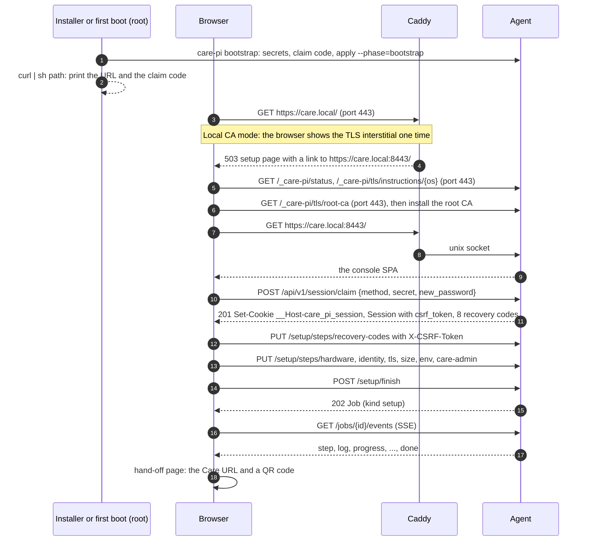
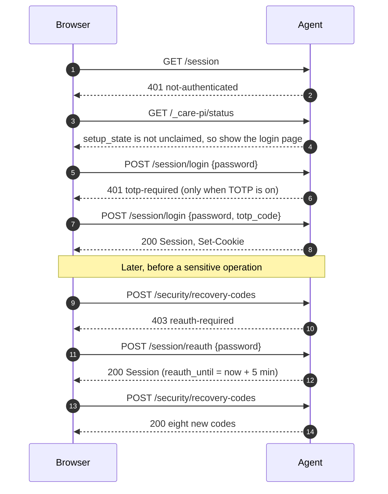
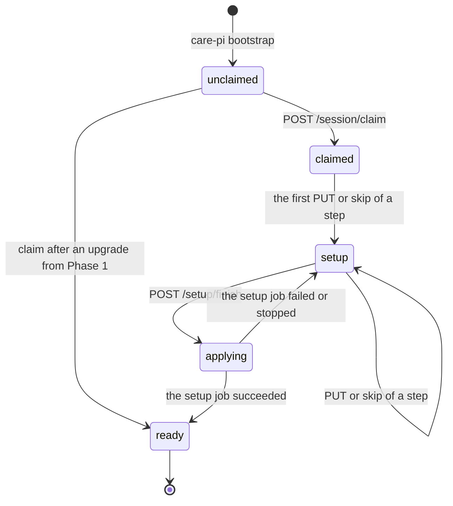

# The console API (design note)

This directory holds the contract between the care-pi agent and the console.

| File | Content |
|---|---|
| `openapi.yaml` | The contract: OpenAPI 3.1.0. Each operation, schema, header, and problem type. |
| `README.md` | This note: the auth flow, the setup state machine, the SSE format, the policies. |
| `openapi_test.go` | The Go test of the contract (kin-openapi and JSON Schema 2020-12). |
| `validate.sh`, `.redocly.yaml`, `.redocly.lint-ignore.yaml` | The lint. Run `make api-lint` or `sh docs/api/validate.sh`. |

The server (`care-pi serve`) and the console implement this document. When the document and the code
disagree, the document wins. Change the document first, then the code.

## 1. Transport and origins

The console has its own origin (decision S48). Care stays on port 443. The console and its API are on port 8443.

| Origin | Serves |
|---|---|
| `https://<host>/` (port 443) | Care, the plug bundles, the S3 buckets, and the status pages. `/_care-pi/*`: the public operations of the agent. `/console` and `/console/*`: `308` to `https://{host}:8443/`. |
| `https://<host>:8443/` | The console SPA at `/`. The API at `/api/v1/`. The public operations also at `/_care-pi/*`. Caddy sends each request on this port to the agent. |

`<host>` is each host name and each LAN address that Caddy serves (for example `care.local` and `192.168.1.10`).

Why: a script on the Care origin (an XSS bug in Care or a malicious FE plug) must not reach the console API,
because the agent runs as root. A different port is a different origin, so the browser does not let a script on
port 443 read a response of port 8443. The CSRF token and the `Origin` check (section 3) block the requests
that a script can send without the response.

The public operations are on both ports:

| Operation | Port 443 | Port 8443 |
|---|---|---|
| Public status | `/_care-pi/status` | `/_care-pi/status` |
| Agent health | `/_care-pi/health` | `/api/v1/health`, `/_care-pi/health` |
| Root CA (DER or PEM) | `/_care-pi/tls/root-ca` | `/api/v1/tls/root-ca`, `/_care-pi/tls/root-ca` |
| Root CA (Apple profile) | `/_care-pi/tls/root-ca/mobileconfig` | `/api/v1/tls/root-ca/mobileconfig`, `/_care-pi/tls/root-ca/mobileconfig` |
| Install steps for each OS | `/_care-pi/tls/instructions/{os}` | `/api/v1/tls/instructions/{os}`, `/_care-pi/tls/instructions/{os}` |

On port 443 the health path is `/_care-pi/health`, because Care has the routes `/health/*` on that origin.
In `openapi.yaml`, each of these operations lists its servers. The status pages and the installer use port 443.
Each other operation is only on port 8443, below `/api/v1`.

Architecture changes for Phase 2 (`plans/01-architecture.md` §5, §12):

- The pod publishes `8443` on each LAN address, the same way as `80` and `443`.
- The firewall allow-list (S42, `care-pi-firewall.service`) also allows `8443/tcp`.
- Caddy serves port 8443 with the same certificates as port 443 (`tls internal`, the same host names and addresses,
  `default_sni`). It sends no HSTS on the local CA names, on both ports.
- On port 443, Caddy sends `/_care-pi/*` to the agent socket and replaces the Phase 1 placeholder of `/console/*`
  with the `308`. Port 80 stays a `308` to port 443.

Other transport rules:

- The agent listens on the unix socket `/run/care-pi/api.sock`. Caddy is the only client.
- Caddy sets `X-Forwarded-For` to the client address. Caddy removes that header from a client,
  so the agent can trust it. The rate limits and the session records use this address.
  Caddy keeps the `Host` header with the port (for example `care.local:8443`). The `Origin` check uses it.
- CORS: none. The agent sends no `Access-Control-*` header on any response.
- Bodies are JSON. Errors are `application/problem+json` (section 7). The agent rejects a body larger than 1 MiB.
- Each response has `Cache-Control: no-store`, except the two root CA downloads.

## 2. Authentication and the claim

### 2.1 One operator account

The agent has one operator account. It is separate from Care (S22). It has:

- a console password: argon2id, m = 19 MiB, t = 2, p = 1 (OWASP minimum). The agent hashes one password at a time,
  because its memory cap of 128M also holds its child processes (`01` §8);
- 8 one-time recovery codes (S46), stored as hashes;
- an optional TOTP secret (RFC 6238: SHA-1, 6 digits, 30 s; the step before and after are valid; no replay).

All of them are in `/etc/care-pi/secrets/` (root 0600). No response contains a secret, with three exceptions:
the recovery codes in the response that makes them, the TOTP secret in the enrolment response, and the
root CA certificate (public data).

The password rules: 12 to 128 characters, Unicode NFC, not in the list of common passwords of the agent.
The Care superuser password must not be the console password.

### 2.2 The claim

A new device has no account. The state is `unclaimed`. The first operator **claims** the device with a
claim secret and sets the console password in the same request (`POST /session/claim`).
The claim also makes the 8 recovery codes and starts a session.

| Method | When | Secret |
|---|---|---|
| `os-password` | The Pi image, flashed with Raspberry Pi Imager and OS customisation | The password of the user that Imager created (07 §4.2). The agent reads the user name from the cloud-init `user-data` of Imager and checks the hash in `/etc/shadow`. |
| `claim-code` | Always, until the claim | A one-time code of 12 Crockford base32 characters (60 bits) in 3 groups, for example `4F7K-Q2MX-9PDA`. |

The claim code:

- `care-pi bootstrap` makes it when the device is not claimed and no code exists.
  On the image path, bootstrap runs at first boot, so the code is never in the image.
- It is in `/etc/care-pi/secrets/claim_code` (root 0600). The claim deletes it.
- The installer (`curl | sh`) prints it after bootstrap, with the URL: open `https://<name>:8443/` and enter the code.
- `sudo care-pi auth claim-code` prints it again. `--rotate` makes a new code.
- Anyone who can read the file is root on the host, so the code adds no new risk.

`GET /_care-pi/status` lists the methods in `claim_methods`. The console shows the field for the first method
and a link for the other one. Without OS customisation, `os-password` is not available. Then the operator reads the
claim code with SSH, or from another channel that a later phase adds (USB export, status TTY: 07 §6).

This keeps 07 §6: no plaintext page, HTTPS only, the Imager password is the claim credential on the image path.
In local CA mode the first visit to port 443 shows the TLS interstitial one time. The setup page on port 443
then offers the root CA (`/_care-pi/tls/root-ca`, with the fingerprint) and the steps for each OS
(`/_care-pi/tls/instructions/{os}`). Some browsers keep a certificate exception for each port (Firefox).
When the device installs the root CA first, port 8443 shows no second interstitial. Spike SP7 checks this on each browser.
The root CA with name constraints (07 §4.1) comes in Phase 7. Until then the root is the root that Caddy makes.

When `care-pi bootstrap` makes the claim code, `claim_methods` lists `claim-code` first, and the
console shows the claim code field first. The console also switches to the claim code field when the
operator types `XXXX-XXXX-XXXX` in the Imager password field.

### 2.3 The first-contact flow



### 2.4 Login, recovery, reauthentication



- **Recover** (`POST /session/recover`): a recovery code and a new password. The agent uses the code one time,
  sets the password, turns TOTP off, deletes the other sessions, and starts a session.
- **Last fallback** (S46): `sudo care-pi auth reset --password-stdin` on the host. It sets the password,
  makes 8 new codes, turns TOTP off, and deletes each session. It does not change the setup state.
- **Reauthentication**: an operation with `x-reauth: true` needs a credential check in the last 5 minutes
  (`Session.reauth_until`). A login, a claim, or a recover counts. Else the agent returns `403 reauth-required`.
  These operations need it: new recovery codes, TOTP enrol and disable, shutdown, and later SSH, Tailscale,
  CA rotation, the recovery key, restore, and rollback (04 §2).
  A reboot does not need it: the host comes back without a person. A shutdown needs a person at the Pi.
- The password change takes the current password in the body, so it needs no reauthentication.
  It deletes the other sessions and gives the current session a new id.
- The console goes to the login page only for the problem type `not-authenticated`.
  `bad-credentials` and `totp-required` also have the status 401, so check `type`.

### 2.5 Sessions

| Item | Value |
|---|---|
| Cookie | `__Host-care_pi_session=<id>; Path=/; Max-Age=86400; HttpOnly; Secure; SameSite=Strict`, no `Domain` |
| Id | 256 random bits, base64url (43 characters) |
| Store | Server side. The agent keeps the SHA-256 of each id in memory and in `/var/lib/care-pi/state/sessions.json` (root 0600). A restart of the agent keeps the sessions. |
| Idle timeout | 2 h (S49). Each request moves it. |
| Absolute timeout | 24 h (S49) |
| Reauthentication window | 5 min |
| Sessions for each account | 10. A new session deletes the oldest. |
| Public reference | `ref`: the first 16 hex digits of the SHA-256 of the id. `DELETE /security/sessions/{ref}` uses it. |

A login always makes a new id (no session fixation). The cookie is for one host name.
After a host name change, the browser must log in again at the new name.

The cookie and the two ports:

- The `__Host-` prefix makes the browser enforce `Secure`, `Path=/`, and no `Domain`.
- A cookie is not specific to a port. The browser also sends the cookie to Care on port 443.
  Caddy strips it before Care: the routes to Care and to the S3 buckets remove it from the `Cookie` header.
  Care uses bearer JWTs. The public operations of the agent on port 443 ignore it.
- A script on port 443 cannot read the cookie (`HttpOnly`) and cannot replace it: a script cannot overwrite an `HttpOnly` cookie (RFC 6265bis).
- `SameSite=Strict` does not separate the ports: they are the same site. Section 3 tells what separates them.

### 2.6 Operations without a session

| Operation | Why it is public |
|---|---|
| `GET /_care-pi/status` (ports 443 and 8443) | The status pages and the installer read it before a login can exist. It gives no address, no version, and no unit detail. |
| `GET /health` (port 8443 `/api/v1/health`; both ports `/_care-pi/health`) | Liveness for Caddy and the installer. The console also uses it to test the trust of the root CA on another host name (section 2.7). |
| `POST /session/claim` | The first operator has no account yet. The claim secret is the credential (07 §4.2). |
| `POST /session/login` | It makes the session. |
| `POST /session/recover` | The operator lost the password or the TOTP device. The recovery code is the credential. |
| `GET /tls/root-ca`, `GET /tls/root-ca/mobileconfig` (both ports) | The root CA is public data. Each staff device must install it, and staff have no console password (07 §6). The setup page on port 443 offers it before the device opens port 8443. The fingerprint is in a header and in the instructions. |
| `GET /tls/instructions/{os}` (both ports) | The setup page on port 443 and the public "install the certificate" page of the console show these steps to staff devices. |

Section 1 gives the paths on each port. Claim, login, and recover are only on port 8443.
All other operations need a session. The tests `TestOperations` and `TestSeparateOrigin` check these rules.

### 2.7 Trust check of the root CA

07 §4.3 asks the console to confirm that a device trusts the root CA. A page cannot read its own certificate (07 F1),
and the browser keeps a certificate exception for the host of the page. So the console tests another host name:
on `https://care.local:8443/` it runs `fetch("https://<LAN IP>:8443/api/v1/health", {mode: "no-cors"})`.
The request needs no CORS header, because the console does not read the response.
The promise resolves only when the browser trusts the certificate of that host. Spike SP7 must confirm this on each browser.

## 3. CSRF

- Each unsafe request (`POST`, `PUT`, `PATCH`, `DELETE`) with a session must have the header `X-CSRF-Token`.
- The value is `Session.csrf_token`: 256 random bits that the agent keeps with the session.
  The agent compares the header with the stored value in constant time.
- The console gets the token from `GET /session`, or from the response of claim, login, or recover.
  It keeps the token in memory. After a page reload, it calls `GET /session` again.
- Each unsafe request, also claim, login, and recover, must have the header `Origin: https://<served host>:8443`.
  `<served host>` is a host name or a LAN address that Caddy serves. The agent rejects each other origin,
  also `https://<served host>` (port 443, the Care origin). Then the agent returns `403 csrf`.
- CORS: none. A script on port 443 cannot read a response of port 8443, so it cannot read the token
  (`GET /session`). The browser sends the cookie with its requests to port 8443 (same site), but the `Origin`
  check and the token reject them.
- An unsafe operation with a body needs `Content-Type: application/json` (`415` else). An unsafe operation
  without a body needs no `Content-Type`. A cross-origin request with that content type needs a CORS
  preflight, and the agent never allows one.
- `GET` never changes state, so an `EventSource` (which cannot send headers) needs no token.
- Each request to an operation with a session, also a `GET` and an `EventSource`, must not have
  `Sec-Fetch-Site` with a value other than `same-origin` or `none`. Else the agent returns `403 csrf`,
  and the idle timeout does not move. A request without the header (for example `curl`) passes.
- For an operation with a session, the agent checks the session and the CSRF token before it reads
  the body. Body limits: 8 KiB for claim, login, recover, reauth, and TOTP verify; 1 MiB for
  `PUT /config`, `PATCH /config`, `PUT /setup/steps/env`, and `PUT /setup/steps/tls`; 64 KiB for each
  other operation. Caddy rejects a body larger than 1 MiB. A body that does not arrive in 10 s gives
  `400 malformed-request`.

## 4. Rate limits and lockout

| Limit | Scope | Value | Response |
|---|---|---|---|
| Credential requests: claim, login, recover, reauth, TOTP verify | client address | 10 each minute | `429 rate-limited` |
| Failed credentials (same operations) | client address | 5 in 15 minutes: the address is locked for 15 minutes | `429 locked-out` |
| Failed claims | all addresses together | 5: the claim is locked for 15 minutes (07 §4.2) | `429 locked-out` |
| Failed passwords of the account: login, reauth, password change | operator account | 10 failures in a row: the account is locked for 1 minute; each next failure doubles the lock, up to 60 minutes; a success resets the count | `429 locked-out` |
| Public reads: `/_care-pi/status`, `/health`, the public `/tls/*` operations | client address | 60 each minute | `429 rate-limited` |
| Requests with a session | session | 300 each minute | `429 rate-limited` |
| Open SSE streams | session, agent | 4 for each session, 16 in total | `429 rate-limited` |

Rules:

- Each `429` has `Retry-After` (seconds) and the same value in `retry_after_s`.
- During a lock, the agent does not check the credential, so the response tells nothing about the credential.
- The account lock does not block `recover`: a recovery code has 50 bits, and the address limits apply.
  So the owner can always recover from an attack on the password.
- `sudo care-pi auth unlock` removes each lock.
- The journal of `care-pi.service` records each auth event (claim, login, failure, lock, recover, password change)
  with the address and the user agent. It never records a secret.

The agent keeps the address locks, the claim lock, and the failed attempts in a file
(`state/auth-locks.json`), so a restart of the agent does not remove them.

## 5. The setup state machine



| State | Description | Setup operations |
|---|---|---|
| `unclaimed` | No account. | none (no session is possible) |
| `claimed` | The account exists. No other step is done or skipped. | each step |
| `setup` | Steps are in progress. | each step, in any order |
| `applying` | The finish job runs. | `GET /setup` only; a change gives `409 job-running` |
| `ready` | Setup is finished. | `GET /setup` only; a change gives `409 setup-finished` |

The steps, in list order:

| Step | Required | Can skip | Phase | What the `PUT` does |
|---|---|---|---|---|
| `account` | yes | no | 2 | Done by the claim. No `PUT`. |
| `recovery-codes` | yes | no | 2 | The operator types one of the codes again. The agent checks it but does not use it. |
| `hardware` | yes | no | 2 | The operator saw `GET /host/check`. A failed required check gives `422 host-check-failed`. |
| `identity` | yes | no | 2 | Writes `identity.display_name` and `identity.hostname`. |
| `tls` | yes | no | 2 | Writes `tls.*`. Phase 2 accepts only the local CA mode. |
| `size` | yes | no | 2 | Writes `size.*`. `busy-counter` on less than 3 GiB RAM gives a warning. |
| `env` | no | yes | 2 | Writes `env.backend`, `env.frontend`, and `fe.*` (the advanced path). |
| `backups` | yes | only in a dev build | 3 | Phase 3. In Phase 2 the `PUT` gives `501`. |
| `care-admin` | yes | no | 2 | Keeps the user name and email in the setup record and the password in memory only. |

Rules:

- **The draft is `config.yaml`.** Each step `PUT` validates its values and writes them into `config.yaml`.
  Nothing is applied before the finish. The agent keeps the step states in `/var/lib/care-pi/state/setup.json`.
- `current_step` is the first step in list order that is not `done` and not `skipped`. The agent does not enforce an order.
- The easy path skips `env`. The advanced path shows it.
- The wizard has no solution step: v1 has only the CARE Clinic solution (S32). A later phase can add the step.
- **Dev builds.** `dev_build` is `true` when the agent version is not a release tag (`vX.Y.Z`).
  Only a dev build can skip `backups` in Phase 2 (`06` Phase 2). So a release build of Phase 2 cannot finish setup.
  This is intentional: no release build exists before Phase 3.
- **Finish** (`POST /setup/finish`) needs each required step `done` or allowed `skipped`.
  Else `409 setup-incomplete` with `missing_steps`. The job validates, checks the host, runs a full apply
  (lock, images, units, buckets, stanza, FE build), waits until Care is healthy, and creates the Care superuser.
  On success the state becomes `ready`. On failure it becomes `setup` again, and `GET /setup` gives the failed `job_id`.
- **Host name change.** The finish job applies a new host name. The browser must open the new URL
  (the job result has it, and the IP URL works too) and log in again. The cookie is for one host name.

### 5.1 `apply --phase=bootstrap` and the page at `/`

Phase 2 changes `care-pi bootstrap` (first boot and installer, `05` §3): it runs `apply --phase=bootstrap`.
That renders and starts only `care.pod` and `care-caddy`. The agent runs on the host as `care-pi.service`.
Care does not start before the finish.
No FE build exists, so Caddy serves `status/setup.html` (503) at `/` (`docs/apply.md`, "Status pages and modes").
The setup page reads `GET /_care-pi/status`, offers the root CA (`/_care-pi/tls/...`), and links to
`https://<host>:8443/` with the host of the page (`console_port`).
An upgrade from Phase 1 (a lock exists, no setup record) records setup as finished. After the claim, the state is `ready`.

### 5.2 Resume

| Event | What happens |
|---|---|
| The browser closes during setup | The cookie stays (24 h at most, 2 h without a request). Open `https://<host>:8443/` again: `GET /session`, then `GET /setup`, then the console opens `current_step`. After a timeout, log in again. |
| Setup continues on another device | Log in with the console password. Setup needs a session; each session comes from the account that the claim made. |
| The operator did not save the recovery codes | `POST /security/recovery-codes` makes new codes. A fresh login counts as reauthentication. |
| The agent restarts during setup | The step states and `config.yaml` are on disk. The Care superuser password is lost: `care-admin` is `current` again with the code `password-needed`. |
| The browser closes during `applying` | `GET /setup` gives `job_id`. The console follows `GET /jobs/{job_id}/events?after=0`. |
| A power loss during `applying` | At start, the agent finds the job `running` with no holder of the apply lock. It marks the job `failed` ("interrupted"), and the state becomes `setup`. The operator finishes again. The apply is idempotent. |

## 6. Jobs and the event stream

### 6.1 The job model

`Job`: `id`, `kind`, `state` (`queued`, `running`, `succeeded`, `failed`, `cancelled`), `source`, `reason`,
`created_at`, `started_at`, `finished_at`, `cancellable`, `steps[]` (`index`, `name`, `action`, `state`,
`started_at`, `finished_at`, `detail`), `error` (a `Problem`), `result` (by kind), `last_event_id`.

A job is the journal file `/var/lib/care-pi/state/jobs/<id>.json` of Phase 1, with members added.
The id is the file name without `.json`, for example `20261030T101500.123Z-apply`.
The events are in `<id>.events.jsonl` next to it. The CLI and the console write the same files,
so `GET /jobs` lists the jobs of both.

| Phase 1 journal | API |
|---|---|
| file name without `.json` | `id` |
| `kind` | `kind` |
| `reason` | `reason` |
| `started` | `created_at` and `started_at` |
| `finished` | `finished_at` |
| `result: running` | `state: running`; `failed` with detail "interrupted" when no process holds the apply lock |
| `result: ok` | `state: succeeded` |
| `result: failed` | `state: failed` |
| `error` | `error.detail` (problem type `internal`) |
| `steps[].name` | `steps[].name`; `steps[].action` is the first word of the name when it is a plan kind |
| `steps[].started`, `steps[].finished` | `steps[].started_at`, `steps[].finished_at` |
| `steps[].error` | `steps[].state: failed`, `steps[].detail` |
| (none) | `source: cli`, `cancellable: false`, `result: null`, `last_event_id: 0` |

Only one job that changes the host runs at a time: kinds `apply`, `setup`, `fe-build`, `fe-prune`, and later
`restore`, `update`, `rollback`, `tls`. They hold the apply lock `/run/care-pi/apply.lock`, as the CLI does.
The agent waits 5 s at most for the lock (state `queued`). Then it returns `409 job-running` with `job_id`:
the newest journal with `state: running`, or `null` when a CLI command without a journal holds the lock.
`GET /apply/plan` also holds the lock, as `care-pi apply --dry-run` does.

Cancel: in Phase 2 only `fe-build` and `support-bundle` are cancellable. An apply stops only at its end.
The agent keeps the last 100 jobs and each job of the last 30 days.

### 6.2 SSE

`GET /jobs/{id}/events` with `Accept: text/event-stream`:

- The stream starts with `retry: 3000`.
- Each event has `id:` (an integer; 1 is the first event of the job), `event:`, and `data:` (one line of JSON).
- Event types: `step` (a `JobStep` after a change), `log` (one output line), `progress` (a long step),
  `error` (a `Problem`; the job can continue, for example after a failed FE build), `done` (the final `Job`).
- After `done` the agent closes the stream.
- `heartbeat` comes every 15 s. It has no `id:`, so it does not change `Last-Event-ID`.
- Resume: the browser sends `Last-Event-ID` when it connects again. After a page reload, the console uses
  `?after=<id>`, because an `EventSource` cannot set headers at the first connect. `0` gives each event.
- Without `Accept: text/event-stream`, the same URL gives JSON: `JobEventPage` with up to 1000 events after `after`.
  Use it for tests and for clients without SSE.
- The agent keeps up to 20000 events for each job. Then it drops `log` events and sends one `log` line that tells how many.
- Caddy sends SSE responses at once (no buffer).
- When the session ends, the agent closes the stream. The next connect gets `401`.

Example (an apply that restarts care-api):

```text
retry: 3000

id: 1
event: step
data: {"index":0,"name":"write-files: 1 file(s)","action":"write-files","state":"running","started_at":"2026-10-30T10:15:00.200Z","finished_at":null,"detail":null}

id: 2
event: step
data: {"index":0,"name":"write-files: 1 file(s)","action":"write-files","state":"succeeded","started_at":"2026-10-30T10:15:00.200Z","finished_at":"2026-10-30T10:15:00.300Z","detail":null}

id: 3
event: step
data: {"index":1,"name":"restart: care-api.service","action":"restart","state":"running","started_at":"2026-10-30T10:15:02Z","finished_at":null,"detail":null}

id: 4
event: log
data: {"time":"2026-10-30T10:15:03Z","step_index":1,"stream":"agent","line":"waiting for care-api.service to become healthy"}

event: heartbeat
data: {"time":"2026-10-30T10:15:15Z"}

id: 5
event: step
data: {"index":1,"name":"restart: care-api.service","action":"restart","state":"succeeded","started_at":"2026-10-30T10:15:02Z","finished_at":"2026-10-30T10:15:24Z","detail":null}

id: 6
event: done
data: {"id":"20261030T101500.123Z-apply","kind":"apply","state":"succeeded","source":"console","reason":null,"created_at":"2026-10-30T10:15:00.123Z","started_at":"2026-10-30T10:15:00.200Z","finished_at":"2026-10-30T10:15:24Z","cancellable":false,"steps":[{"index":0,"name":"write-files: 1 file(s)","action":"write-files","state":"succeeded","started_at":"2026-10-30T10:15:00.200Z","finished_at":"2026-10-30T10:15:00.300Z","detail":null},{"index":1,"name":"restart: care-api.service","action":"restart","state":"succeeded","started_at":"2026-10-30T10:15:02Z","finished_at":"2026-10-30T10:15:24Z","detail":null}],"error":null,"result":{"kind":"apply","changed":true,"lock_changed":false,"fe_build_id":null},"last_event_id":6}

```

`GET /logs/{unit}?follow=true` uses the same format with `event: log` (a `LogLine`) and `heartbeat`.
The event id is the journal cursor. After a reconnect, the stream continues after that cursor.

## 7. Errors

Each error is RFC 9457 `application/problem+json` (schema `Problem`): `type`, `title`, `status`, `detail`, `instance`,
and these extension members when they apply: `errors[]` (`pointer`, `message`, `code`, `parameter`), `job_id`,
`retry_after_s`, `missing_steps`, `failed_checks`, `phase`.
The type URI is `https://care-pi.rithviknishad.dev/problems/<slug>`. A client must branch on `type`.
Each operation lists its own types in `x-problems`. Each operation can also return the general types
(`malformed-request`, `payload-too-large`, `unsupported-media-type`, `rate-limited`, `internal`, `unavailable`).
An operation with a session can also return `csrf` (403); see §3.

| Slug | Status | When |
|---|---|---|
| `malformed-request` | 400 | The body is not JSON, or a header is malformed. |
| `invalid-request` | 422 | A body member or a parameter fails the schema or a rule. `errors[]` tells which. |
| `invalid-config` | 422 | The config fails `config.schema.json`. `errors[]` points into the config. |
| `unsupported-config` | 422 | The config is valid, but this version cannot apply a value (`apply` exit code 2). `phase` tells when. |
| `weak-password` | 422 | The new password breaks the password rules. |
| `host-check-failed` | 422 | A required host check fails. `failed_checks` lists them. |
| `not-authenticated` | 401 | No session, or the session ended. |
| `bad-credentials` | 401 | The password, claim secret, or recovery code is not correct. |
| `totp-required` | 401 | TOTP is on and the login has no code. |
| `csrf` | 403 | The `X-CSRF-Token` or the `Origin` is not correct. |
| `reauth-required` | 403 | The operation needs a credential check in the last 5 minutes. |
| `not-found` | 404 | The resource does not exist. |
| `job-not-found` | 404 | The job does not exist. |
| `unit-not-found` | 404 | The unit has no journal on this host. |
| `not-claimed` | 409 | Login or recover before the claim. |
| `already-claimed` | 409 | A claim after the claim. |
| `setup-incomplete` | 409 | Finish, apply, or a Care operation before setup is finished. `missing_steps` for finish. |
| `setup-finished` | 409 | A setup step change after `ready`. |
| `step-not-skippable` | 409 | The step cannot be skipped. |
| `job-running` | 409 | Another job holds the apply lock. `job_id` tells which. |
| `job-not-cancellable` | 409 | The job cannot be cancelled, or it ended. |
| `care-user-exists` | 409 | The Care user name exists. |
| `state-conflict` | 409 | Another state conflict, for example a TOTP enrolment when TOTP is on. |
| `config-changed` | 412 | `If-Match` is not the ETag of `config.yaml` now. |
| `payload-too-large` | 413 | The body is larger than 1 MiB. |
| `unsupported-media-type` | 415 | The `Content-Type` is not the one of the operation. |
| `precondition-required` | 428 | `If-Match` is not there. |
| `rate-limited` | 429 | A rate limit (section 4). |
| `locked-out` | 429 | A lockout (section 4). |
| `internal` | 500 | An error of the agent or a host command. The journal of `care-pi.service` has the detail. |
| `not-implemented-in-this-version` | 501 | An operation with `x-phase` greater than the version. `phase` tells when. |
| `care-not-running` | 503 | The operation needs a healthy care-api. |
| `unavailable` | 503 | The agent starts or stops. |

The type URIs need not resolve. The DNS/ACME service of Phase 6 can serve a page for each slug later.

## 8. The config resource

- `GET /config` gives `config.yaml` as JSON and an `ETag`. `view=effective` (default) adds the defaults of
  `docs/config.md`. `view=file` gives only the keys of the file.
- `PUT /config` replaces the file. `PATCH /config` is a JSON merge patch (RFC 7396) on the file keys.
  Both need `If-Match`. Both validate and return a plan preview (`care-pi apply --dry-run`).
  `dry_run=true` writes nothing. `apply=true` also starts an apply job.
- The agent writes the file again from JSON. Comments and the key order are lost.
- The schema of the body is `agent/internal/config/schema/config.schema.json`, by the relative `$ref`
  `../../agent/internal/config/schema/config.schema.json`. The setup steps reference parts of it
  (for example `#/properties/identity/properties/hostname`), so each pattern has one source.
  Redocly and kin-openapi resolve the reference. A tool that cannot resolve it uses the bundle (section 9).
- `GET /config/schema` gives the same schema for the forms of the console.

## 9. How the server and the console use this document

### 9.1 Server (`care-pi serve`)

- Each handler test validates the request and the response against this document:
  - route with kin-openapi (`openapi3.NewLoader` with `IsExternalRefsAllowed`, then a router);
  - validate the bodies with JSON Schema 2020-12. kin-openapi cannot resolve the external `$ref` in its 2020-12 mode,
    so compile the schemas with `santhosh-tekuri/jsonschema/v6` from `openapi.yaml#/...`, as `openapi_test.go` does,
    or validate against the bundle of section 9.2.
- An error response must have a `type` from the `x-problems` of the operation or a general type.
- Each operation with `x-phase` greater than 2 must return `501 not-implemented-in-this-version`.
- Each response must have `Cache-Control: no-store` (except the root CA downloads), and no `Access-Control-*` header.
- An unsafe request with an `Origin` other than `https://<served host>:8443` must get `403 csrf`, also from port 443.
- The public operations must answer on both ports, at the paths of section 1. Each other operation must not answer on port 443.
- The session cookie is `__Host-care_pi_session` with `Path=/`, `Max-Age=86400`, and no `Domain`.
- `care-pi status --json` and `GET /status` print the same `Status` object. Phase 1 omitted empty members;
  Phase 2 always prints each member (`null` or an empty list). The names and types of Phase 1 do not change.

### 9.2 Console

Make the TypeScript types from a bundle (the bundle puts the config schema in `components`):

```sh
npx --yes @redocly/cli@latest bundle docs/api/openapi.yaml --ext json -o console/src/api/openapi.bundled.json
npx --yes openapi-typescript@7 console/src/api/openapi.bundled.json -o console/src/api/schema.d.ts
```

Wave 4 checked these two commands: the types compile with `tsc --strict`.
Redocly names the parts of the config schema by their key (for example `hostname`, `dnsLabel`).

The agent embeds the console build and serves it at `https://<host>:8443/`. The API base URL of the console is `/api/v1`
(same origin). The console and the agent always have the same version of this document.

The console stops the job event poll on a 4xx problem other than `429` and shows the problem.

## 10. Versions

- The path has the major version: `/api/v1`. Inside v1, changes are additive only:
  new operations, new optional request members, new response members, new problem slugs,
  and new enum values where the description says "a later version can add".
- A client must ignore an unknown response member and must map an unknown enum value to a general case.
  `additionalProperties: false` describes the current version, not a promise against new members.
- A change that breaks a client makes `/api/v2`. The agent serves v1 and v2 together for one release.
- `info.version` is the version of this document (semver). It becomes `1.0.0` when Phase 2 ships.
- `x-phase` marks reserved parts. When a phase implements a part, it removes the `x-phase` mark and keeps the shape,
  or it adds members.

## 11. Operations and CLI commands

CLI parity is an exit criterion of Phase 2 (`06`). Each operation has the CLI command with the same effect
(`x-cli`). `-` means that the operation only manages browser state. "new" means that Phase 2 adds the command.
The paths are below `/api/v1` on port 8443, except `/_care-pi/status`. Section 1 gives the paths of the public operations on port 443.

| Method | Path | Auth | CLI command (`x-cli`) | Phase | In the CLI today |
|---|---|---|---|---|---|
| GET | `/_care-pi/status` | public | `care-pi status --json` | 2 | yes |
| GET | `/health` | public | `systemctl is-active care-pi.service` | 2 | yes |
| GET | `/host/check` | session | `care-pi host check --json [--probe]` | 2 | `--probe` is new |
| GET | `/session` | session | `-` | 2 | — |
| DELETE | `/session` | session + CSRF | `-` | 2 | — |
| POST | `/session/claim` | public | `care-pi auth set-password --password-stdin` | 2 | new |
| POST | `/session/login` | public | `-` | 2 | — |
| POST | `/session/recover` | public | `care-pi auth reset --password-stdin` | 2 | new |
| POST | `/session/reauth` | session + CSRF | `-` | 2 | — |
| GET | `/security` | session | `care-pi auth status --json` | 2 | new |
| PUT | `/security/password` | session + CSRF | `care-pi auth set-password --password-stdin` | 2 | new |
| POST | `/security/recovery-codes` | session + CSRF + reauth | `care-pi auth recovery-codes --regenerate` | 2 | new |
| POST | `/security/totp` | session + CSRF + reauth | `care-pi auth totp enrol` | 2 | new |
| DELETE | `/security/totp` | session + CSRF + reauth | `care-pi auth totp disable` | 2 | new |
| POST | `/security/totp/verify` | session + CSRF | `care-pi auth totp enrol` | 2 | new |
| GET | `/security/sessions` | session | `care-pi auth sessions --json` | 2 | new |
| DELETE | `/security/sessions/{session_ref}` | session + CSRF | `care-pi auth sessions revoke REF` | 2 | new |
| PUT | `/security/ssh` | session + CSRF + reauth | `care-pi ssh enable\|disable` | 7 | new |
| GET | `/setup` | session | `care-pi setup status --json` | 2 | new |
| PUT | `/setup/steps/recovery-codes` | session + CSRF | `care-pi setup finish` | 2 | new |
| PUT | `/setup/steps/hardware` | session + CSRF | `care-pi host check --json` | 2 | yes |
| PUT | `/setup/steps/identity` | session + CSRF | `care-pi config set identity.display_name=NAME identity.hostname=LABEL` | 2 | new |
| PUT | `/setup/steps/tls` | session + CSRF | `care-pi config set tls.local_ca.enabled=true` | 2 | new |
| PUT | `/setup/steps/size` | session + CSRF | `care-pi config set size.preset=PRESET` | 2 | new |
| PUT | `/setup/steps/env` | session + CSRF | `care-pi config set env.backend.NAME=VALUE env.frontend.NAME=VALUE fe.provider=PROVIDER` | 2 | new |
| PUT | `/setup/steps/backups` | session + CSRF | `care-pi config set backups.destinations=JSON` | 3 | new |
| PUT | `/setup/steps/care-admin` | session + CSRF | `care-pi setup finish --care-username USER --care-email EMAIL --care-password-stdin` | 2 | new |
| POST | `/setup/steps/{step}/skip` | session + CSRF | `care-pi setup skip STEP` | 2 | new |
| POST | `/setup/finish` | session + CSRF | `care-pi setup finish` | 2 | new |
| GET | `/status` | session | `care-pi status --json` | 2 | yes |
| GET | `/config` | session | `care-pi config show --json [--file]` | 2 | new |
| PUT | `/config` | session + CSRF | `care-pi config validate && care-pi apply --dry-run` | 2 | yes |
| PATCH | `/config` | session + CSRF | `care-pi config set KEY=VALUE... [--dry-run] [--apply]` | 2 | new |
| GET | `/config/schema` | session | `care-pi config schema` | 2 | yes |
| GET | `/config/presets` | session | `care-pi config presets --json` | 2 | new |
| POST | `/apply` | session + CSRF | `care-pi apply [--update] [--reason TEXT]` | 2 | yes |
| GET | `/apply/plan` | session | `care-pi apply --dry-run [--update]` | 2 | yes |
| GET | `/jobs` | session | `care-pi jobs list --json` | 2 | new |
| GET | `/jobs/{job_id}` | session | `care-pi jobs show JOB_ID --json` | 2 | new |
| GET | `/jobs/{job_id}/events` | session | `care-pi jobs follow JOB_ID` | 2 | new |
| POST | `/jobs/{job_id}/cancel` | session + CSRF | `care-pi jobs cancel JOB_ID` | 2 | new |
| GET | `/logs` | session | `care-pi logs --help` | 2 | yes |
| GET | `/logs/{unit}` | session | `care-pi logs UNIT [-n N] [--since TIME] [-f] [--json]` | 2 | `--since`, `--json` are new |
| POST | `/support-bundle` | session + CSRF | `care-pi support-bundle [--out FILE] [--lines N]` | 2 | new |
| GET | `/support-bundle/{bundle_id}` | session | `care-pi support-bundle --out FILE` | 2 | new |
| GET | `/network` | session | `care-pi status --json` | 2 | yes |
| PUT | `/network/wifi` | session + CSRF | `care-pi network wifi --ssid SSID --psk-stdin [--failover]` | 6 | new |
| GET | `/tls` | session | `care-pi tls show --json` | 2 | new |
| GET | `/tls/root-ca` | public | `care-pi tls root-ca [--format der\|pem] [--out FILE]` | 2 | new |
| GET | `/tls/root-ca/mobileconfig` | public | `care-pi tls root-ca --format mobileconfig [--out FILE]` | 2 | new |
| GET | `/tls/instructions/{os}` | public | `-` | 2 | — |
| PUT | `/tls/public` | session + CSRF | `care-pi tls public enable --clinic-id ID` | 6 | new |
| PUT | `/tls/tailscale` | session + CSRF + reauth | `care-pi tls tailscale enable --auth-key-stdin` | 6 | new |
| POST | `/tls/local-ca/rotate` | session + CSRF + reauth | `care-pi tls local-ca rotate` | 7 | new |
| GET | `/fe` | session | `care-pi fe status --json` | 2 | `--json` is new |
| POST | `/fe/build` | session + CSRF | `care-pi fe build [--force]` | 2 | yes |
| POST | `/fe/prune` | session + CSRF | `care-pi fe prune --keep N` | 2 | yes |
| GET | `/care` | session | `care-pi care info --json` | 2 | new |
| POST | `/care/superuser` | session + CSRF | `care-pi care create-superuser --username USER --email EMAIL --password-stdin` | 2 | yes |
| POST | `/power/reboot` | session + CSRF | `care-pi power reboot` | 2 | new |
| POST | `/power/shutdown` | session + CSRF + reauth | `care-pi power shutdown` | 2 | new |
| GET | `/backups` | session | `care-pi backup status --json` | 3 | new |
| POST | `/backups/run` | session + CSRF | `care-pi backup run [--destination ID]` | 3 | new |
| POST | `/backups/destinations/test` | session + CSRF | `care-pi backup destination test ...` | 3 | new |
| GET | `/backups/recovery-key` | session + reauth | `care-pi backup recovery-key` | 3 | new |
| GET | `/restore/points` | session | `care-pi restore points --json` | 3 | new |
| POST | `/restore` | session + CSRF + reauth | `care-pi restore --kind pitr --time TIME` | 3 | new |
| GET | `/updates` | session | `care-pi update status --json` | 4 | new |
| POST | `/updates/check` | session + CSRF | `care-pi update check` | 4 | new |
| POST | `/updates/apply` | session + CSRF | `care-pi update apply [--version VERSION]` | 4 | new |
| POST | `/updates/rollback` | session + CSRF + reauth | `care-pi update rollback` | 4 | new |
| GET | `/plugs` | session | `care-pi plugs list --json` | 4 | new |
| PUT | `/plugs/{plug_id}` | session + CSRF | `care-pi plugs set PLUG_ID --enabled=true\|false` | 4 | new |

Phase 2 adds these CLI commands (or flags):

- `care-pi serve` (the HTTP API on the socket; `care-pi.service` runs it);
- `care-pi auth claim-code [--rotate]`, `auth set-password --password-stdin` (also claims an unclaimed device as root),
  `auth reset --password-stdin`, `auth unlock`, `auth status --json`, `auth recovery-codes --regenerate`,
  `auth totp enrol|disable`, `auth sessions [--json]`, `auth sessions revoke REF`;
- `care-pi setup status --json`, `setup skip STEP`, `setup finish [--care-username U --care-email E --care-password-stdin]`.
  These are the only setup commands. `care-pi config set` replaces a command for each step (identity, tls, size, env, backups).
  As root, `setup finish` counts the steps `account` (after `auth set-password`), `recovery-codes`, and `hardware` as done;
- `care-pi config show --json [--file]`, `config set KEY=VALUE... [--dry-run] [--apply]`, `config presets --json`;
- `care-pi jobs list|show|follow|cancel`;
- `care-pi support-bundle [--out FILE] [--lines N]`;
- `care-pi tls show --json`, `tls root-ca [--format der|pem|mobileconfig] [--out FILE]`;
- `care-pi care info --json`, `care-pi power reboot|shutdown`;
- the flags `host check --probe`, `logs --since --json`, `logs agent`, `fe status --json`.

## 12. Decisions of the owner

| # | Decision |
|---|---|
| S48 | The console and its API have their own origin, `https://<host>:8443/` (SPA at `/`, API at `/api/v1/`). On port 443, `/console` and `/console/*` give `308` to `https://{host}:8443/`. The public operations are on both ports (section 1). Cookie `__Host-care_pi_session`. The `Origin` check accepts only `https://<served host>:8443`. No CORS. The pod publishes 8443 on each LAN address; the firewall allows 8443/tcp. |
| S49 | Session timeouts: 2 h idle, 24 h absolute. |
| Claim | The claim code is in `/etc/care-pi/secrets/claim_code`. The Imager password is the second method on the image path (section 2.2). |
| Account | One operator account, without a user name (section 2.1). |
| Care admin | The Care superuser password must not be the console password. |
| Reauthentication | A shutdown needs it. A reboot does not (section 2.4). |
| Wizard | No solution step (section 5). |
| Config writes | An API write of `config.yaml` loses the comments and the key order (section 8). |
| Rate limits | The table of section 4. |
| CLI | `care-pi config set` replaces a CLI command for each setup step. The setup commands are `care-pi setup status`, `skip`, and `finish` (section 11). |
| Backups step | Only a dev build can skip it. This is intentional: no release build exists before Phase 3. |
| Root CA | The root CA with name constraints (07 §4.1) comes in Phase 7. Until then `CaRoot.name_constraints` is `null` (`x-phase: 7`). |
