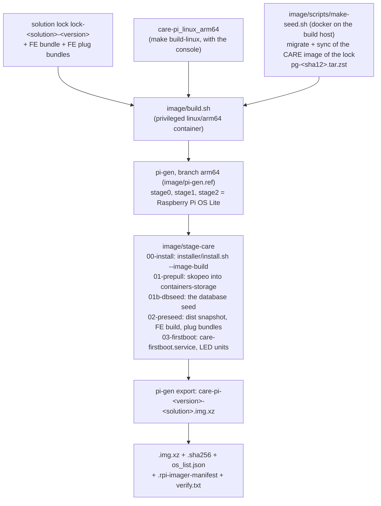

# The Raspberry Pi image (Phase 5)

This page describes the Raspberry Pi image of care-pi: the build pipeline, the local build, the check of an image,
the flash with Raspberry Pi Imager, the first boot, the `user-data` pre-seed, and the tests on hardware.

The image is Raspberry Pi OS Lite (64-bit, trixie) after the installer ran, with the container images already pulled.
One image boots a Raspberry Pi 4 and a Raspberry Pi 5. A first boot without internet reaches the claim and the setup
wizard without a download. Care itself starts only after the clock is synchronized (section 7 and section 10, point 5).

Related pages: `plans/05-image-and-installer.md` (design), `plans/08-spike-log.md` (SP10 and the Phase 5 build),
`docs/install.md` (the installer and `--image-build`), `docs/console-server.md` (setup mode and the claim),
`docs/solutions.md` (locks, `index.json`, the dist base), `image/README.md` (the files of `image/`).

## 1. The pipeline



- **Tool.** pi-gen (`https://github.com/RPi-Distro/pi-gen`, branch `arm64`), the generator of Raspberry Pi OS. Spike
  SP10 tried `rpi-image-gen` first. It builds in Docker, but its images have no Imager customisation (no cloud-init
  seed, no `rpi-cloud-init-mods`) and its `rpi5` device layer makes a Pi-5-only file system. See `plans/08-spike-log.md`, SP10.
- **Base.** pi-gen stages 0 to 2 are Raspberry Pi OS Lite: the same packages, `cloud-init` with `rpi-cloud-init-mods`,
  the NoCloud seed files on the boot partition, `rpi-resize` (the root file system grows at the first boot), `rpi-swap`,
  and both kernels (`kernel8.img` for Pi 4, `kernel_2712.img` with 16 KB pages for Pi 5).
- **One installer.** Stage `00-install` runs `installer/install.sh --image-build` in the chroot. The flag writes each
  file and enables each unit, but it starts nothing (`docs/install.md`, "The image build").
- **Pre-pull.** Stage `01-prepull` copies each image of the lock with
  `skopeo copy --override-arch arm64 docker://<repo>@<digest> containers-storage:[overlay@<root>/var/lib/containers/storage+<runroot>]<repo>:<tag>`.
  No podman runs in the chroot. podman finds each image by the digest of the lock (the units use `<repo>@<digest>`).
- **Pre-migrated database (S72).** Before pi-gen, `image/build.sh` runs `image/scripts/make-seed.sh` on the build host
  with docker: PostgreSQL (the `postgres-pgbackrest` image of the lock), Redis, and the solution image of the lock run
  `migrate`, `sync_permissions_roles`, and `sync_valueset` against an empty database. Stage `01b-dbseed` copies the
  data directory as `/var/lib/care-pi/seed/pg-<sha12>.tar.zst` (section 6.5). `--no-seed` builds without it;
  `--seed FILE` uses a seed of an earlier run.
- **Pre-seed.** Stage `02-preseed` writes the dist snapshot, the default FE build, the built FE plug bundles, and
  `/etc/care-pi/image-release.json`. Section 3 has the paths.
- **First boot.** Stage `03-firstboot` installs `care-firstboot.service` and the ACT LED units (section 6).
- **No device secret.** The image has no `config.yaml`, no secret, no claim code, no SSH host key, and no machine id.
  The first boot makes them.
- **Apt sources.** The image uses HTTPS for `deb.debian.org` and `archive.raspberrypi.com`. In a Docker Desktop
  container, plain HTTP goes through its HTTP proxy at 22 KB/s; HTTPS gives 4 MB/s. apt checks the signatures in both cases.

## 2. Build the image

### 2.1 What you need

- A linux/arm64 container runtime: Docker Desktop on Apple silicon, Docker on a GitHub `ubuntu-24.04-arm` runner, or
  Docker on a Pi 5. An x86 host needs `qemu-user-static` (binfmt). It is very slow, and nobody tested it.
- `--privileged` containers with `/dev`. pi-gen mounts `proc`, `sys`, and `dev` in the chroot and uses loop devices.
- `jq` and `zstd` on the host, for the database seed (S72): `image/scripts/make-seed.sh` runs the CARE image and the
  postgres image of the lock with Docker on the host (about 2 minutes with the pulls; `--no-seed` skips it).
- About 20 GB of free space for the Docker volume `care-pi-image-work` during the build (the build keeps about 2 GB of it
  for `--reuse-base`), and 2 GB in `image/out`. On a Mac with Apple silicon, a full build took 34 minutes (17 of them a
  slow apt download through Docker Desktop), and a build with `--reuse-base` took 6 minutes
  (`plans/08-spike-log.md`, "Phase 5 build").
- Internet: the Debian and Raspberry Pi archives, GitHub (pi-gen), and the container registries (about 1.9 GB).

### 2.2 Steps

1. Build the agent with the console:

   ```sh
   make build-linux                 # bin/care-pi_linux_arm64
   ```

2. Get a dist directory for the lock: the lock, its FE bundle, and its built FE plug bundles in the release layout
   `<tag>/<asset>`. From the GitHub releases:

   ```sh
   image/scripts/fetch-dist.sh --solution care-clinic --lock-version 2026.11.0 --out image/out/dist --care-pi <care-pi of this host>
   ```

   Or make a development lock with `solutions/scripts/make-lock.sh` (`docs/solutions.md`, section 17):

   ```sh
   solutions/scripts/make-lock.sh --solution care-clinic --version 2026.11.0 --out image/out/dist \
     --care-fe-sha <sha of the FE bundle> --fe-bundle care_fe-care-clinic-<sha12>-<build id>.tar.gz
   ```

3. Build the image:

   ```sh
   image/build.sh --dist image/out/dist --lock-version 2026.11.0 [--version 2026.11.0-2] [--reuse-base] [--no-verify]
   ```

   `--version` is the image version (default: the lock version). `--reuse-base` keeps the Raspberry Pi OS stages of an
   earlier build with the same pi-gen commit. Use it only for development.

### 2.3 Outputs

`image/out/` (not in git):

| File | Content |
|---|---|
| `care-pi-<version>-<solution>.img.xz` | The image. |
| `care-pi-<version>-<solution>.img.xz.sha256` | The SHA-256 of the `.img.xz`. |
| `os_list.json` | The Raspberry Pi Imager repository file of the image (section 4). |
| `care-pi-<version>-<solution>.rpi-imager-manifest` | The same content. Imager 2.x opens it with a double-click. |
| `care-pi-<version>-<solution>.image-release.json` | The copy of `/etc/care-pi/image-release.json`. |
| `care-pi-<version>-<solution>.verify.txt` | The report of `image/scripts/verify.sh` (section 2.4). |
| `care-pi-<version>-<solution>.install.log` | The log of `install.sh --image-build`. |
| `care-pi-<version>-<solution>.pi-gen.log`, `.info`, `.bmap` | The log of pi-gen, the package list of the image, and the block map (for `bmaptool`). |

Measured times and sizes are in `plans/08-spike-log.md`, "Phase 5 build".

### 2.4 Check an image

`image/build.sh` runs `image/scripts/verify.sh` at the end (unless `--no-verify`). The script runs in the build
container. It unpacks the image, mounts the two partitions with loop devices, and checks:

- `cmdline.txt`: one line, `cgroup_enable=memory cgroup_memory=1`, no `cgroup_disable=memory`;
- the cloud-init seed (`user-data`, `meta-data`, `network-config`) and both kernels on the boot partition;
- `care-pi version` (the binary of the image), the host name `care`;
- the units: `care-firstboot`, `care-pi`, `care-pi-firewall`, `care-pi-led` (and its path unit), avahi, timesyncd, the apt
  timers, NetworkManager, cloud-init (`systemctl --root=<mount> is-enabled`);
- the packages and the apt holds; the drop-ins of zram, journald, sysctl, apt, the firewall, and the NetworkManager hook;
- that no device secret, `config.yaml`, `lock.yaml`, SSH host key, or first-boot marker is in the image;
- the dist snapshot (a valid `index.json` with `dist_base: file:///var/lib/care-pi-dist/`, each lock with the SHA-256 of
  the index), the FE build of the lock without `fe/current`, and each built FE plug bundle;
- each image of the lock: `podman --root <mount>/var/lib/containers/storage image exists <repo>@<digest>`, and the
  architecture `arm64`.

The script does not boot the image. `image/scripts/boot-test.sh` does a container boot: it writes the files that Imager
writes (`user-data` with `user:`, a yescrypt hash, and the host name `clinic`), then boots the root file system with
`systemd-nspawn` in the build container, without a network. It checks cloud-init, `care-firstboot.service`, `care-pi
bootstrap --from-image`, setup mode from the pre-pulled images (no pull), the solution lock of the image in the update
cache (the solution and the lock version come from `/etc/care-pi/image-release.json` of the image), the claim method
`os-password` first, a claim with the Imager password, and the LED path unit. It is not a Pi boot: no Pi kernel, no `rpi-resize`, and a fake zram line.

```sh
docker run --rm --privileged --platform linux/arm64 -v /dev:/dev -v care-pi-image-work:/work \
  -v "$PWD:/src:ro" -v "$PWD/image/out:/out:ro" care-pi-image-builder \
  bash /src/image/scripts/boot-test.sh /out/care-pi-<version>-<solution>.img.xz /work/boottest
```

A boot test in QEMU (`virt` machine with the Pi OS kernel) is an open point (section 10). The hardware test is section 9.

## 3. Files of the image

| Path | Content |
|---|---|
| `/usr/local/bin/care-pi` | The agent of the build (with the console). |
| `/etc/systemd/system/care-pi.service` | Enabled. It starts at each boot, also before the first-boot work ends (as after the installer). |
| `/boot/firmware/cmdline.txt` | `cgroup_enable=memory cgroup_memory=1` (the stock file has `cgroup_disable=memory`). |
| `/etc/rpi/swap.conf.d/50-care-pi.conf` | zram of 1x RAM (`plans/09-handoff.md`, section 3). |
| `/etc/systemd/journald.conf.d/50-care-pi.conf`, `/etc/sysctl.d/50-care-pi.conf`, `/etc/avahi/avahi-daemon.conf`, `/etc/apt/apt.conf.d/52care-pi.conf`, `/etc/care-pi/firewall.nft`, `/etc/NetworkManager/dispatcher.d/90-care-pi` | The files of the installer. |
| `/var/lib/containers/storage` | The pre-pulled images: the solution image, `postgres-pgbackrest`, `caddy`, `redis`, `versitygw`, `node`. |
| `/var/lib/care-pi-dist/` | The dist snapshot: `index/index.json` (`dist_base: file:///var/lib/care-pi-dist/`), the lock, the FE bundle, and the FE plug bundles, each with its `.sha256`. |
| `/var/lib/care-pi/fe/<build id>/` | The default FE build of the lock. No `fe/current`: setup mode shows the setup page. The apply at the end of the setup points `fe/current` at the build. |
| `/var/lib/care-pi/plugs/<slug>/<sha12>/` | Each built FE plug bundle of the lock. An external FE plug (a `url` only) needs internet in the browser. |
| `/var/lib/care-pi/seed/pg-<sha12>.tar.zst`, `.json` | The pre-migrated database of the CARE commit `<sha12>` of the lock (S72, section 6.5): about 8 MB (81 MB extracted). |
| `/etc/care-pi/image-release.json` | `version`, `solution`, `lock_version`, `lock_sha256`, `agent_version`, `built_at`, `git_sha`, `base`, `seed.pg` (`care_git_sha`, `created_at`, `file`, `size_bytes`, `migrations`; `null` without a seed). |
| `/usr/local/lib/care-pi/care-firstboot`, `/etc/systemd/system/care-firstboot.service` | The first boot (section 6). |
| `/usr/local/lib/care-pi/care-pi-led`, `care-pi-led.service`, `care-pi-led.path`, `care-pi-led-off.service` | The ACT LED (section 6.3). |

The host name of the image is `care` (mDNS name `care.local`, S27).

## 4. Flash with Raspberry Pi Imager

Use Raspberry Pi Imager 2.x. Imager 1.x cannot customise a Raspberry Pi OS trixie image with cloud-init
(rpi-imager `doc/os_customisation_formats.md`).

Imager customises an image only when a repository file declares its `init_format`. For "Use custom" with a local
`.img.xz`, Imager 2.x shows no customisation. Thus do not use "Use custom". Use one of these:

- Start Imager with the repository URL:

  ```sh
  rpi-imager --repo https://github.com/rithviknishad/care-pi/releases/download/imager/os_list.json
  ```

  The release `imager` always has the `os_list.json` of the newest image (`.github/workflows/pi-image.yml`).
  The release `image-<version>` has the `os_list.json` of that image.
- In Imager: **App Options** > **Content Repository** > **Edit** > use a custom file, select `os_list.json` or the
  `.rpi-imager-manifest`, then **Apply & Restart**.
- Double-click `care-pi-<version>-<solution>.rpi-imager-manifest`.

The entry of `os_list.json`:

```json
{
  "name": "Care: CARE Clinic 2026.11.0 (image 2026.11.0)",
  "description": "Raspberry Pi OS Lite (64-bit, trixie) with Care ...",
  "icon": "https://raw.githubusercontent.com/rithviknishad/care-pi/main/image/icon.png",
  "url": "https://github.com/rithviknishad/care-pi/releases/download/image-2026.11.0/care-pi-2026.11.0-care-clinic.img.xz",
  "extract_size": 0, "extract_sha256": "...", "image_download_size": 0, "release_date": "YYYY-MM-DD",
  "init_format": "cloudinit-rpi", "devices": ["pi5-64bit", "pi4-64bit"], "capabilities": [],
  "website": "https://github.com/rithviknishad/care-pi", "architecture": "armv8"
}
```

`extract_sha256` must be correct, or Imager stops the write. An appearance in the official list of Imager needs an
application to Raspberry Pi.

Set these in the customisation of Imager:

| Setting | Effect |
|---|---|
| Host name | The mDNS name (`<host name>.local`). Default `care` (`care.local`). |
| User name and password | Required. The console accepts this password for the claim (section 6.2). |
| Wi-Fi | cloud-init writes it. The setup needs ethernet (S35). |
| SSH | Optional. Useful to read the claim code and the logs. |
| Locale and time zone | The time zone sets the update window (`docs/solutions.md`, open point 5). |

Imager writes `user-data`, `meta-data`, and `network-config` to the boot partition, and adds the NoCloud data source to
`cmdline.txt`. The `cgroup_enable=memory cgroup_memory=1` words of the image stay.

## 5. The `user-data` pre-seed (S36)

A pre-seed sets keys of `config.yaml` before the first boot, for example the TLS mode and the identity.
The mechanism is the cloud-init module `write_files`: it writes the file `/etc/care-pi/preseed.yaml` (mode 0600).
`care-pi bootstrap --from-image` reads it:

- The file is a `config.yaml` document (`docs/config.md`). The keys that it does not set get their defaults.
- bootstrap validates it, and runs the checks of `apply` on it before it installs it: a feature that this version does
  not have (for example `tls.local_ca.enabled: false`), or a mode that needs an enrol job (`tls.public`, `tls.tailscale`).
- A pre-seed that sets `clock.policy` keeps its value: `care-pi clock detect` (section 6.4) does not change it.
  A file that fails is not used, and the device is never silent: bootstrap moves the file to `preseed.yaml.rejected`,
  writes the error to `/var/lib/care-pi/state/firstboot-error.json`, and starts setup mode (the claim). The claim page of
  the console and the setup page on port 443 show the error (`firstboot_error` of `GET /_care-pi/status`) until the
  setup is finished. Correct the `user-data` and flash again, or continue with the console setup.
- bootstrap installs it as `/etc/care-pi/config.yaml` and applies everything at once (`--unattended`): no console
  setup. Care starts from the pre-pulled images and the pre-seeded FE build. The console is not claimed: claim it later.
  Create the first Care user with `sudo care-pi care create-superuser`.
- After a successful first boot, bootstrap renames the file to `preseed.yaml.applied`.

Example (`user-data`):

```yaml
#cloud-config
write_files:
  - path: /etc/care-pi/preseed.yaml
    permissions: "0600"
    content: |
      version: 1
      identity:
        display_name: Hill Clinic
        hostname: hill
      tls:
        local_ca:
          enabled: true
```

Two ways to add it:

- **Imager CLI.** Put the full `user-data` (with `user:`, `hostname:`, and `write_files:`) in a file, then run
  `rpi-imager --cli --cloudinit-userdata user-data.yaml <image> <device>`.
- **After Imager.** Open the boot partition (FAT) on a computer. Add the `write_files:` block at the end of `user-data`.
  Imager writes no `write_files:` key, so the file then has one.

Without a pre-seed, the first boot starts setup mode (the default).

## 6. The first boot

### 6.1 Order

1. Raspberry Pi OS: `rpi-resize` grows the root partition and its file system.
2. cloud-init (`cloud-init-main`, `cloud-config`, `cloud-final`): the host name, the Imager user with its password hash
   in `/etc/shadow`, Wi-Fi, SSH, locale, and `write_files` (the pre-seed). `care-pi.service` starts at
   `multi-user.target`, before the next step, as after the installer.
3. `care-firstboot.service` (oneshot): after `cloud-final.service`, `network-online.target`, and `swap.target`.
   Its condition is `ConditionPathExists=!/var/lib/care-pi/state/firstboot-done`. The script
   `/usr/local/lib/care-pi/care-firstboot`:
   1. waits for `cloud-init status --wait` (at most 10 minutes);
   2. reads the host name, and restarts avahi, so that avahi announces `<host name>.local`;
   3. checks the memory cgroup controller (it stops with an error when the controller is off) and the zram swap
      (a warning below 90 % of the RAM);
   4. runs `care-pi bootstrap --from-image`: the host check, the directories, the secrets, `config.yaml` (or the
      pre-seed), the import of the dist snapshot into the update cache, the claim code, the start of
      `care-pi.service`, `care-pi clock detect` (section 6.4), and the apply of setup mode (Caddy and the console; the
      Caddy image of the lock, no registry); then the marker `/var/lib/care-pi/state/firstboot-done`.
4. `care-pi-led.service`: the ACT LED blinks (`heartbeat`) until the claim.

`care-firstboot.service` has `DefaultDependencies=no` and the usual service dependencies by hand. `cloud-final.service`
has `After=multi-user.target`, so the default `After=` of `multi-user.target` on its wanted units would give an ordering
cycle. A failure starts the unit again after 2 minutes, at most 3 times in one hour. The script exits with the exit code
of bootstrap; exit code 2 (wrong input: the same error again) does not start the unit again
(`RestartPreventExitStatus=2`).

### 6.2 The claim

Open `https://<host name>.local:8443/` or `https://<IP address>:8443/`. The first visit shows a certificate warning
(local CA, `plans/07-first-contact-trust.md`).

- The console asks first for the password of the Imager user (claim method `os-password`). The agent finds the user in
  `user-data` (`user:` of Imager 2.x, or `users:`) and checks the password against `/etc/shadow`. Imager 2.x writes a
  yescrypt hash (`$y$`) for each OS with a release date of 2023 or later; the agent checks `$y$`, `$5$`, and `$6$`.
  cloud-init writes the hash before `care-firstboot.service` starts.
- The claim code is the fallback. Read it over SSH: `sudo care-pi auth claim-code`, or in
  `journalctl -u care-firstboot`. bootstrap does not record the claim hint `claim-code` on the image, because no
  terminal shows the code.
- The claim also gives the time of the browser (S52). Without internet, the agent sets the clock from it, so the install
  at the end of the setup does not wait for NTP. Use a computer or a phone with a correct clock for the claim.

### 6.3 The ACT LED

| LED | Meaning |
|---|---|
| Heartbeat (two short flashes, a pause) | The first boot is done. The console waits for the claim. |
| The normal disk activity (`mmc0`) | Before the end of the first boot, or after the claim. |

`care-pi-led.path` watches `/etc/care-pi/secrets/agent.json` (written by the claim). Then `care-pi-led-off.service`
stops `care-pi-led.service` (`Conflicts=`), and the LED gets its earlier trigger back.

### 6.4 The clock policy (S75, SP9)

bootstrap runs `care-pi clock detect`. It reads the RTC time at boot from the kernel message
`rpi-rtc …: setting system clock to <time> UTC (<seconds>)` (`journalctl -k -b 0`) and, on a Pi 5,
`/sys/class/rtc/rtc0/battery_voltage`:

| RTC | Policy | The clock gate at each boot |
|---|---|---|
| A time after the build time of the agent at boot, and no battery voltage of 0 (an RTC battery) | `rtc` | Passes at once from the RTC. NTP confirms it later: the clock is trusted then; a difference of more than 5 minutes gives the warning "clock drift" of `care-pi doctor`. |
| `1970-01-01` at boot (no battery; care.local), a battery voltage of 0, or no `/dev/rtc0` (a Pi 4 without an RTC module) | `ntp` | Waits for NTP, or (without internet) for the time of the browser at the claim (S52). |

A warm reboot keeps the RTC time also without a battery (the board keeps its power): so a Pi 5 that reports a battery
voltage of 0 never gets `rtc`. `fake-hwclock` and the clock file of `systemd-timesyncd` restore the time of the last
shutdown: they are never trusted. `sudo care-pi clock detect --dry-run` prints what detect would set. detect does not
change a value that the operator set (`--force` does). `docs/config.md` has `clock.policy`.

### 6.5 The pre-migrated database (S72)

The migrations of an empty CARE database take about 3 min 20 s on a Pi 5. The image has them done:
`/var/lib/care-pi/seed/pg-<sha12>.tar.zst` is the data directory of PostgreSQL after `migrate`,
`sync_permissions_roles`, and `sync_valueset` of the CARE image of the lock (`image/scripts/make-seed.sh`).

- **The first start** of `care.target` (the apply at the end of the setup, or a pre-seed apply) on a device with an
  empty `/var/lib/care-pi/pg`: the agent extracts the seed of the CARE commit of the lock (else the newest seed) into
  it with the owner 999:999, then sets the password of the user `postgres` to the generated secret of the device:
  `podman run --network none` of the postgres image with `postgres --single` and the podman secret (no server, no
  password on a command line). Then `care-beat` runs `migrate`: "No migrations to apply" when the commit is the same,
  or only the migrations that a newer lock adds. A seed of another commit is used too (migrations go forward), and the
  job log says so. `state/seed-db.json` records the restore.
- **What the seed does not have:** no secret of a device (the password and `DJANGO_SECRET_KEY` of the build are thrown
  away; CARE keeps neither in the database), no CARE user (the setup makes the superuser), no session. The roles and
  the value sets of `sync_*` are the same rows on each device of one image.
- **A failure** of the password change right after the restore removes the restored files: `care-db` then
  initializes an empty database, as without a seed. A change that an interrupted apply left pending
  (`password_set: false` in `state/seed-db.json`) runs at the next apply that starts `care.target`: the agent stops
  `care-db.service` first (the next boot can have started it on the seeded directory; `postgres --single` needs the
  directory alone), sets the password, and the start follows. The data stays.
- **Measured** (Docker Desktop on the Mac, arm64, CARE `28211e29a359` of the branch `ENG-737-backup-backup`): the seed
  is 7.8 MB (`zstd -19`; 81 MB extracted, 117 tables, 847 migrations); `migrate` and the `sync_*` commands of an empty
  database took 60 s, with the seed 7 s (restore 1 s, password change below 1 s, `migrate` "No migrations to apply"
  2.3 s). On a Pi 5 the empty database took about 3 min 20 s (Phase 1 exit test), so the gain is about 3 minutes of
  the first start.

## 7. Without internet, and later with internet

The image needs no internet for the first boot and for the setup:

| Part | Without internet |
|---|---|
| Setup mode (Caddy, console, claim) | Works. The Caddy image comes from the solution lock in the cache. In setup mode, `care.target` does not wait for the clock gate. |
| Install at the end of the setup | The lock comes from the dist snapshot. No pull (each image is in the storage: the job log says "image present, no pull"), no FE build (the FE build of the lock exists), no migration of an empty database (the seed, section 6.5), only the first user. The clock gate passes with the time of the browser (S52): the console sends it at the claim, and the agent sets the clock when NTP is not synchronized (`docs/api/README.md` section 16). The console shows "Clock not trusted" until the device reaches an NTP server. |
| FE plugs with a built bundle | Work (pre-seeded). |
| FE plugs with only a `url` (`requires_internet: true`; the Clinic solution has none today) | The browser cannot load them. Care works without them. |
| A change of the frontend env (another FE build id) | Needs internet for the local FE build (`docs/fe.md`). |
| `update check` | Fails with `index-unavailable`. The device keeps running. |
| Public certificates, Tailscale | Phase 6. |

The order of the index (`docs/solutions.md`, section 4.3):

1. `updates.index_url` (default `https://github.com/rithviknishad/care-pi/releases/download/index/index.json`) at each
   update check;
2. the cache `/var/lib/care-pi/state/update-cache/index.json` (the last good index);
3. the dist snapshot `file:///var/lib/care-pi-dist/index/index.json`, when no cache exists. `care-pi bootstrap
   --from-image` imports it at the first boot, so the cache starts as the snapshot.

When the device gets internet, the next update check (`care-update-check.timer`, or "Check now" in the console) gets
the index of GitHub. It replaces the cached snapshot. A newer lock on the track `stable` installs in the update window
(`docs/solutions.md`, sections 7 and 10). The GitHub index must exist (the workflow `solution-index.yml`).

## 8. Troubleshooting

| Symptom | Cause and fix |
|---|---|
| Imager shows no customisation | The image came from "Use custom", or Imager is 1.x. Use Imager 2.x with the repository file (section 4). |
| `care.local` does not open | Wait 3 minutes after the first power-on (the LED blinks when the console is ready). Use the IP address (the DHCP list of the router). Another device can have the name: avahi then announces `care-2.local`. |
| The console does not accept the Imager password | Use the claim code: `ssh <user>@<host>.local sudo care-pi auth claim-code`. Check `user-data` on the boot partition: it must have `user:` with `passwd:`. |
| No console after 10 minutes | `journalctl -u care-firstboot -b`. Then `systemctl status care-pi care-caddy`. |
| `care-firstboot`: "the memory cgroup controller is not active" | Somebody changed `cmdline.txt`. Put `cgroup_enable=memory cgroup_memory=1` back on its one line, remove `cgroup_disable=memory`, and reboot. |
| The console says "The pre-seed was not used" | The pre-seed is not valid, or it asks for a feature that this version does not have (section 5). The device is in setup mode: claim it and use the console setup. Or correct the `user-data` (check it with `care-pi --config <file> config validate`) and flash the card again. |
| The first boot failed 3 times | Correct the cause, then `sudo care-pi bootstrap --from-image` (or `sudo systemctl restart care-firstboot`). The marker stops later runs. |
| Updates without internet | Copy a dist directory to a USB drive and set `updates.index_url` to its `file:///` index (`docs/solutions.md`, section 2.2). |
| Build: `losetup` fails | The container needs `--privileged` and `-v /dev:/dev` (`image/build.sh` does this). |
| Build: very slow downloads | Plain HTTP in a container (section 1, "Apt sources"). Check a proxy. |
| Build: no space | `docker volume rm care-pi-image-work` removes the pi-gen work tree. |

## 9. Hardware test checklist

Do the test on each device of `plans/05-image-and-installer.md`, section 7. Record the results in `plans/08-spike-log.md`.

| Device | Boot medium |
|---|---|
| Pi 5, 2 GB (lumine) | USB SSD |
| Pi 5 | NVMe HAT |
| Pi 4, 2 GB | USB SSD or SD card |
| Pi 4, 4 GB | USB SSD or SD card |

For each device:

1. Flash with Imager 2.x and the repository file. Set the host name, a user with a password, and the time zone.
   Keep Wi-Fi empty.
2. Connect ethernet to a LAN **without internet** (a router with DHCP and no uplink). Power on. Measure the time to the
   LED heartbeat.
3. Check: `care-firstboot` succeeded; `findmnt /` shows the full disk (resize); `cat /proc/cmdline` has
   `cgroup_enable=memory`; `swapon` shows zram of about 1x RAM; `getconf PAGESIZE` (16384 on Pi 5, 4096 on Pi 4);
   `avahi-resolve -n <host name>.local` from a laptop.
4. Claim the console with the Imager password. Finish the wizard (easy path, a local backup destination).
   Measure the time of the install step. Check that no image was pulled (`journalctl -u care-pi | grep pull`).
5. Open Care at `https://<host name>.local`. Sign in as the first user. Create a patient.
6. Golden path of `05` section 7: "Back up now", PITR to 5 minutes ago (the patient is gone), restore the latest
   (the patient is back).
7. Connect the uplink. Run "Check now" in the console. With a newer lock in the GitHub index, apply it (or wait for the
   window). The update must finish healthy (Phase 5 exit).
8. Reboot. Care must come back. `care-firstboot` must be skipped (condition) and the LED must stay normal.

## 10. Open points

1. A QEMU boot test in CI (`05` section 7): the `virt` machine with the kernel and initramfs of the image. Not done:
   the Pi OS kernels need a Pi device tree, so the path is fragile. The file-tree check (section 2.4) runs instead.
2. A partial pre-seed for setup mode (for example only `tls`, then the wizard). Today a pre-seed means `--unattended`.
3. `solution-lock.yml` does not start `pi-image.yml` (a release made with `GITHUB_TOKEN` starts no workflow). Run
   `pi-image.yml` by hand after a lock, or call it from `solution-lock.yml` (it adds about 50 minutes to a lock).
4. The published index (`index` release) and its `index.json` must exist for the update after the first boot.
5. ~~**The clock gate without internet.**~~ Resolved by S52: at the claim, the console sends the time of the browser, and
   the agent sets the clock one time when NTP is not synchronized; the gate passes, and the console shows "Clock not
   trusted" until NTP synchronizes the clock (`docs/api/README.md` section 16). After a reboot without internet the clock
   continues from the clock file of `systemd-timesyncd` (the time of its last save). A Pi 5 with an RTC battery gets the
   `rtc` policy (S75, section 6.4): the gate then passes from the RTC at each boot.
