# Quick start: a clinic on a Raspberry Pi

This page takes one Raspberry Pi from a new SD card to a running Care for a small clinic.
Each step links to the full page.
The time is about 30 minutes, plus the first build of the Care frontend (about 3 minutes).

You need:

- A Raspberry Pi 5 (or 4) with 4 GB of RAM or more, its power supply, and an ethernet cable to the clinic router.
- A microSD card of 32 GB or more (or an NVMe drive), and a computer with Raspberry Pi Imager.
- A phone or a computer on the same network as the Pi.
- For the backups: a USB disk, or an SFTP or S3 account.

## 1. Flash the image

1. In Raspberry Pi Imager, add the Care repository (`docs/image.md`, "Raspberry Pi Imager"), then select **Care** as the
   operating system.
2. In the customisation of Imager, set the user name and the password (the console asks for this password at the
   claim), and optionally the Wi-Fi network and an SSH key. Care uses the host name `care`.
3. Write the card. Put it in the Pi, connect the ethernet cable, and connect the power.

The first boot takes a few minutes. When it is done, the ACT LED of the Pi shows a heartbeat (two short flashes, a
pause) until the claim (`docs/image.md`, "The first boot"). To install on a host without the image, use the script:
`docs/install.md`.

## 2. Claim the device

Open `https://care.local:8443/` on a phone or a computer of the same network.
The browser warns about the certificate the first time: the device makes its own certificate authority.
Accept the warning for this first visit only. Step 4 installs the certificate.

The console asks for the password of the Imager user. The claim code is the fallback: read it over SSH with
`sudo care-pi auth claim-code`. Then set the password of the console administrator.

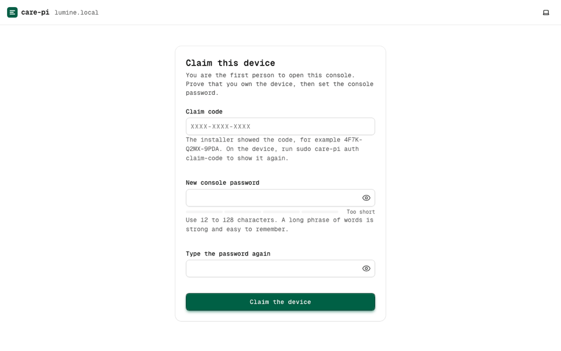

The console shows 8 recovery codes one time. Write them down and keep them away from the device.
A recovery code replaces the password when it is lost (`docs/console-server.md`, section 4).

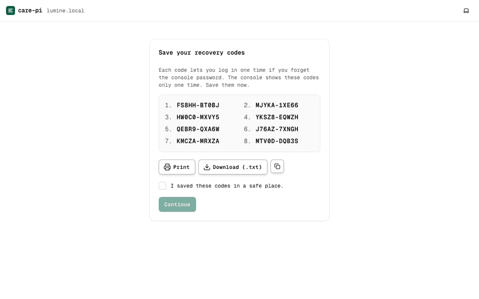

## 3. Run the setup wizard

The wizard asks simple questions and uses good defaults for the rest. **Easy** is enough for a clinic.

1. **Hardware check**: the RAM, the disk, the clock, and the network. Fix each red item before you continue.
2. **Name and address**: the name of the clinic and the address of the device (`care.local`).

   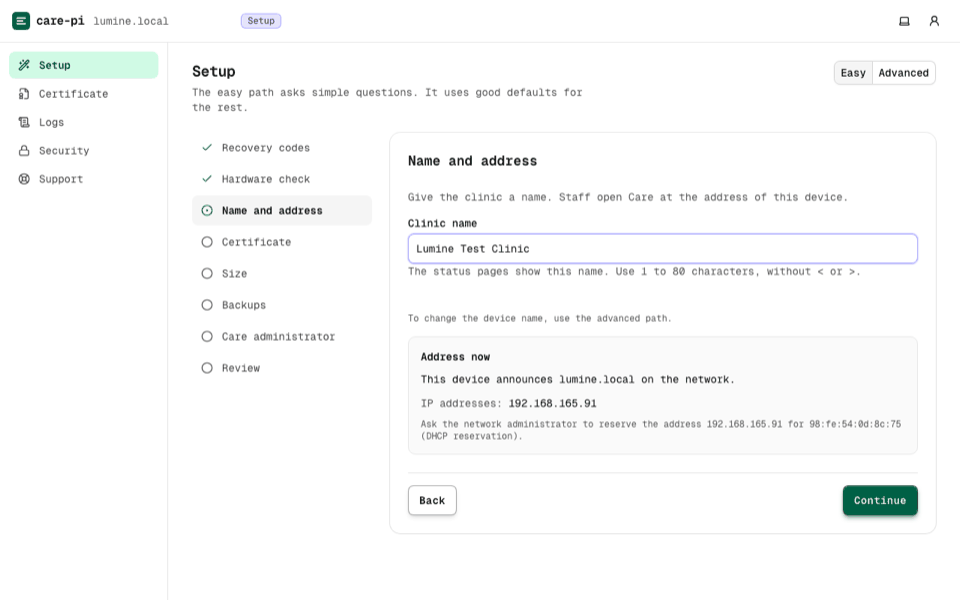

3. **Certificate**: keep **Local certificate (local CA)** for a clinic without internet access from the outside.
   A public name and Tailscale are the other modes (`docs/connectivity.md`).

   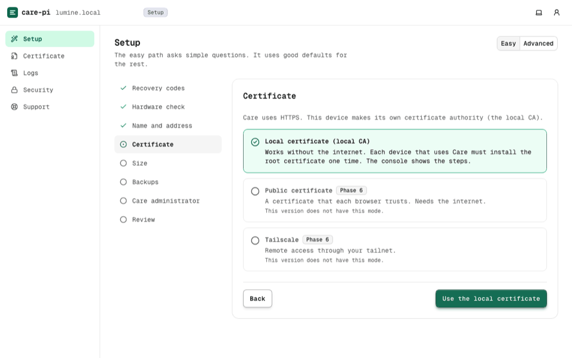

4. **Size**: the preset **small clinic** fits 2 to 4 staff at the same time (`docs/config.md`, `size.preset`).
5. **Backups**: step 5 of this page.
6. **Care administrator**: the user name and password of the first Care user.
7. **Review**, then **Start**.

   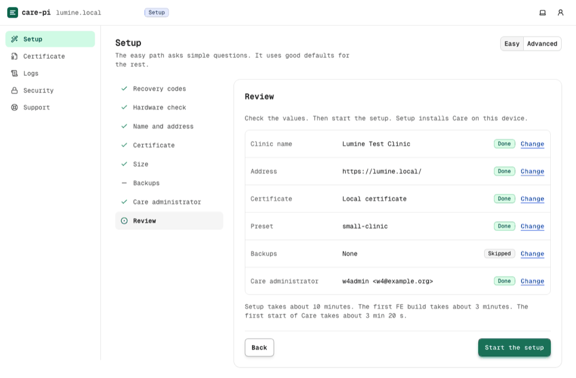

The device pulls the images, starts the database, runs the migrations, and builds the Care frontend.
The page shows each step. Keep the page open; you can also close it and come back.

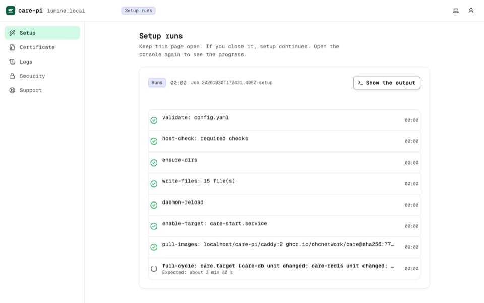

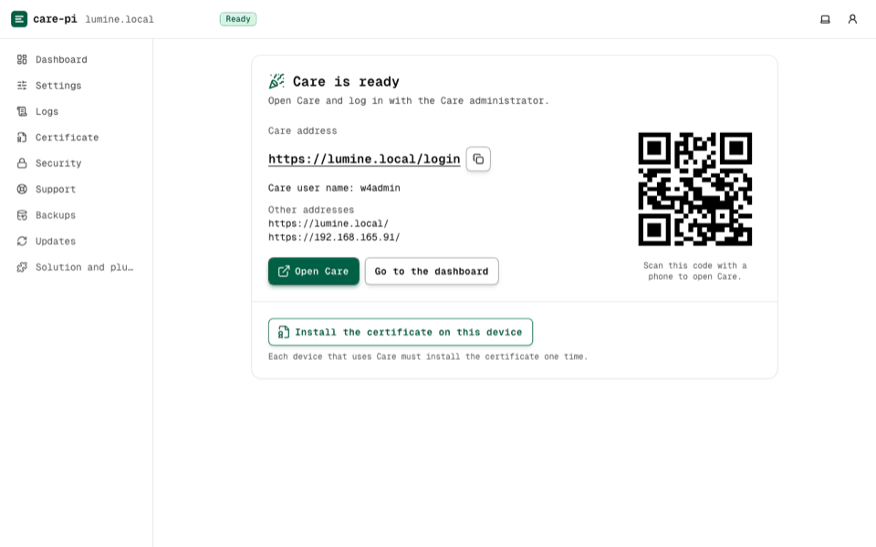

## 4. Install the certificate on each device

Open **Certificate** in the console. It shows the steps for each kind of device (Android, iPhone and iPad, Windows,
macOS, Linux) and a QR code of the download link.
Install the root certificate on each phone, tablet, and computer that uses Care.
After that, `https://care.local/` opens without a warning.

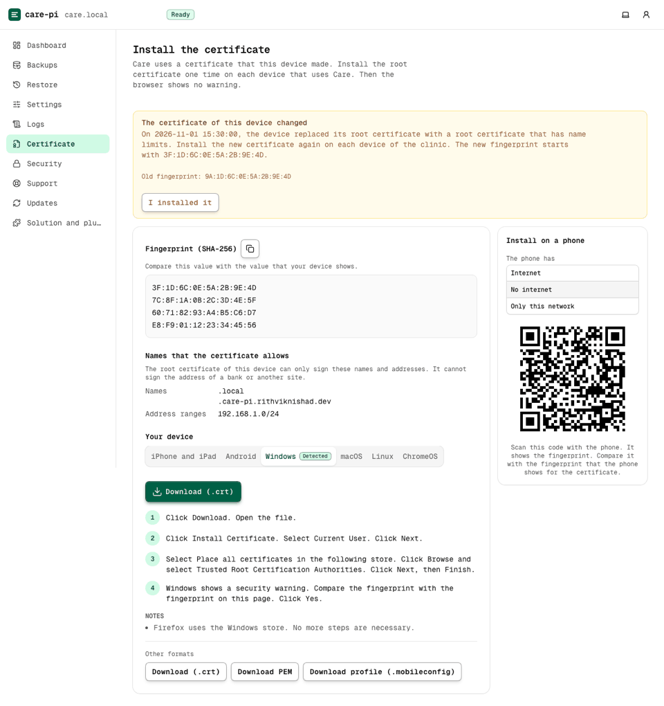

Compare the fingerprint on the page with the fingerprint on the device after the install
(`docs/connectivity.md`, section 2). When the operator rotates the local CA, the page shows the old and the new
fingerprint for 7 days, and each device must install the new certificate.

## 5. Turn on the backups

The wizard (or **Backups** later) makes the **recovery key**: 24 words. Write them on paper. The console asks for three
of them to check. Without the recovery key, nobody can read the backups, not even after a disk failure.

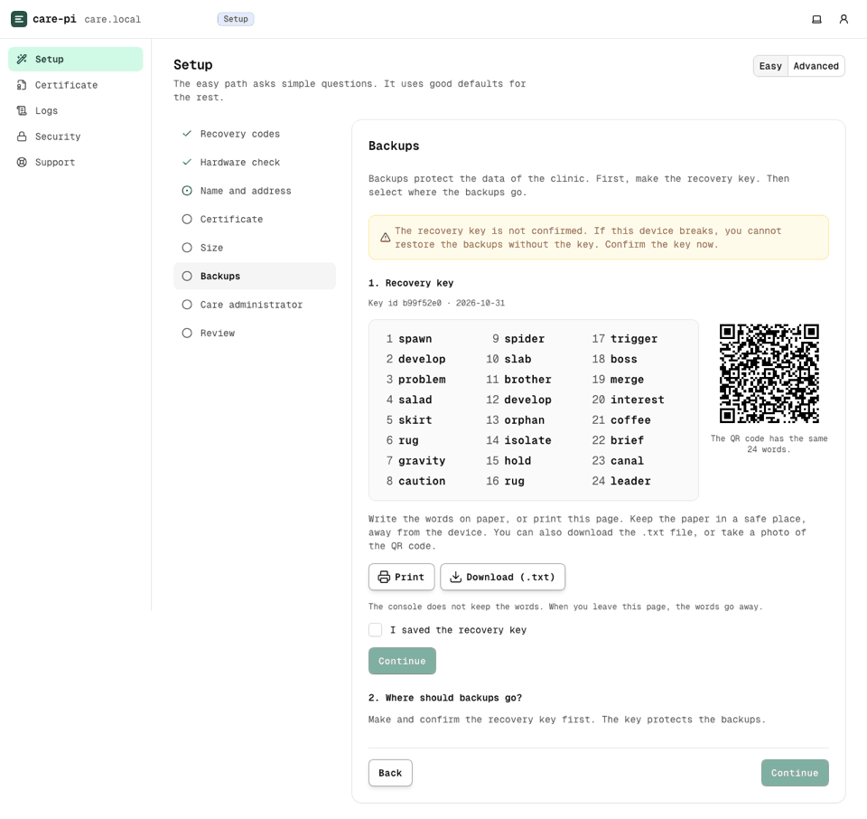

Then add a destination: a USB disk (the console formats it), an SFTP server, or an S3 bucket.
The device backs up the database continuously (point-in-time recovery) and the files every night.
The **Backups** page shows the last snapshot of each destination and warns when a backup is late.

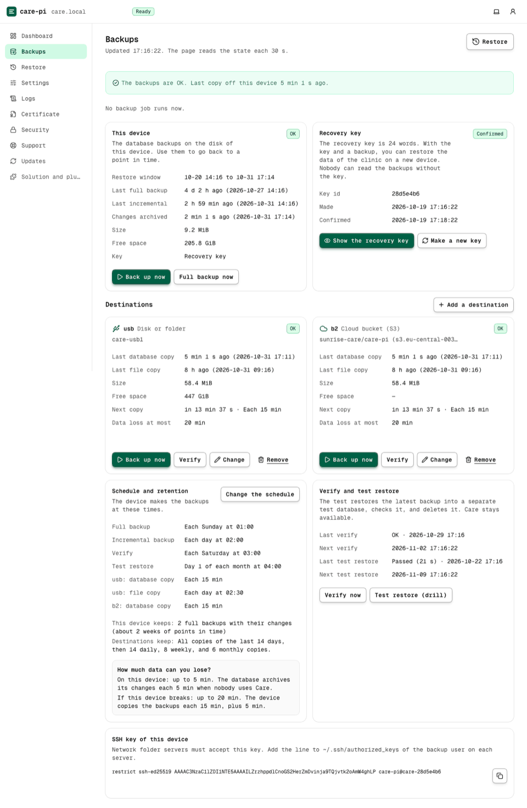

Test a restore once: the restore drill of the **Backups** page restores the latest backup into a test folder, starts a
test database, and checks it (`docs/backups.md`, "The restore drill").

## 6. Keep it up to date

**Updates** shows the release of the solution that the device runs and the next one.
The device checks every day. The operator chooses the update window and whether updates apply automatically.
Before the migrations of an update, the device makes a backup checkpoint. A failed update rolls back to the previous
release, and the page offers a point-in-time restore when the database changed (`docs/solutions.md`, section 8).

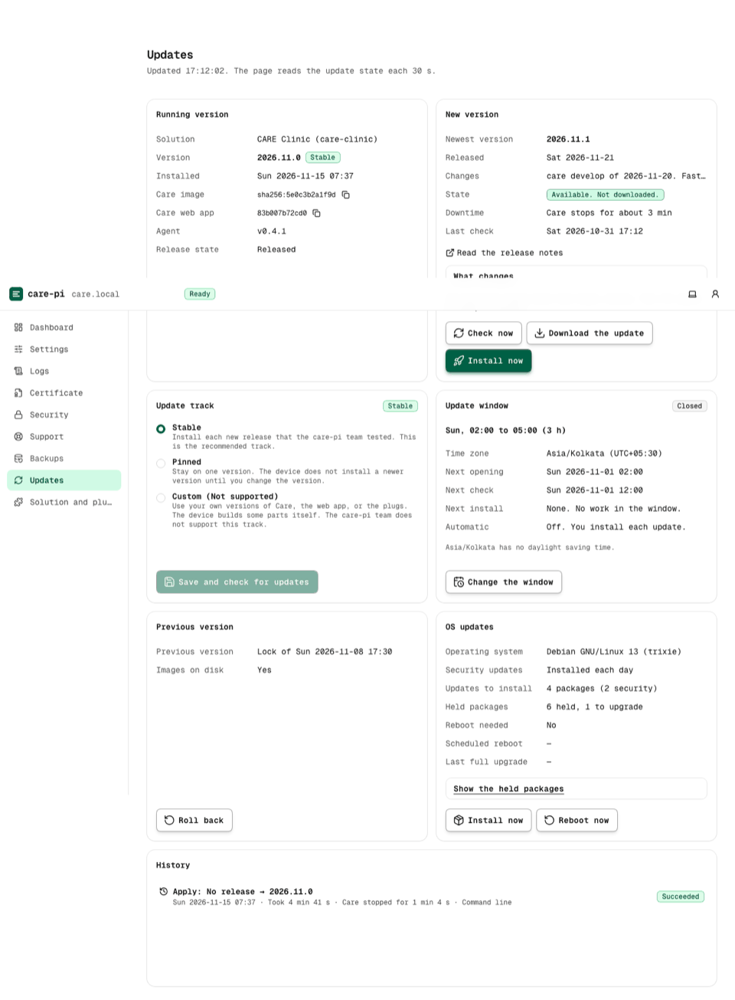

The operating system installs its security updates by itself (unattended-upgrades). With `updates.os_reboot`, the
device reboots in the update window when an update needs it.

## 7. Daily use

The **Dashboard** shows the state of Care, the backups, the certificate, and the updates.

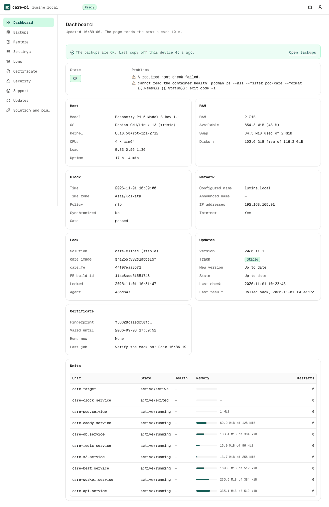

When something is wrong, open **Support > Health checks** or run `sudo care-pi doctor` over SSH
([Troubleshooting](troubleshooting.md)).
