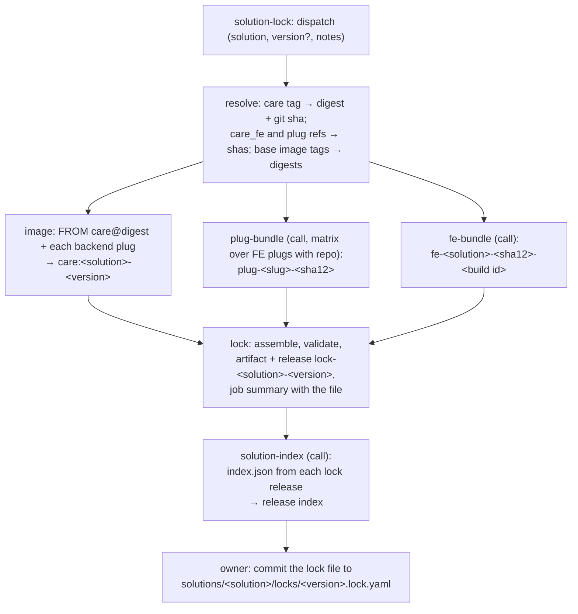
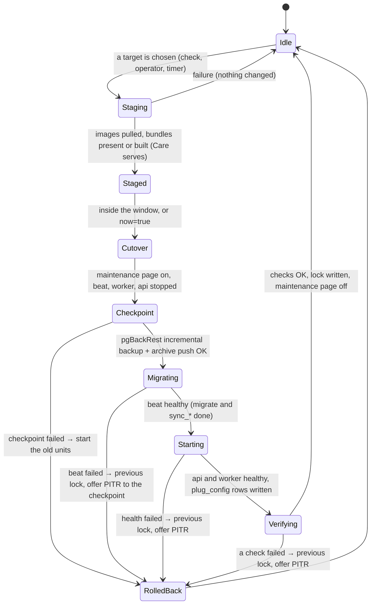

# Solutions, locks, and updates (Phase 4)

This document is the specification of Phase 4: the solution format, the solution lock, `index.json`,
the CI pipeline that makes them, the on-device lock, the tracks, the update steps, rollback, the update
window, OS updates, and plugs. Two implementations follow it: the agent and CI (Go, workflows), and the
console (React). The HTTP contract is `docs/api/openapi.yaml`; its design note is `docs/api/README.md`,
section 14. When this document and the code disagree, this document wins. Change the document first.

Sources: `plans/03-solutions-releases-updates.md` (the plan), `plans/00-decisions.md` (S9, S10, S11, S24,
S30, S32, S33, S38, S43, P15, P16, P17, P20), `plans/01-architecture.md` §9 and §10.

Terms:

| Term | Meaning |
|---|---|
| solution | One directory `solutions/<name>/` with `solution.yaml`: a curated plug set, env defaults, and default refs (S11). |
| solution lock | One released set of immutable identities for a solution: `solutions/<name>/locks/<YYYY.MM.N>.lock.yaml` (P20). Section 3. |
| `index.json` | The list of solutions and their locks that devices poll. Section 4. |
| on-device lock | `/etc/care-pi/lock.yaml`: what runs on this device now. Section 6. |
| ref | Anything that git or OCI can name: a branch, a tag, a sha, or a digest. |
| tracked, pinned | A branch or tag is tracked: the agent resolves it again at each check. A sha or digest is pinned (S33). |
| track | `stable`, `pinned`, or `custom` (`solution.track`). Section 7. |
| artefact | A file or image that CI makes: a lock, a bundle, an image, `index.json`. |
| dist base | The base URL of the artefact files. Section 2.2. |
| window | The time when an automatic update can stop Care (`updates.window`). Section 10. |
| cutover | The short part of an update with the maintenance page: stop, checkpoint, migrate, start. Section 8. |
| checkpoint | The checkpoint of Phase 3 (`docs/api/README.md` section 13.11): an incremental pgBackRest backup just before the migrations. Section 8.4. |

## 1. The solution format

### 1.1 The file

`solutions/<name>/solution.yaml`. The schema is `solutions/schema/solution.schema.json` (JSON Schema 2020-12).
`solutions/README.md` describes each field of Phase 1. `solutions/care-clinic/solution.yaml` is the only solution (S32).
`care-pi solution validate FILE` checks a file against the schema and checks the rule that the schema cannot
express: each plug id occurs one time.

### 1.2 Phase 4 additions

Each addition is optional. A Phase 1 file stays valid.

| Field | Type | Meaning |
|---|---|---|
| `min_agent_version` | `vX.Y.Z` | The oldest agent that can install a lock of this solution. CI copies it into each lock. Without it, CI uses the version of the agent that it builds. |
| `plugs[].frontend.entry` | path, default `assets/remoteEntry.js` | The path of the module federation entry in the built bundle. |
| `plugs[].frontend.build.script` | npm script, default `build` | The script that builds the bundle. |
| `plugs[].frontend.build.out` | path, default `dist` | The output directory of the build. |
| `plugs[].settings[].min`, `.max` | number | The limits of a field of type `number`. |
| `plugs[].settings[].pattern` | ECMA-262 regular expression | A value of type `string`, `url`, or `secret`, or each line of a `list`, must match it. |
| `plugs[].settings[].advanced` | boolean, default `false` | The console shows the field only in the advanced part of the form. |

New rule: a setting of type `secret` must have `part: backend`. Care serves `plug_config` rows without
authentication (`GET /api/v1/plug_config/` has no permission check), so a frontend value is public.

Changed meanings (descriptions in the schema):

- `plugs[].enabled` is the default state only. CI installs the backend part of each plug of the solution
  into the solution image, on or off (section 1.5).
- `plugs[].auto` plugs are in the solution image too. The agent needs no local build to enable one.
- `plugs[].frontend`: with `repo`, CI builds the bundle and the device serves it. `url` alone is an external
  bundle that the browser loads from that URL. With `repo` and `url`, `url` only records where upstream
  publishes the plug.

The solution has no `version` field. The version of a solution is the version of its lock.

### 1.3 When a plug is on

The agent decides each plug in this order. The first rule that gives a value wins.

1. Track `custom`: `solution.custom.plugs[].enabled` for this plug id.
2. `solution.plugs.<id>.enabled` when it is `true` or `false` (the operator choice; supported on each track).
3. `auto: when_multihost`: on when Caddy serves more than one host name. IP addresses do not count.
4. `enabled` of the plug in the solution of the lock.

The source of the value is the plug `source` in the API: `custom`, `operator`, `auto`, or `solution`.
A plug that is on and has a required setting without a value is an error (`plug-settings-invalid`).

### 1.4 Plug settings: where each value goes

`plugs[].settings` is the form of the plug. The console builds the form from it (`docs/api/README.md` §14.6).

`advanced` is not a JSON Schema keyword. The console reads it from `Plug.settings[].advanced` of `GET /plugs`, not from
`GET /plugs/{plug_id}/settings-schema`. (That schema copies it as the annotation `x-advanced`, which a validator ignores.
Do not depend on it.) The same applies to `placeholder` (`x-placeholder`).

| Part | Value source | Destination | When it changes |
|---|---|---|---|
| `backend`, not `secret` | `solution.plugs.<id>.settings.backend.<KEY>`, else `default`, else `backend.configs.<KEY>` | `configs.<KEY>` of the `ADDITIONAL_PLUGS` entry | api, worker, and beat restart |
| `backend`, `secret` | `/etc/care-pi/secrets/plug-<id>.json` (root 0600) | the same | the same |
| `frontend` | `solution.plugs.<id>.settings.frontend.<PATH>`, else `default`, else the value at `<PATH>` in `frontend.meta` | `meta` of the `plug_config` row, at the dotted path `<PATH>` | the row only; no restart |

`ADDITIONAL_PLUGS` can contain a secret from Phase 4. Thus it reaches the containers as the podman secret
`care-additional-plugs` (`type=env`, `target=ADDITIONAL_PLUGS`), not in `backend.env`.
`/etc/care-pi/rendered/care/additional-plugs.json` holds the same JSON with each secret value replaced by
`"<secret>"`, for support. The rule of Phase 1 stays: a rendered file never contains a secret.

### 1.5 The superset rules

A plug switch must not need a build on a Pi. Two rules give this:

1. **Image.** The solution image installs the backend part of **each** plug of the solution, on or off, at the
   locked sha (`solution_image.installed_plugs`). Upstream reads `ADDITIONAL_PLUGS` at build time to install
   packages (`install_plugins.py`) and at run time to fill `INSTALLED_APPS` (`plugs/manager.py`,
   `config/settings/base.py`). An installed package that is not in `INSTALLED_APPS` has no effect.
   `images/care/Containerfile` gets two build arguments: `INSTALL_PLUGS` (the superset, for `install_plugins.py`)
   and `ADDITIONAL_PLUGS` (the default on-set, for the `ENV` of the image). The device always sets
   `ADDITIONAL_PLUGS` at run time.
2. **FE build.** The frontend env of the default bundle has `REACT_MFE_REGISTERED_COMPONENTS` with the
   components of **each** plug of the solution, on or off. A registered component that no plug overrides
   shows its default. The other keys of `plugs[].env.frontend` count only when the plug is on.
   Thus a plug switch does not change the FE build id. `care-pi fe env` and the build id of `docs/fe.md` follow this rule from Phase 4.

A plug that is not in the solution (track `custom`) or a backend plug with an operator ref needs a local image
build (section 13).

## 2. Artefacts, names, and URLs

### 2.1 What CI publishes

| Artefact | Name | Where | Made by |
|---|---|---|---|
| Solution lock | `<solution>-<version>.lock.yaml` and `.sha256` | release `lock-<solution>-<version>`; the owner commits the same file to git: `solutions/<solution>/locks/<version>.lock.yaml` (section 5.2) | `solution-lock.yml` |
| Index | `index.json` and `index.json.sha256` | release `index` (one release; CI replaces the assets) | `solution-index.yml` (called by `solution-lock.yml`) |
| Default FE bundle | `care_fe-<solution>-<sha12>-<build id>.tar.gz` and `.sha256` | release `fe-<solution>-<sha12>-<build id>` (unchanged, `docs/fe.md`) | `fe-bundle.yml` |
| FE plug bundle | `plug-<slug>-<sha12>.tar.gz` and `.sha256` | release `plug-<slug>-<sha12>` | `plug-bundle.yml` |
| Solution image | `ghcr.io/rithviknishad/care-pi/care:<solution>-<version>` (manifest list, arm64 and amd64) | ghcr (public, S43) | `solution-image.yml` |
| Base images | `ghcr.io/rithviknishad/care-pi/postgres-pgbackrest:<tag>`, `…/caddy:<tag>` | ghcr | `images.yml` (unchanged) |

`<sha12>` is the first 12 hex digits of a git sha. `<build id>` is the FE build id (16 hex digits, `docs/fe.md`).
`<version>` is `YYYY.MM.N` (section 5.3). Each name contains its identity, so a new artefact never replaces an
artefact that a device expects. The tags `<solution>-latest` (image) stay for builds on `main`; no lock uses them.

A plug bundle is a `tar.gz` of the build output. Its root holds `entry` (for example `assets/remoteEntry.js`)
and `care-pi-plug.json` (`slug`, `repo`, `sha`, `entry`, `built_at`). CI builds it with
`--base /plugs/<slug>/<sha12>/`, the path where the device serves it.

### 2.2 The dist base: release assets now, Pages later

GitHub Pages needs a public repository (S38). Until then, each file is a GitHub release asset.
Each artefact URL has the form `<dist base><tag>/<asset>`:

- now: `https://github.com/rithviknishad/care-pi/releases/download/` + `lock-care-clinic-2026.11.0/care-clinic-2026.11.0.lock.yaml`;
- later (Pages): `https://rithviknishad.github.io/care-pi/` + the same `<tag>/<asset>` path.

Rules that make the move a change of one value:

- CI writes each artefact reference in a lock and in `index.json` as a relative reference `<tag>/<asset>`.
- `index.json` has `dist_base`. The agent resolves each relative reference against it.
- The default URL of `index.json` is `<dist base>index/index.json`. `updates.index_url` overrides it.
- Integrity comes from the SHA-256 in the lock and in the index, not from the host.

The repository is private now. A release asset of a private repository gives HTTP 404 without a token,
so `stable` cannot fetch `index.json` until the repository is public (open point 1). The images on ghcr are public (S43).
For a test, set `updates.index_url` to a `file:///` URL or to another host.
A `file:///` index with a `file:///` `dist_base` also updates a device from a USB drive without internet.

## 3. The solution lock

### 3.1 The file

`solutions/<solution>/locks/<version>.lock.yaml` in git, and the asset `<solution>-<version>.lock.yaml` of the
release `lock-<solution>-<version>`. The two files are the same bytes. The schema is
`solutions/schema/lock.schema.json`. A lock never changes after its release. To fix a lock, release a new one
and withdraw the old one (section 5.4).

```yaml
# solutions/care-clinic/locks/2026.11.0.lock.yaml
apiVersion: care-pi/v1
kind: SolutionLock
name: care-clinic
version: "2026.11.0"
created_at: "2026-11-14T10:00:00Z"
created_by: "rithviknishad (workflow solution-lock, run 11650001)"
notes: |
  First lock of CARE Clinic. care develop of 2026-11-13, care_fe develop of 2026-11-13.
min_agent_version: v0.4.0
source:
  commit: 9505cacb7c710ed17125fcc6cb3669e8ddca6c8c
  solution_sha256: c9e9420c990680921a6caf90891119c1267797f3025c68d6cc58a4ac1a53f193
  run_url: https://github.com/rithviknishad/care-pi/actions/runs/11650001
solution:                          # solution.yaml at source.commit, as data (shortened here)
  apiVersion: care-pi/v1
  kind: Solution
  name: care-clinic
  # ... title, description, care, care_fe, plugs (with settings), env, defaults
care:
  image: ghcr.io/ohcnetwork/care
  ref: latest
  digest: sha256:03c0d3dcece83afa3b6105c876cf44bf3bc61d68ceb791d261c5906791f997a9
  git_sha: 456c9ed13b3344caaa3110c6a5263a24a3a8746b
solution_image:
  image: ghcr.io/rithviknishad/care-pi/care
  tag: care-clinic-2026.11.0
  digest: sha256:ca655b51ea069a139ccb070fa1fd1258a3142b661916fdb554b928e5a93d40b5
  installed_plugs: [care_multihost_files_be, care_filly]
care_fe:
  repo: https://github.com/ohcnetwork/care_fe
  ref: develop
  sha: 1f944e82caeee09d9cbfe55f299b7414d890033d
fe:
  build_id: c7cb2784c87242c1
  url: fe-care-clinic-1f944e82caee-c7cb2784c87242c1/care_fe-care-clinic-1f944e82caee-c7cb2784c87242c1.tar.gz
  sha256: e5e6cd2910acdba3c12c06f33c81d41e47c3089224bded2b6f5f9bfe37cd1d72
  size_bytes: 13421772
  env_keys: [REACT_ALLOWED_ENCOUNTER_CLASSES, REACT_ALLOWED_LOCALES, REACT_CARE_API_URL, REACT_MFE_REGISTERED_COMPONENTS]
plugs:
  care_onboarding_fe:
    frontend:
      slug: care_onboarding_fe
      source: built
      ref: main
      sha: 0785ff3b4dc6f0c9fa3abb7ba4f01cc854cff8b6
      url: plug-care_onboarding_fe-0785ff3b4dc6/plug-care_onboarding_fe-0785ff3b4dc6.tar.gz
      sha256: 428151386eaa5c7e2c45193879f0c2244618520b99632a891f752c7dea7aa74c
      entry: assets/remoteEntry.js
      size_bytes: 2097152
  care_multihost_files_be:
    backend:
      ref: main
      sha: 3edf06b127830e4fbf14823ac69568460eaed291
      additional_plug:
        name: care_multihost_files_be
        package_name: git+https://github.com/ohcnetwork/care_multihost_files_be.git
        version: "@3edf06b127830e4fbf14823ac69568460eaed291"
        configs: {ALLOWED_HOSTS: ["*.local", "*.ts.net", "*.care-pi.rithviknishad.dev"]}
  # ... care_fasterappointments_fe (frontend), care_filly (backend)
images:
  postgres: {ref: "ghcr.io/rithviknishad/care-pi/postgres-pgbackrest:17", digest: "sha256:d80dc0a2…"}
  caddy:    {ref: "ghcr.io/rithviknishad/care-pi/caddy:2", digest: "sha256:d6e0ff2b…"}
  redis:    {ref: "docker.io/library/redis:8-alpine", digest: "sha256:34fb46c8…"}
  s3:       {ref: "docker.io/versity/versitygw:latest", digest: "sha256:41242b9f…"}
  node:     {ref: "docker.io/library/node:22-bookworm-slim", digest: "sha256:545ea538…"}
```

The full example is in `solutions/schema/lock.schema.json` (`examples`).

### 3.2 Fields

| Field | Content |
|---|---|
| `apiVersion`, `kind` | `care-pi/v1`, `SolutionLock`. |
| `name`, `version` | The solution and the calendar version. |
| `created_at`, `created_by` | The time and the person or workflow run. |
| `notes` | Release notes (Markdown). The release page shows the same text. `changelog_url` of the index points at that page. |
| `min_agent_version` | An older agent refuses the lock (`agent-too-old`). |
| `source` | The care-pi commit, the SHA-256 of `solution.yaml` at that commit, and the CI run. |
| `solution` | `solution.yaml` at `source.commit`, as data. The agent reads the plugs, labels, settings forms, env, and defaults of a lock from here. A lock that is newer than the agent thus shows the correct forms. |
| `care` | The upstream image, the ref, the digest, and the git sha (label `org.opencontainers.image.revision`, `null` when absent). |
| `solution_image` | The image that api, worker, and beat run. `installed_plugs`: each plug with a backend part (section 1.5). |
| `care_fe` | The repo, the ref, and the resolved sha. |
| `fe` | The default FE bundle: build id, URL, SHA-256, size, and the names of the env keys. |
| `plugs.<id>.backend` | The ref, the sha, and the `ADDITIONAL_PLUGS` entry with the default `configs` (`version: "@<sha>"`). |
| `plugs.<id>.frontend` | `source: built`: the bundle URL, SHA-256, entry, and size. `source: external`: the absolute URL of `remoteEntry.js`; `sha`, `sha256`, `entry`, and `size_bytes` are `null`. |
| `images` | `postgres`, `caddy`, `redis`, `s3`, `node`: the ref and the digest. |

Each plug of `solution.plugs` has an entry in `plugs`, on or off. The settings form of a plug is
`solution.plugs[].settings` of the lock.

### 3.3 Rules

- Every identity in a lock is immutable: a digest, a 40-digit sha, or a SHA-256. An external FE plug is the only exception, and the console marks it "not pinned".
- The agent downloads a lock only through `index.json` (or from its embedded copy, or a `--lock-file` on the CLI).
  The SHA-256 of the file must equal `sha256` of the index entry. `name` and `version` must equal the entry.
  The file must pass `lock.schema.json`. Else the problem is `artefact-invalid`.
- No signature (S24). Phase 7 can add one (`06` Phase 7).

## 4. `index.json`

### 4.1 Example

```json
{
  "apiVersion": "care-pi/v1",
  "kind": "Index",
  "generated_at": "2026-11-21T09:00:00Z",
  "dist_base": "https://github.com/rithviknishad/care-pi/releases/download/",
  "agent": {"latest": "v0.4.1", "release_url": "https://github.com/rithviknishad/care-pi/releases/tag/v0.4.1"},
  "solutions": [
    {
      "name": "care-clinic",
      "title": "CARE Clinic",
      "description": "Outpatient clinic. Appointments, encounters, prescriptions, and invoices.",
      "latest": "2026.11.1",
      "locks": [
        {
          "version": "2026.11.1",
          "url": "lock-care-clinic-2026.11.1/care-clinic-2026.11.1.lock.yaml",
          "sha256": "da007b85a27bdadce321def754cce1984b7af1a00927e026357ce1dd3b6efc5b",
          "released_at": "2026-11-21T08:55:00Z",
          "min_agent_version": "v0.4.0",
          "changelog_url": "https://github.com/rithviknishad/care-pi/releases/tag/lock-care-clinic-2026.11.1",
          "summary": "care develop of 2026-11-20. Faster appointments plug 2026-11-18.",
          "withdrawn": false,
          "withdrawn_reason": null
        }
      ]
    }
  ],
  "os": {"held_packages": {"trixie": {"podman": "5.4.2+ds1-2", "crun": "1.21-1", "netavark": "1.14.1-1",
    "aardvark-dns": "1.14.0-3", "conmon": "2.1.12-4", "skopeo": "1.18.0+ds1-1"}}}
}
```

The schema is `solutions/schema/index.schema.json`. Its `examples` has the full example.

### 4.2 Fields and rules

| Field | Content |
|---|---|
| `dist_base` | Section 2.2. It ends with `/`. |
| `agent` | The newest agent release. Information only: Phase 4 does not update the agent binary (open point 4). |
| `solutions[].latest` | The newest lock that is not withdrawn. `null` when no such lock exists. |
| `solutions[].locks[]` | Each released lock, newest first, also the withdrawn locks. |
| `locks[].min_agent_version` | Copied from the lock, so the agent can refuse a lock without a download. |
| `locks[].summary` | One line for the console. `changelog_url` is the release page. |
| `locks[].withdrawn`, `withdrawn_reason` | Section 5.4. |
| `os.held_packages.<codename>.<package>` | The tested Debian version of each held container package (installer `HOLD_PACKAGES`: `podman crun netavark aardvark-dns conmon skopeo`). Section 11. |

### 4.3 How the agent fetches it

- URL: `updates.index_url`, else the default of the agent release (`<dist base>index/index.json`).
- `GET` with `If-None-Match` and `If-Modified-Since` of the cached copy. Redirects: yes (GitHub release assets redirect).
  Time limit: 30 s. Size limit: 1 MiB. `User-Agent: care-pi/<version>`.
- The agent validates the file against `index.schema.json` and keeps it in `/var/lib/care-pi/state/update-cache/index.json`.
- Failure (network, HTTP status, schema): the problem `index-unavailable`. The agent keeps the cached copy and uses it.
- Each lock that the agent downloads is cached in `state/update-cache/locks/<solution>-<version>.lock.yaml`.
- The versions of `GET /updates` (`latest`, `available`) are the locks of the index. Without an index (or without the
  solution in it), they are the cached and the embedded locks. The cache also holds the lock of a `--lock-file`;
  with an index, it is not a release.

## 5. The CI pipeline

### 5.1 Workflows

| Workflow | Triggers | What it does |
|---|---|---|
| `solution-lock.yml` (new) | `workflow_dispatch` (inputs `solution`, `version` (empty: the next version of the month), `notes`) | Jobs `resolve` (care tag → digest and git sha with `skopeo inspect` and the label `org.opencontainers.image.revision`; care_fe and plug refs → shas with `gh api`; base image tags → digests), `image` (the solution image), `fe` (calls `fe-bundle.yml`), `plugs` (calls `plug-bundle.yml`, a matrix over the FE plugs with `repo`), `lock` (`care-pi solution lock --input`, validate, workflow artifact, **published** release `lock-<solution>-<version>`, job summary with the lock file), `index` (calls `solution-index.yml`). |
| `solution-image.yml` (changed) | `workflow_dispatch`; push to `main` | `install-plugs.json` in the build context has each backend plug of the solution (the superset rule). Push builds keep `<solution>-latest` and `0.0.0-dev`. `solution-lock.yml` builds the versioned image itself with the same Containerfile. |
| `plug-bundle.yml` (new) | `workflow_call` (inputs `slug`, `repo`, `sha`, `entry`, `script`, `out`); `workflow_dispatch` | Skip when the release `plug-<slug>-<sha12>` exists (the name is the identity). Else check out the plug at the sha, Node 22, `npm ci`, `npm run <script> -- --base /plugs/<slug>/<sha12>/`, check that `<out>/<entry>` exists, add `care-pi-plug.json`, pack, write the `.sha256`, create the release. Output: URL, SHA-256, size. |
| `fe-bundle.yml` (changed) | `workflow_call` (new; inputs `solution`, `care_fe_sha`); `workflow_dispatch`; push to `main` | Unchanged recipe and names. `care-pi fe env` applies the superset rule of section 1.5. Output: build id, URL, SHA-256, size, env keys. |
| `solution-index.yml` (new) | `workflow_call`; `workflow_dispatch`; push to `main` that changes `solutions/*/locks/withdrawn.yaml` | Download the lock of each release `lock-*`, read `solutions/*/locks/withdrawn.yaml`, write `index.json` with `care-pi solution index`, validate it, write its `.sha256`, and upload both to the release `index` (`gh release upload --clobber`; create the release on the first run). |
| `images.yml` | unchanged | Base images. |

The release `index` and the releases `lock-*`, `fe-*`, and `plug-*` use `--latest=false`, so the "latest release"
of the repository stays the agent release.

### 5.2 The release flow

Phase 4 (wave 6a) uses a short flow. CI publishes the lock at once. CI does not open a pull request and does not
push to `main`. The owner commits the lock file.



- The dispatch is the human approval. Test a candidate before the dispatch on a test Pi with a local lock:
  `make lock-local SOLUTION=care-clinic VERSION=…` (`solutions/scripts/make-lock.sh`) and
  `care-pi update apply --lock-file FILE --now`.
  Nobody pushes an update to a device (S24): a device installs a lock only on its track, inside its window, or by an operator action.
- The images and the bundles are content-addressed, so a new artefact cannot change a device. A `stable` device sees
  the new lock at its next check, because the index lists it at once.
- The owner commits each lock to `solutions/<solution>/locks/`. The agent embeds the locks of that directory
  (`solutions/embed.go`), and the Pi image (Phase 5) embeds them too (`03` §2). A lock that is not committed works
  from the index only.
- Planned later (not in wave 6a): a draft release and a pull request with the lock, and a weekly scheduled candidate.

### 5.3 Version numbers

`YYYY.MM.N`: `YYYY.MM` is the UTC month of the release, with two digits for the month. `N` is 0 for the first lock
of the month and increases by 1. The workflow takes the highest `N` of that month from `solutions/<solution>/locks/`
on `main` and from the releases `lock-<solution>-*`, and adds 1. The agent compares versions as three numbers, so `2026.1.0`
in `config.yaml` (`solution.pin`) equals `2026.01.0`.

### 5.4 Withdraw a lock

`solutions/<solution>/locks/withdrawn.yaml` is a map from version to reason:

```yaml
"2026.11.1": The migration of care_filly fails on databases from 2025. Use 2026.11.2.
```

A push to `main` that changes this file runs `solution-index.yml`. The index then has `withdrawn: true` and the reason.
The lock and its release stay. Effects on a device: the `stable` track skips the lock; the console shows the reason
when the device runs it; the agent never downgrades by itself (section 7.4).

## 6. The on-device lock (`/etc/care-pi/lock.yaml`, version 2)

### 6.1 Example

```yaml
# Generated by care-pi. Do not edit. Resolved digests, shas, and build ids.
version: 2
generated_at: "2026-11-22T02:07:41Z"
agent_version: v0.4.1
solution:
  name: care-clinic
  version: "2026.11.1"          # null: no solution lock (Phase 1 behaviour, or a custom track without a base)
  track: stable
  source: lock                  # lock | solution-refs | custom
  lock_sha256: da007b85a27bdadce321def754cce1984b7af1a00927e026357ce1dd3b6efc5b
components:
  care:
    image: ghcr.io/ohcnetwork/care
    ref: latest
    digest: sha256:a626f7197cb8b77c940893a599ce00c723cac7a758d6d3fab0134b12e6de0a9f
    git_sha: 456c9ed13b3344caaa3110c6a5263a24a3a8746b
    tracked: true
    source: lock                # lock | operator | solution
    build: null                 # a local build: {id, base_digest, installed_plugs, containerfile_sha256}
  care_fe:
    repo: https://github.com/ohcnetwork/care_fe
    ref: develop
    sha: e4d292b313571fdb6916395fd8cebc655dcf24f7
    tracked: true
    source: lock
  plugs:
    care_onboarding_fe:
      enabled: true
      reason: solution          # solution | auto | operator | custom (section 1.3)
      frontend:
        slug: care_onboarding_fe
        source: built           # built | external | local-build
        ref: main
        sha: 0785ff3b4dc6f0c9fa3abb7ba4f01cc854cff8b6
        tracked: true
        url: https://github.com/rithviknishad/care-pi/releases/download/plug-care_onboarding_fe-0785ff3b4dc6/plug-care_onboarding_fe-0785ff3b4dc6.tar.gz
        sha256: 428151386eaa5c7e2c45193879f0c2244618520b99632a891f752c7dea7aa74c
        meta_url: https://care.local/plugs/care_onboarding_fe/0785ff3b4dc6/assets/remoteEntry.js
    care_multihost_files_be:
      enabled: false
      reason: auto
      backend:
        name: care_multihost_files_be
        ref: main
        sha: 3edf06b127830e4fbf14823ac69568460eaed291
        tracked: true
        installed: true         # installed in images.care
images:                         # Phase 1 shape: ref, digest, pinned, local
  care: {ref: "ghcr.io/rithviknishad/care-pi/care:care-clinic-2026.11.1", digest: "sha256:7a7433792e7dde7145bd348ff07ec8507754350b53a5c11191069d9b4cf767f3"}
  postgres: {ref: "ghcr.io/rithviknishad/care-pi/postgres-pgbackrest:17", digest: "sha256:d80dc0a2…"}
  # caddy, redis, s3, node
fe:                             # Phase 1 shape (docs/fe.md)
  provider: artifact
  build_id: 4948ab3b7260deca
  care_fe_sha: e4d292b313571fdb6916395fd8cebc655dcf24f7
  url: https://github.com/rithviknishad/care-pi/releases/download/fe-care-clinic-e4d292b31357-4948ab3b7260deca/care_fe-care-clinic-e4d292b31357-4948ab3b7260deca.tar.gz
  sha256: 9d0a…
history:
  dir: /var/lib/care-pi/state/locks
  previous: 20261115T020512Z.yaml   # the file of the lock before this one; null for the first lock
```

### 6.2 Fields

| Field | Content |
|---|---|
| `version` | `2`. |
| `solution.version` | The solution lock that the device installed. `null` when no solution lock applies. |
| `solution.source` | `lock`: the components come from a solution lock. `solution-refs`: the agent resolved the refs of `solution.yaml` (Phase 1 behaviour, no lock published). `custom`: track `custom`. |
| `solution.lock_sha256` | The SHA-256 of the solution lock file. `null` without one. |
| `components.care` | The upstream image and its identity. `build` describes a local image build (section 13.1). |
| `components.care_fe` | The care_fe identity. |
| `components.plugs.<id>` | Each plug of the effective plug set, on or off: `enabled`, `reason`, and the resolved parts. `backend.installed` tells that `images.care` contains the package. `frontend.url` is the bundle that the agent downloaded; `meta_url` is the URL in the `plug_config` row. |
| `tracked` | The ref is a branch or a tag. The `custom` track resolves a tracked operator ref again at each check. |
| `source` | `lock`: from the solution lock. `operator`: an override of `solution.custom`. `solution`: from `solution.yaml` without a lock. |
| `images` | Each image that a unit runs (Phase 1 shape). `images.care` is the solution image, or `localhost/care-pi/care:<build id>` with `local: true`. |
| `fe` | Unchanged from Phase 1. |
| `history.previous` | The file in `state/locks/` of the lock before this one. Rollback uses it (section 9). |

### 6.3 Migration from version 1

The agent reads version 1 and version 2. It writes only version 2. It never rewrites a file in `state/locks/`.

| Version 1 | Version 2 |
|---|---|
| (none) | `version: 2` |
| `solution.{name,track}` | the same; `version: null`; `source: solution-refs` (track `stable`) or `custom`; `lock_sha256: null` |
| `images.care` | `images.care` (unchanged); `components.care`: `image` and `ref` from the reference, `digest`, `git_sha: null`, `tracked: !pinned`, `source: solution` |
| `git.care_fe` | `components.care_fe`: `repo`, `ref`, `sha`, `tracked: !pinned`, `source: solution` |
| `plugs.<id>` (each backend plug that was on) | `components.plugs.<id>`: `enabled: true`, `reason: solution`, `backend: {ref, sha, tracked: !pinned, installed: true}` |
| `fe` | `fe` (unchanged) |
| (none) | `history.previous`: the newest file in `state/locks/`, or `null` |

A rollback to a version 1 file migrates it in memory first.

### 6.4 State files

| Path | Content |
|---|---|
| `/var/lib/care-pi/state/locks/<UTC time>.yaml` | The previous locks (Phase 1 already keeps them). The name has the form `20261115T020512Z.yaml`; the API calls the name without `.yaml` a lock id. The agent keeps the last 20 files and each file that a history entry references. |
| `/var/lib/care-pi/state/update-history.jsonl` | One `UpdateHistoryEntry` (API schema) for each lock change of an update, rollback, or plug change, and for each OS update. The last 200 lines. |
| `/var/lib/care-pi/state/updates.json` | The state of the update machine: the last check, the target, the staging, the scheduled reboot, and the phase of a running cutover (section 8.6). |
| `/var/lib/care-pi/state/update-cache/` | `index.json` and the downloaded solution locks. |
| `/var/lib/care-pi/state/staging/<target id>/` | The rendered tree of a staged target, and `previous/`, the tree before a cutover. |
| `/var/lib/care-pi/state/plug-config.json` | The slugs of the `plug_config` rows that the agent manages, with the SHA-256 of their `meta`. |
| `/var/lib/care-pi/state/mode/maintenance` and `maintenance.json` | The flag file of Caddy (Phase 1) and `{job_id, kind, started_at}`. |
| `/var/lib/care-pi/state/images.json` | Each image reference that the agent pulled or built, with the time. `prune-images` reads it (section 8.7). |

## 7. Tracks and resolution

### 7.1 `stable`

1. Fetch `index.json` (section 4.3).
2. Take the entry of `solution.name`. The target is `latest`.
3. The update is available when the target is newer than `solution.version` of the on-device lock, or when the
   on-device lock has no version.
4. When `min_agent_version` of the target is newer than the agent, the update is blocked (`agent-too-old`).
5. The agent applies the operator choices (`solution.plugs`, `env`, `fe`, `size`) on top of the lock. They do not change the track.

When the index has no lock for the solution, and the agent has no embedded lock, `stable` keeps the Phase 1
behaviour: the agent resolves the refs of the embedded `solution.yaml` (`solution.source: solution-refs`).

### 7.2 `pinned`

The target is `solution.pin`. The agent finds the lock in the cache, in the embedded locks, or in the index.
Without it: `lock-not-found`. The device stays on the pin. `GET /updates` still shows the newer locks
(`available`) and `update_available: false`. `POST /updates/apply` with a `version` writes `solution.pin` and installs that lock.

### 7.3 `custom`

The base is the lock `solution.pin`, or `latest` when `pin` is `null`. The overrides of `solution.custom`
(`care_ref`, `care_fe_ref`, `plugs`) replace components of the base. The agent resolves each override itself:
`skopeo inspect` for an image tag, `git ls-remote` over HTTPS for a branch or tag (Phase 1 resolvers).
A tracked override resolves again at each check. The target id is the first 16 hex digits of the SHA-256 of the
`components` of the target lock. The update is available when the target id differs from the running one.

What the agent builds itself (section 13):

| Component | CI artefact | Else |
|---|---|---|
| care image with a plug set that the solution image does not have (another care digest, a plug not in `installed_plugs`, or another sha) | none | local `.build` |
| FE plug with an operator ref | `plug-<slug>-<sha12>` when CI built that sha (`HEAD` request) | local plug build |
| care_fe with an operator ref | `fe-<solution>-<sha12>-<build id>` when it exists | the `fe.provider` (`local`, or `fe.artifact_url`) |

A build that needs the network on a device without internet gives `build-required-offline`. The console marks
the `custom` track "unsupported" (`03` §3.2).

### 7.4 General rules

- **Never down.** An automatic update never installs a lock that is older than the running lock. A withdrawn
  running lock gives a banner with the reason; the operator can roll back or pin.
- **`agent-too-old`.** The agent compares `vX.Y.Z` as numbers. A dev build (`v0.4.0-12-gabcdef-dirty`) compares
  its last tag (`v0.4.0`). A build without a tag passes, with a warning in the job log.
  The fix: install a newer agent (run the installer again). Phase 4 does not replace the agent binary.
- **Offline.** Without the index, the agent uses its cache and its embedded locks. A check fails with
  `index-unavailable`, and the device keeps running. The update window does nothing without a target.
- **The plan.** The target is a new on-device lock. The agent renders the target and compares it with the running state,
  as `apply` does. The kind of the largest change selects the path (section 12.1).

### 7.5 `care-pi apply --update` in Phase 4

On `stable` and `pinned`, the locks are pinned. `apply --update` resolves nothing. Use `care-pi update`.
On `custom`, `apply --update` resolves the tracked overrides again, as in Phase 1.
An apply whose plan changes the care image or the set of backend plugs that are on runs the cutover of section 8
(plan action `cutover`), because migrations can run.

## 8. Update orchestration

### 8.1 States and job steps



Each state maps to job steps (`JobStep.action`). The jobs are `update-check`, `update-stage`, `update-apply`, `update-rollback`.

| State | Step `action` | What the step does | Care | On failure |
|---|---|---|---|---|
| check | `fetch-index` | Section 4.3. | up | job fails (`index-unavailable`); nothing changes |
| check, stage | `fetch-lock` | Download the target lock; check the SHA-256, the schema, `min_agent_version`. | up | `artefact-invalid`, `agent-too-old`, `lock-not-found` |
| check | `resolve-refs` | `custom` only: resolve the tracked overrides. | up | job fails |
| Staging | `plan` | Make the target on-device lock and the plan. | up | job fails |
| Staging | `stage-pull` | `podman pull` each new image in a transient unit (`systemd-run`), by digest. | up | → Idle |
| Staging | `stage-bundles` | Download the FE bundle and the FE plug bundles; check each SHA-256; extract to `fe/<build id>/` and `plugs/<slug>/<sha12>/`. | up | → Idle |
| Staging | `stage-build` | Local builds (section 13). Scale-down rule of `docs/fe.md` for each Node build. | up, 1 worker | → Idle |
| Staging | `render` | Render the target tree into `state/staging/<target id>/`; quadlet `-dryrun`. | up | → Idle |
| Cutover | `cutover-maintenance-on` | Create `state/mode/maintenance` and `maintenance.json`. Caddy shows the maintenance page at `/`. The API routes stay. | page | → `maintenance-off` |
| Cutover | `stop` | Stop `care-api`, `care-worker`, `care-beat`; wait until each unit is `inactive` (SP6). | down | → `rollback` |
| Checkpoint | `checkpoint` | `backup.Checkpoint` (section 8.4). | down | → `rollback`; no PITR offer (the database did not change) |
| Migrating | `activate` | Copy the current tree to `staging/<target id>/previous/`; install the target tree (units, env, podman secrets); `daemon-reload`; point `fe/current` at the target build. Phase 6: a host without the root of the agent gets it first (`ensure-ca`), and a running `care-caddy` restarts. | down | → `rollback` |
| Migrating | `migrate` | Start `care-beat`; wait until it is healthy (it runs `migrate`, `sync_permissions_roles`, `sync_valueset`). Limit 20 min (`update.DefaultMigrateTimeout`). The `log` events are the lines of its journal. | down | → `rollback` + PITR offer |
| Starting | `start` | Start `care-worker` and `care-api`; wait until healthy. | starting | → `rollback` + PITR offer |
| Starting | `plug-config` | Write the `plug_config` rows (section 12.2). | up behind the page | → `rollback` + PITR offer |
| Verifying | `verify` | `/ping/` through Caddy gives 200; `fe/current/index.html` is the target build; `/api/v1/plug_config/` lists each FE plug that is on, with its `meta.url`; each `meta.url` gives 200. The requests go to the canonical host. When it is the public name without a valid certificate (pending, expired, or staging), they go to the primary local name with the local CA (Phase 6). | up behind the page | → `rollback` + PITR offer |
| Verifying | `write-lock` | Write the on-device lock (version 2); copy the previous lock to `state/locks/`; append the history entry. | up | (local file; the job fails) |
| Verifying | `maintenance-off` | Delete the flag file. | up | — |
| Idle | `prune-images` | Remove the care-pi images that neither the current lock nor the previous lock uses (section 8.7). | up | a warning only |
| RolledBack | `rollback` | Stop the app units; install `staging/<target id>/previous/`; `daemon-reload`; point `fe/current` at the previous build; start beat, then worker and api; wait until healthy; write the previous `plug_config` rows. Then `maintenance-off`. | starting | `rollback-failed`: the maintenance page stays |

A job of kind `update-apply` runs the stage steps first when the target is not staged.
An update always runs the cutover, also when the change alone needs less (for example an FE plug that turns on). So
the path of an update target in `GET /updates` is `cutover` (or `build-and-cutover`), or `none` when nothing changes.
The step `name` is `<action>` or `<action>: <detail>`, for example `migrate: care-beat.service`. The console keys on `action`.
`update-stage` runs `fetch-lock`, `plan`, `stage-pull`, `stage-bundles`, `stage-build`, `render`.
The lock (`write-lock`) is written only after `verify`. A failure before `write-lock` never changes `/etc/care-pi/lock.yaml`.

### 8.2 Staging

- Staging changes nothing that Care uses. A staged target stays valid until the config, the lock, or the target changes.
- Images: pull by digest. The previous images stay (section 8.7).
- Downloads: the time limit is 15 minutes for each file, the size limit 200 MB (as `docs/fe.md`).
- A local build in staging scales Care down (`docs/fe.md`, "Scale-down"). The API has 1 worker for the build time.
  So the automatic path (the check timer) stages only downloads outside the window. It does the local builds inside the window.
- After a check, the agent stages a target by itself when `updates.auto` is `true`, the target needs no local build,
  and no job runs. Thus the window time is only the cutover.

### 8.3 Cutover

- Downtime (expected): stop, about 20 s; checkpoint, seconds to a minute; `migrate`, 0 s to a few minutes; start
  of api and worker, about 45 s (`01` §8). Phase 4 measures it.
- Caddy shows `status/maintenance.html`. The page polls `GET /_care-pi/status` and shows the sentence of `maintenance.step`:
  the sentence of `docs/console-ui.md` section 9 ("Update the database"), the same as in the console.
  It needs no reload of Caddy.
- The order beat, then worker and api, is the order of upstream compose (`depends_on: celery-beat healthy`).

### 8.4 The checkpoint (`backup.Checkpoint`)

Migrations are rarely reversible. The honest rollback of the database is PITR to the time just before the
migrations (S24, P16). Care is stopped from `stop` to `migrate`, so a restore to the checkpoint loses no data.

Contract. The update package defines the interface. Phase 3 (`agent/internal/backup`) supplies the real implementation:

```go
// package update (agent/internal/update/checkpoint.go)
type Checkpointer interface {
	Checkpoint(ctx context.Context) (CheckpointRef, error)
}

type CheckpointRef struct {
	BackupLabel  string    // pgBackRest label of the incremental backup
	RestorePoint string    // a pg_create_restore_point name; "" (the checkpoint of Phase 3 makes none)
	TargetTime   time.Time // the PITR target: after the end of the backup, before migrate
	TakenAt      time.Time
	Duration     time.Duration
}
```

`Updater.NewCheckpointer(label)` makes the implementation for one job (the label is the job id). `service.Updater()`
sets it to `update.BackupCheckpointer` (also the default when it is `nil`): the checkpoint of Phase 3
(`docs/api/README.md` section 13.11, `backup.Ops.LocalBackup`). The tests use fakes.

Steps, in `care-db` with `podman exec` through the host interface, under the local backup lock
(`/run/care-pi/backup-local.lock`; the update waits while a timer backup runs):
`pgbackrest --stanza=main backup --type=incr --archive-check --archive-timeout=120 --annotation=care-pi-reason=…`
(the end of the backup switches the WAL segment and waits until the archive has it), then
`pgbackrest --stanza=main info --output=json` (the label and the end of the newest backup). The job records the
checkpoint in `RestorePoints.checkpoints` (`backup.State`, `job_kind` `update-apply`, `update-rollback`, `plug-change`,
or `apply`), so the Restore page also offers it. `TargetTime` is after the end of the backup (at least 1 s after its
`undo_point`, because `pgbackrest info` has whole seconds) and before `migrate`. No named restore point.
The local pgBackRest repository is enough: the restic copies to the destinations are not part of the checkpoint.
A failure stops the update before any change (state `RolledBack` without a PITR offer).

An `apply` whose plan has the action `cutover` (section 7.5) uses the same checkpoint through the hook `apply.Options.Checkpoint`.

### 8.5 Failure, rollback, and the PITR offer

- A failure before `checkpoint` completes: the agent starts the old units and turns the page off. The outcome is
  `rolled-back`; `pitr_offer` is `null`: the database did not change.
- A failure after `migrate` started: the agent rolls back to the previous lock (`rollback` step). The old code then
  runs on a database that the new code can have changed. The outcome is `rolled-back` with a `pitr_offer`:

  ```json
  {"available": true, "reason": null, "checkpoint_at": "2026-11-22T02:05:12Z",
   "target_time": "2026-11-22T02:05:40Z", "restore_point": null,
   "restore": {"kind": "pitr", "time": "2026-11-22T02:05:40Z"}}
  ```

  `restore` is the body of `POST /api/v1/restore` (Phase 3, `RestorePitrRequest`). The console shows the offer and
  says that data after `target_time` is lost; Care was stopped after it, so in this case nothing is lost.
  `available` is `false` when the local repository no longer covers `target_time` (retention), with the reason.
  The agent never starts a PITR by itself.
- A failure of `rollback`: the outcome is `rollback-failed`. The maintenance page stays. The console shows the
  problem, the PITR offer, and the support bundle.
- The job of a failed update has `state: failed` and an `error` with the type of the first failure
  (`checkpoint-failed`, `migration-failed`, `verify-failed`, `rollback-failed`, ...) and the member `pitr_offer`.
  Its `result` is `null`. The history entry (`outcome: rolled-back` or `rollback-failed`) has the same `pitr_offer`.
  `GET /updates` gives the same in `last_result`.
- A rollback that succeeded (section 9) has the offer in `result.pitr_offer` and in its history entry (`kind: rollback`,
  `outcome: succeeded`). A recovery (section 8.6) does the same with `outcome: rolled-back` and the offer of the
  interrupted update. Thus the console can show the restore card after a reload.

### 8.6 An interrupted update

The agent writes the phase of the cutover to `state/updates.json` before each cutover step. At start, the agent
finds a cutover job with no holder of the apply lock (for example after a power loss). It marks the job `failed`
("interrupted"). Then:

| What is on disk | What the agent does |
|---|---|
| The previous tree (the interruption was before the step `activate` started) | It starts the stack, waits until healthy, and turns the page off. |
| The target tree, or a part of it (the interruption was inside or after `activate`) | A job `update-rollback` (`source: timer`, `reason: recovery <job id>`) installs the lock on disk again (the lock before the update, because `write-lock` did not run) and gives the PITR offer of the interrupted job when `migrate` started. |

The step `activate` writes `activating: true` to `state/updates.json` before its first write (`previous/`, the
units, the env files), and `activated: true` at its end. A cutover record with the step `activate` or with
`activating` is a rollback: the agent cannot know how much of the target tree is on disk, and the install of
the lock on disk is safe in both cases.

Wave 6a does not resume an update after a successful `migrate`. It rolls back, and the next window installs the target again.
`care-pi serve` runs the recovery at start (`service.RecoverUpdates`), after it marks the interrupted jobs, and then
each minute: a CLI job of a timer that stopped inside a cutover (SIGKILL, an out-of-memory kill) is recovered
without a restart of the agent. While a process holds the apply lock, nothing is interrupted, and the check waits.
The agent handles each interrupted cutover one time in each run of `care-pi serve`.

A boot during a cutover starts `care.target` with the tree on disk. The checkpoint comes before `activate`, so each
tree on disk has a checkpoint.

### 8.7 Image retention

The images of the previous lock stay until the next successful update (`03` §4). `prune-images` removes each image
that the agent pulled or built (`state/images.json`) and that neither the current lock nor `history.previous` uses.
It never removes an image that care-pi did not pull. Then `podman image prune -f` removes dangling layers.
FE builds: `care-pi fe prune --keep 2` (Phase 1). Plug bundles: the agent keeps the bundles of the current and the
previous lock.

## 9. Manual rollback

`POST /updates/rollback` (`care-pi update rollback [--to LOCK_ID]`) installs a previous lock. It needs a recent
authentication. Without `to_lock`, the target is `history.previous`.

1. `fetch-lock` reads the file from `state/locks/`. A version 1 file is migrated in memory.
2. `stage-pull` and `stage-bundles` only when an image or a bundle of that lock is missing (after a prune). Offline,
   a missing image gives `build-required-offline`.
3. `cutover-maintenance-on`, `stop`, `checkpoint` (a failure is a warning here: a rollback must not depend on a backup),
   `activate`, `migrate`, `start`, `plug-config`, `verify`, `write-lock`, `maintenance-off`.
4. The result and the history entry have the `pitr_offer` of the update that installed the lock that the rollback
   removes: the checkpoint of that update. A rollback of the code does not undo its migrations. Only a PITR does.

`rollback-unavailable` (409): no previous lock, or the lock id is not in `state/locks/`.
The track does not change. On `stable`, the next window installs the newest lock again. To stay, pin the version.

## 10. The update window and the timers

### 10.1 Window semantics

`updates.window` is `days`, `start`, `end` in the time zone of the host (`timedatectl`; `Status.clock.timezone`).

- Each day in `days` opens one window at `start`.
- `end` after `start`: the window closes the same day. `end` before `start`: it closes the next day
  (`Sat 23:00` to `Sun 02:00` for `days: [Sat]`). `end` equal to `start`: the window is 24 hours.
- A time is open when it is in a window that opened today or yesterday.
- Daylight saving time: the agent computes in local wall time. A `start` or an `end` in the skipped hour moves one
  hour later. On the day with a repeated hour, the agent uses the first occurrence. Thus the window is one hour
  shorter or longer on those days. Most clinics of the first deployments use `Asia/Kolkata`, which has no daylight saving time.
- The window applies to automatic work and to `POST /updates/apply` and `POST /updates/os/apply` without `now`.
  Outside the window, they give `409 update-window-closed` with `next_window_at`. `now: true` runs at once.
  `POST /updates/check` and `POST /updates/stage` run at any time (Care stays up).

### 10.2 Timers

`apply` renders the timers when the setup state is `ready`:

| Unit | Content |
|---|---|
| `care-update-check.timer` | `OnCalendar=*-*-* 12:00:00`, `RandomizedDelaySec=4h`, `Persistent=true`. A daily check at a random time in the afternoon, when a clinic usually has internet. |
| `care-update-check.service` | `Type=oneshot`, `ExecStart=/usr/local/bin/care-pi update check --scheduled`, `TimeoutStartSec=infinity`. After the check, it stages a target that needs no local build (section 8.2). |
| `care-update-apply.timer` | One `OnCalendar=<Day> *-*-* <start>:00` line for each day of the window. `RandomizedDelaySec=` the smaller of 10 minutes and a quarter of the window. `Persistent=true`: a device that boots inside a window runs the missed slot. |
| `care-update-apply.service` | `Type=oneshot`, `ExecStart=/usr/local/bin/care-pi update apply --scheduled`, `TimeoutStartSec=infinity`, `TimeoutStopSec=15min`. A start timeout would stop a cutover in the middle; the jobs enforce the window. |

`care-pi update apply --scheduled` does these steps, in this order:

1. Stop with exit code 0 when the window is closed (a `Persistent=` run outside the window).
2. Check (section 7) when the last check is older than 1 hour or failed.
3. When `updates.auto` is `true`, an update is available and not blocked, and at least 30 minutes of the window remain:
   a job `update-apply` (`source: timer`). It includes the staging that is not done. After the staging, the job
   starts the cutover only when at least 10 minutes of the window remain (`update.DefaultCutoverMargin`: a cutover
   takes about 6 minutes on a Pi 5); else it fails with `update-window-closed`, and the staged target waits for the
   next window. `POST /updates/apply` without `now` does the same.
4. When `updates.os_full` is `true`, step 3 did not fail, and at least 10 minutes of the window remain: a job
   `os-update` (section 11).
5. When `/run/reboot-required` exists, `updates.os_reboot` is `true` (or an operator scheduled a reboot), no job runs,
   and the window is still open: reboot.

`next_apply_at` in `GET /updates` is the next window opening when step 3, 4, or 5 has work. Else it is `null`.

**A stop of the command.** `care-pi update apply`, `update rollback`, `update --os`, and `plugs set --apply` handle
SIGTERM (`systemctl stop`, a shutdown) and SIGINT (Ctrl-C): the job starts no new step and takes its failure path.
A cutover rolls back (section 8.5; before `activate`, it starts the old units again); an OS update holds the
packages again (`os-hold`). The process ends after the job. The scheduled run starts no other job after a signal.
`TimeoutStopSec=15min` of `care-update-apply.service` gives the rollback the time. `care-pi serve` keeps its own
behaviour: its jobs end with the process, and the recovery of section 8.6 handles them.

## 11. OS updates

- **Security updates.** `unattended-upgrades` installs the security pocket each day (the installer configures it,
  step 9). It never reboots (`Unattended-Upgrade::Automatic-Reboot "false"`). From Phase 4 the agent owns
  `/etc/apt/apt.conf.d/52care-pi.conf`: `updates.os_security: false` writes `APT::Periodic::Unattended-Upgrade "0"`.
  The held packages stay held.
- **Reboot.** When a package needs a reboot, Debian creates `/run/reboot-required` (and `.pkgs`). The agent reboots
  inside the window (section 10.2, step 5). `POST /updates/os/reboot` reboots now, or schedules the reboot for the next window.
- **Full upgrade.** `care-pi update --os` (`POST /updates/os/apply`, a job of kind `os-update`):

| Step `action` | What it does |
|---|---|
| `os-refresh` | `apt-get update`. |
| `os-upgrade` | `apt-get -y full-upgrade` with the holds in place: a held package never moves to an untested candidate. `DEBIAN_FRONTEND=noninteractive`, `-o Dpkg::Options::=--force-confdef -o Dpkg::Options::=--force-confold`. |
| `os-unhold` | Only after a full upgrade that succeeded. For each held package (`podman crun netavark aardvark-dns conmon skopeo`) with an entry in `index.json` `os.held_packages.<codename>` that is newer than the installed version and that apt can install: `apt-mark unhold`. Without an entry, the package stays held. |
| `os-upgrade` (a second step) | Only when `os-unhold` released a package: `apt-get -y install <package>=<tested version>` for the released packages. |
| `os-hold` | `apt-mark hold` each package of the list again. This step runs always, also after a failure. |

A tested version that is older than the installed version (the order of the version table of `apt-cache policy`)
stays held at the installed version, with a line in the job log: `index.json` has no way to allow a downgrade, so the
agent never passes `--allow-downgrades`.
| `cutover-maintenance-on`, `stop`, `start`, `verify`, `maintenance-off` | Only when a held package changed: a full cycle of `care.target` behind the maintenance page. |
| `reboot` | Only with `reboot_if_required: true` and `/run/reboot-required`. |

apt runs in a transient unit (`systemd-run --wait --collect --unit=care-pi-apt -p MemoryMax=512M`): `care-pi.service`
has `ProtectSystem=strict` and a memory cap of 128M. The job waits up to 10 minutes for the dpkg lock
(`unattended-upgrades` can hold it). The tested versions come from the cached `index.json`; offline, the job
upgrades from the configured apt sources only. A failure gives `os-update-failed`.

## 12. Plugs on and off; settings

### 12.1 Change paths

`PUT /plugs/{plug_id}` (`care-pi plugs set`) writes `solution.plugs.<id>` (and the secret file), then returns the
plan. With `apply=true` it starts a job of kind `plug-change`. The path is the largest change:

| Change | Path | Maintenance page | Checkpoint | Effect on Care |
|---|---|---|---|---|
| FE plug on or off; FE settings | `plug-config`: download or build the bundle when it is missing; write or delete the row | no | no | none; the next page load in the browser uses the row |
| BE plug off; BE settings | `restart`: render `ADDITIONAL_PLUGS`, restart beat, then worker and api | no | no | seconds of API break |
| BE plug on, installed in the image | `cutover` (section 8): migrations of the plug can run | yes | yes | the cutover |
| BE plug on, not installed (track `custom`) | `build-and-cutover`: local `.build` in staging, then the cutover | yes | yes | the build with 1 API worker, then the cutover |
| A setting (backend, frontend, or secret) of a plug that is off | `none`: the agent stores the value (`config.yaml` or the secret file); no job | no | no | none now; the value counts when the plug turns on |

With the path `none`, `apply=true` starts no job: the response is `200` with `job: null`. A plug that is off has no
`ADDITIONAL_PLUGS` entry and no `plug_config` row, so its settings have no runtime effect. When the plug turns on, the
plan of that change uses the stored values (and a required value must be there, else `plug-settings-invalid`).

A `cutover` or `build-and-cutover` that fails puts `solution.plugs.<id>` of `config.yaml` and the secret file back to
their values before `PUT /plugs` (the service gives the job a snapshot of both), before the rollback. The rollback
renders `ADDITIONAL_PLUGS` with the plug set of the previous lock (`components.plugs`), so the old image does not get
the new plug.

A plug change changes the on-device lock (`components.plugs.<id>.enabled`). A switch of a plug of the solution
needs no image build and no FE build (section 1.5). Outside the window, the operator confirms the path in the console;
`PUT /plugs` does not check the window.

### 12.2 `plug_config` rows

Upstream facts (`care/users/api/viewsets/plug_config.py`, `care/users/models.py`): the model `PlugConfig` has
`slug` (unique) and `meta` (JSON). The API is `/api/v1/plug_config/` with the lookup `slug`. `list` and `retrieve`
need no authentication; create, update, and delete need `IsAdminUser` (`is_staff`). The list is cached under
`care_plug_viewset_list`; the viewset deletes the key after each write. `PluginEngine.tsx` in care_fe loads
`meta.url` only when it is an absolute URL (O7).

What the agent writes for each FE plug that is on:

```json
{"slug": "care_onboarding_fe",
 "meta": {"url": "https://care.local/plugs/care_onboarding_fe/0785ff3b4dc6/assets/remoteEntry.js",
          "config": {"redirect_after_login": true}}}
```

- `meta` is `frontend.meta` of the solution with the frontend settings at their paths, and `url`.
- `url` of a built bundle: `https://<canonical host>/plugs/<slug>/<sha12>/<entry>`. The canonical host is the
  first site of the Caddyfile (`<hostname>.local` in Phase 4). Of an external bundle: `frontend.url`.
- How: `podman exec -i care-api python manage.py shell` with a fixed script on stdin. The script validates each row
  with `PlugConfigSerializer`, saves it, and deletes the cache key, as the viewset does. Then the agent reads
  `GET /api/v1/plug_config/` through Caddy (no authentication) and compares. This needs no Care credential
  (decision; open point 3 has the alternative).
- Ownership: the agent manages only the slugs of the FE plugs of the effective plug set, and records them in
  `state/plug-config.json`. It deletes a row only for a managed slug of a plug that is off. A row that a Care
  administrator made for another slug stays. A change of a managed row in Care is replaced at the next sync;
  `GET /plugs` shows `plug_config.state: differs` until then.
- When: the step `plug-config` of `plug-change`, `update-apply`, `update-rollback`, and of an `apply` whose plan has
  the action `plug-config` (for example a new canonical host name).

### 12.3 Multihost auto-enable

`care_multihost_files_be` has `auto: when_multihost`. The agent turns it on when Caddy serves more than one host
name (IP addresses do not count). Phase 4 serves only `<hostname>.local`, so the plug stays off. Phase 6 adds the public
name and the Tailscale name (`docs/connectivity.md` section 5): with a second name, the count crosses 1, the plug turns
on, and the plan path is `cutover` (the plug is in the image). When the count goes back to 1, the plug turns off (a
cutover too). `ALLOWED_HOSTS` of the plug defaults to `configs` of the solution (`*.local`, `*.ts.net`,
`*.care-pi.rithviknishad.dev`); the operator can change it. The canonical host is the public name when it is on.
O7: the `plug_config` rows keep the canonical host; Caddy sends `Access-Control-Allow-Origin: *` on `/plugs/*`
(`01` §5). The upstream change for root-relative `meta.url` is open (O7).

## 13. Local builds (track `custom`)

### 13.1 Backend: the `.build` quadlet

- Unit: `/etc/containers/systemd/care-build-<solution>.build` (`01` §3), with `ImageTag=localhost/care-pi/care:<build id>`,
  `File=/etc/care-pi/rendered/build/care/Containerfile`, `SetWorkingDirectory=/etc/care-pi/rendered/build/care`,
  `PodmanArgs=--build-arg=BASE=<image>@<digest>`, `Pull=never` (`stage-pull` pulls the base first).
  Quadlet of podman 5.4 has no `BuildArg=` key, thus `PodmanArgs=`. The service is `care-build-<solution>-build.service`
  (`Type=oneshot`, transient: `apply` never starts it). It gets `MemoryHigh=640M`, `MemoryMax=768M` (`01` §4) and the
  scale-down rule of `docs/fe.md` (`fe.RunScaled`).
- Containerfile: the two-stage file of `01` §10 (P15): `builder` installs `build-essential libpq-dev libffi-dev git` and runs
  `install_plugins.py` with `INSTALL_PLUGS` from `install-plugs.json` in the build context; the runtime stage copies `/app/.venv`.
  `FROM` is always `<care image>@<digest>`.
- Install list: each backend plug of the solution, and each backend plug of `solution.custom.plugs` that is on, at the resolved sha (the superset rule).
- Build id: the first 16 hex digits of the SHA-256 of the lines `base=<image>@<digest>`, `containerfile=<sha256>`,
  `plugs=<canonical JSON of the install list>`. An image with that tag is reused.
- Network: pip fetches the plugs from GitHub. Offline: `build-required-offline`.

### 13.2 FE plug build

Status: experimental in wave 6a. The provider interface (`update.PlugBundleProvider`), the unit, and the script exist
and have tests. The build was not run on a Pi.

- Unit: `care-plug-build.container`, the shape of `care-fe-build.container` (`docs/fe.md`): `images.node`, `MemoryHigh=768M`,
  `MemoryMax=1700M`, `MemorySwapMax=1500M`, `OOMScoreAdjust=900`, and the scale-down rule.
- Script `plug-build.sh`: fetch `https://codeload.github.com/<repo>/tar.gz/<sha>` into `/var/lib/care-pi/build/plugs/<slug>/src`;
  `npm ci --no-audit --no-fund --prefer-offline` (cache `/var/lib/care-pi/build/plugs/npm-cache`); `npm run <build.script> -- --base /plugs/<slug>/<sha12>/`;
  copy `<build.out>` to `/var/lib/care-pi/plugs/<slug>/<sha12>.tmp`, write `care-pi-plug.json`, rename to `<sha12>`.
- The same recipe runs in `plug-bundle.yml`, as `fe-build.sh` runs in `fe-bundle.yml`.
- Order for a FE plug bundle: the bundle on disk; else the CI artefact; else a local build when `fe.provider` is `local`;
  else `artefact-invalid` (HTTP 404) or `build-required-offline`.

### 13.3 care_fe

The providers of `docs/fe.md` stay. One Phase 4 rule: when the FE build id of the device equals `fe.build_id` of
the solution lock, the agent downloads `fe.url` of the lock, with any provider except `none`. Thus a device with
the default env never builds care_fe for an update.

## 14. Files on the device

| Path | Content |
|---|---|
| `/etc/care-pi/lock.yaml` | The on-device lock, version 2 (section 6). |
| `/etc/care-pi/secrets/plug-<id>.json` | The secret settings of one plug (root 0600). |
| `/etc/care-pi/rendered/care/additional-plugs.json` | `ADDITIONAL_PLUGS` with the secret values replaced. |
| `/etc/care-pi/rendered/build/care/` | `Containerfile` and `install-plugs.json` of a local image build. |
| `/etc/systemd/system/care-update-{check,apply}.{timer,service}` | The timers (section 10.2). |
| `/etc/apt/apt.conf.d/52care-pi.conf` | `unattended-upgrades` on or off (section 11). |
| `/var/lib/care-pi/plugs/<slug>/<sha12>/` | One FE plug bundle. Caddy serves `/plugs/*` from `/var/lib/care-pi/plugs`. |
| `/var/lib/care-pi/build/plugs/` | The sources and the npm cache of the FE plug builds. |
| `/var/lib/care-pi/state/…` | Section 6.4. |

## 15. Commands

| Command | API | Effect |
|---|---|---|
| `care-pi update status --json` | `GET /updates` | The update state. |
| `care-pi update check [--scheduled]` | `POST /updates/check` | Job `update-check`. |
| `care-pi update stage [--version V] [--lock-file FILE]` | `POST /updates/stage` | Job `update-stage`. |
| `care-pi update apply [--version V] [--now] [--lock-file FILE] [--scheduled]` | `POST /updates/apply` | Job `update-apply`. `--lock-file` installs a lock file from a path (a test of a candidate; CLI only). |
| `care-pi update rollback [--to LOCK_ID]` | `POST /updates/rollback` | Job `update-rollback`. |
| `care-pi update history --json [--limit N] [--before JOB_ID]` | `GET /updates/history` | The history. |
| `care-pi update --os --check --json` | `GET /updates/os` | The OS update state. |
| `care-pi update --os [--now] [--reboot-if-required]` | `POST /updates/os/apply` | Job `os-update`. |
| `care-pi update --os --reboot [--now]` | `POST /updates/os/reboot` | Reboot now, or in the next window. |
| `care-pi plugs list [--json]` | `GET /plugs` | The plugs. |
| `care-pi plugs set ID [--enabled=true\|false\|default] [--setting PART.KEY=VALUE]... [--secret-stdin PART.KEY] [--dry-run] [--apply]` | `PUT /plugs/{plug_id}` | Change a plug. |
| `care-pi plugs schema ID` | `GET /plugs/{plug_id}/settings-schema` | The JSON Schema of the settings. |
| `care-pi solution list [--json]` | `GET /solutions` | The solutions. |
| `care-pi solution show NAME [--json]` | `GET /solutions/{name}` | One solution and its locks. |
| `care-pi solution show NAME --lock VERSION [--json]` | `GET /solutions/{name}/locks/{version}` | One solution lock. |
| `care-pi solution validate FILE` | — | Validate a `solution.yaml`, a lock, or an `index.json` (by `kind`). |
| `care-pi solution lock --input FILE.json` | — | CI and `make-lock.sh`: write a solution lock from resolved identities (`solution.LockInput`) and validate it. |
| `care-pi solution index --dist-base URL --lock FILE... [--withdrawn FILE]...` | — | CI and `make-lock.sh`: write `index.json` from lock files. |
| `make lock-local SOLUTION=… VERSION=… [ARGS="…"]` | — | `solutions/scripts/make-lock.sh`: a lock and `index.json` on a development machine (section 17). |

## 16. Open points for the owner

1. **Where devices fetch from until Pages exists.** The repository is private, so its release assets give HTTP 404 to
   a device. Options: make the repository public (S38); or a public repository `rithviknishad/care-pi-dist` that holds
   only the releases (and later Pages); the dist base is then `https://github.com/rithviknishad/care-pi-dist/releases/download/`.
2. **Superset image and superset FE registration** (section 1.5). The alternative is a build on each plug switch. A plug
   with heavy or conflicting Python dependencies can need an opt-out later.
3. **`plug_config` writes.** Chosen: `manage.py shell` in `care-api` (no Care credential, no extra user in Care). The
   alternative is the REST API with a staff service account whose password the agent keeps in `secrets/`.
4. **Agent self-update.** Phase 4 refuses a lock that needs a newer agent (`agent-too-old`) and tells the operator
   to run the installer again. An automatic agent update can come with the release pipeline of Phase 5.
5. **Time zone.** The window uses the time zone of the host. No config key sets it (Pi OS takes it from Imager).
   A key `identity.timezone` would let the console set it.
6. **Named restore points.** `RestorePitrRequest` of Phase 3 has `time` or `checkpoint` (a backup label). The checkpoint
   of an update makes no named restore point; `POST /restore` with `checkpoint: <backup_label>` is the exact undo.
7. **Withdrawn running lock.** The agent never downgrades by itself. Confirm that a banner is enough.

## 17. Implementation status (Phase 4 wave 6a)

This section records what the code does now. The sections above stay the specification.

| Part | Where | Status |
|---|---|---|
| Solution format, schemas, lock and index parsing, settings schema | `agent/internal/solution` (`schemas.go`, `lockfile.go`, `store.go`, `settings.go`, `assemble.go`, `version.go`) | done |
| On-device lock version 2 and the migration from version 1 | `agent/internal/lock` | done; tests with the version 1 goldens in `agent/internal/lock/testdata/v1-*.lock.yaml` |
| Window and timers | `agent/internal/window`, `quadlets/templates/care-update-{check,apply}.{timer,service}.tmpl` | done; DST table tests |
| Index client, tracks, update jobs, rollback, recovery, OS updates, plugs | `agent/internal/update` | done; the fake host end-to-end tests are in `update_test.go` and `more_test.go` |
| `plug_config` rows | `agent/internal/plugcfg` (`manage.py shell` in `care-api`) | done |
| Plan actions `cutover` and `plug-config`; the `care-additional-plugs` podman secret | `agent/internal/plan`, `agent/internal/apply`, `agent/internal/render` | done |
| API of `docs/api/README.md` §14 | `agent/internal/service/updates.go`, `agent/internal/server/updates.go` | done; contract tests in `server/updates_test.go` |
| CLI `care-pi update`, `plugs`, `solution` | `agent/cmd/care-pi/{update,plugs,solution}.go` | done |
| Checkpoint | `update.BackupCheckpointer` (section 8.4) on `backup.Ops.LocalBackup` of Phase 3 | done at the merge of Phases 3 and 4 |
| Local backend build (`.build`) | `quadlets/templates/care-build.build.tmpl`, `apply.BuildCare` | done; quadlet `-dryrun` of podman 5.4.2 passes |
| Local FE plug build | `update.LocalPlugProvider`, `care-plug-build.container.tmpl`, `plug-build.sh.tmpl` | experimental (section 13.2) |
| CI | `.github/workflows/solution-lock.yml`, `solution-index.yml`, `plug-bundle.yml`; changes to `fe-bundle.yml` (`workflow_call`) and `solution-image.yml` | done; the short flow of section 5.2; not run on GitHub yet |
| Development locks | `solutions/scripts/make-lock.sh`, `make lock-local` | done |

Notes for the console (wave 6b alignment):

- The running identities: the console reads the running care digest from `GET /status`: `pull` of the entry
  `name: care` of `Status.images` (`<repo>@<digest>` of the image that runs: the solution image, or the tag of a local
  build). It reads the running care_fe sha from `Status.care_fe_sha`. `GET /updates` (`components`) gives the upstream
  identities of the lock, the target, and the tracked refs.
- The `advanced` flag of a setting comes from `Plug.settings[].advanced` (section 1.4), not from the settings schema.
- The maintenance page of Caddy shows the sentence of `maintenance.step` from `render.MaintenanceSteps`, a verbatim copy of
  `strings.steps.actions` of the console (`docs/console-ui.md` section 9). `TestMaintenanceStepsMatchConsole`
  (`agent/internal/render`) fails when the two tables differ.
- `pitr_offer`: a rollback that succeeded has it in `result` and in its history entry; an update with an automatic
  rollback has it in `error` and in its history entry (`outcome: rolled-back`). Section 8.5.
- A setting of a plug that is off has the path `none` (section 12.1).

Decisions of wave 6a:

- **CI flow.** `solution-lock.yml` publishes the release `lock-<solution>-<version>` at once and writes `index.json` again.
  It opens no pull request and does not push. The owner commits the lock file (section 5.2).
- **min_agent_version.** `solution.yaml`, else the newest tag `vX.Y.Z` of the repository, else `v0.4.0`.
- **Default index URL.** `https://github.com/rithviknishad/care-pi/releases/download/index/index.json` (`solution.DefaultIndexURL`).
  It gives HTTP 404 while the repository is private (open point 1). Use `updates.index_url` with `file:///` for tests.
- **Conditional requests.** The agent sends `If-None-Match` and `If-Modified-Since` only for `https://`. A `file://`
  index is read each time.
- **Migrate limit.** 20 minutes.
- **OS updates.** apt runs in the transient unit `care-pi-apt` (`systemd-run --wait --collect --pipe`), because
  `care-pi.service` has `ProtectSystem=strict`. The agent writes `52care-pi.conf` through the same kind of unit. The reboot is
  `systemctl reboot` (the daemon may call it: no sandbox rule blocks D-Bus calls to systemd).
- **Prune.** `prune-images` removes the images of `state/images.json` that neither the current lock nor
  `history.previous` uses, then runs `podman image prune -f`.
- **Verify.** `/ping/`, `/health/`, `fe/current`, `/api/v1/plug_config/`, and each `meta.url`. It does not read `/`,
  because the maintenance page is on.
- **Scheduled apply.** `care-pi update apply --scheduled` decides in the CLI process (the timers run it as root) and
  starts the jobs through the service layer.
- **Multihost auto-enable** is in the code and inert: Phase 4 serves one host name.

Make a lock on a development machine, and test the update machine with it:

```sh
make lock-local SOLUTION=care-clinic VERSION=2026.11.0 ARGS="--dist-base file:///var/lib/care-pi-dist/ --fe-bundle care_fe.tar.gz"
# out: ./dist-local/ with lock-care-clinic-2026.11.0/…, fe-…/…, and index/index.json (each lock of the directory)
# An FE plug is external (its url). --plug-bundle ID=FILE adds a built bundle (the tar.gz of plug-bundle.yml, with
# care-pi-plug.json) as plug-<slug>-<sha12>/…, and the lock gets source: built.
make e2e-local
# solutions/scripts/e2e-local.sh: two offline locks (2026.11.0; 2026.11.1 with care_fasterappointments_fe on, a built bundle), then
# TestMakeLockDist: check, apply N → N+1, rollback with a PITR offer, on the fake host. CI runs it too (ci.yml).
```

The Phase 4 exit test on a Pi is a plan in `plans/08-spike-log.md`, "Phase 4 exit test — plan". It uses
`images/care-test/Containerfile.broken-migrate` (TEST ONLY) to force a migration failure.

## 18. Signatures of the index and the locks (Phase 7, optional)

P20 and S24 said "no artefact signing" for v1: the agent trusts TLS to the release origin and the SHA-256 values of
`index.json`. Phase 7 adds optional [minisign](https://jedisct1.github.io/minisign/) signatures. They protect against a
changed release asset (a stolen token of the repository, a changed mirror, a `file://` index on a USB drive of somebody
else).

**What CI signs.** `solution-lock.yml` signs each lock (`<solution>-<version>.lock.yaml.minisig`, trusted comment
`care-pi lock <solution> <version> run <id>`); `solution-index.yml` signs `index.json` (`index.json.minisig`). Both
upload the `.minisig` next to the file. The index has the SHA-256 of each lock, so the signature of the index also
covers the locks that the agent gets through it; the signature of a lock covers a lock that comes alone
(`care-pi update --lock-file`). Without the repository secret `MINISIGN_KEY`, CI signs nothing and writes a notice.

**What the agent checks.** `updates.require_signed: true` (default `false`; the planned default after the key
ceremony and one release with signatures):

- `GET <index_url>.minisig` before the agent accepts `index.json`; each check downloads the index again (no
  `If-None-Match`), because a cached index can be from before the setting.
- The cache records the check: `state/update-cache/index.meta.json` has `signed_by` (the key id) and `signed_sha256`
  (the SHA-256 of the cached file). An update or a rollback uses the cached index only with this record, the same
  file, and a key that the agent still trusts. Else it downloads the index again; offline it stops with
  `lock-signature-invalid` ("the cached index is unsigned"). The tested versions of the held OS packages also come
  only from such a cache.
- `GET <lock url>.minisig` before it accepts a lock of the index.
- `<file>.minisig` next to `care-pi update --lock-file <file>`, and `index/index.json.minisig` of a dist snapshot.
- The trusted keys: `solutions/keys/*.pub` of the agent build (embedded) and `/etc/care-pi/keys/*.pub` of the host
  (for example the key of a self-hosted index). The signature names its key id; the agent uses the key with that id.
- A missing, changed, or unknown-key signature gives `502 lock-signature-invalid`; the agent keeps the cache and
  installs nothing. The locks embedded in the agent and the locks of the cache that an earlier check accepted need no
  signature.

`care-pi solution verify FILE [--sig FILE.minisig] [--key KEY.pub]` runs the same check by hand.

**The key ceremony** (the owner, once, on a trusted computer):

1. `minisign -G -W -p solutions/keys/care-pi.pub -s care-pi.minisign.key` (`-W`: no password, so CI can sign
   without a prompt; the secret of the repository protects the key).
2. `gh secret set MINISIGN_KEY < care-pi.minisign.key` in the repository.
3. Keep an offline copy of `care-pi.minisign.key` (a USB drive in a safe), then delete the file on the computer.
4. Commit `solutions/keys/care-pi.pub`. The next agent release embeds it. Run `solution-lock.yml` (or
   `solution-index.yml`): the release assets get `.minisig` files. `care-pi solution verify` checks them.

**Rotation.** Make a new key pair (`care-pi-2027.pub`), commit it **beside** the old public key, and release an
agent. When the devices run that agent, replace the secret `MINISIGN_KEY` with the new key, run `solution-index.yml`
and sign the newest locks again, then remove the old public key in a later release. A lost or stolen private key:
replace the secret at once, release an agent without the old key, and tell the operators to update the agent first.
A device with `require_signed` and only the old key refuses each new index until the agent update: its operator can
turn `require_signed` off for that update.

