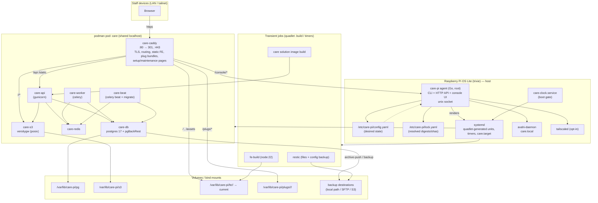
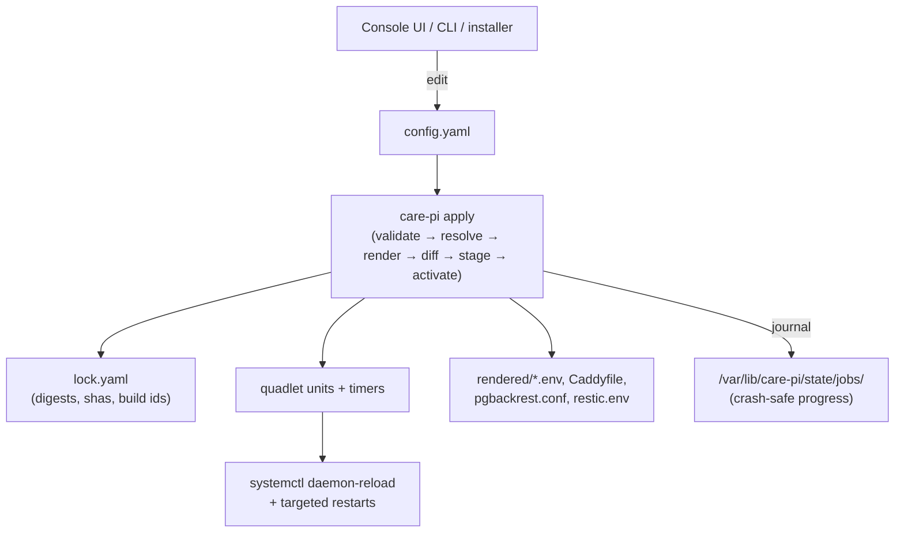
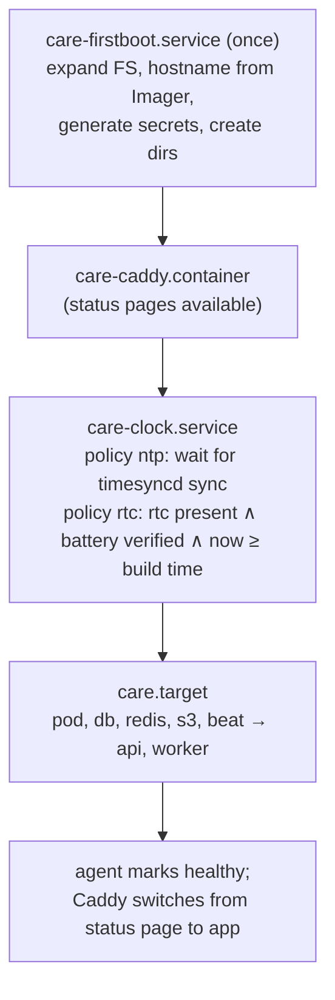
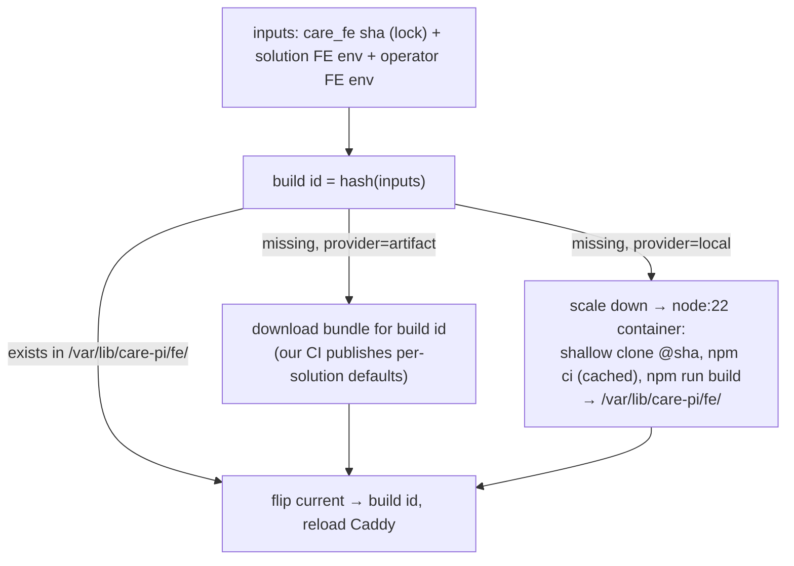

# 01 — Architecture

## 1. Goals and non-goals

Goals: a doctor or local IT person flashes an image (or runs one script), plugs the
Pi into ethernet, opens `https://care.local`, answers a few questions, and has a
working, backed-up, updatable CARE for their clinic — on a 2 GB Pi, without
touching a terminal.

Non-goals for v1: HA/multi-node, full-disk encryption, Wi-Fi-only setup, running
on anything that cannot run quadlet-capable podman.

## 2. Component overview



## 3. Host layout

| Item | Choice | Notes |
|---|---|---|
| OS | Raspberry Pi OS Lite, Debian 13 (trixie), arm64 | Same image for Pi 4 and Pi 5. podman 5.4.x from Debian ⇒ quadlet `.pod`, `.container`, `.volume`, `.image`, `.build`, `Secret=` all available (**SPIKE** to confirm on-device). |
| Container engine | rootful podman, netavark, crun, overlayfs on ext4 | `/var/lib/containers/storage` is pre-populated in the image. |
| Host packages | `podman`, `skopeo`, `avahi-daemon`, `systemd-timesyncd`, zram (Pi OS trixie ships `rpi-swap` + `systemd-zram-generator`: zram0 = 1× RAM, zstd, with `/var/swap` writeback — keep it; `install.sh` on other distros must provide `systemd-zram-generator` with `zram-size = ram`, because the FE build depends on it — SP4), `unattended-upgrades`, `nftables`, `tailscale` (repo added, package installed, service disabled until opted in), `restic` (**PROPOSED** host binary; alternative: run restic as a pinned container from a timer) | No node, no python toolchain, no postgres on the host. |
| Agent | `/usr/local/bin/care-pi`, `care-pi.service` (root, `Type=notify`), listens on `/run/care-pi/api.sock` | Hardened unit: `ProtectSystem=strict` with explicit `ReadWritePaths`, `NoNewPrivileges` is *not* possible (needs podman/systemctl), so keep the attack surface small instead (see `04-security.md`). |
| Config | `/etc/care-pi/config.yaml` (desired state), `/etc/care-pi/secrets/*` (0600 root), `/etc/care-pi/rendered/<unit>/*` (generated: env files, Caddyfile, pgbackrest.conf, restic env, headers — **mounted as directories**, never single files, so atomic renames are visible inside containers; SP6), `/etc/care-pi/lock.yaml` | Only `config.yaml` and `secrets/` are backed up. |
| Quadlets | `/etc/containers/systemd/care.pod`, `care-*.container`, `care-*.volume`, `care-*.image`, `care-build-*.build` | All generated by `care-pi apply`. Every `.container` carries `RunInit=true` (SP6: Postgres as PID 1 crash-restarted when an orphaned pgBackRest worker died), `PartOf=care.target`, `Restart=always`, both `MemoryMax=` and `MemorySwapMax=`, `OOMScoreAdjust=` (-500 db/redis, +900 builders). |
| Data | `/var/lib/care-pi/{pg,s3,backup/pg,fe,plugs,build,state}` | Bind mounts, not named volumes, so paths are obvious to an IT person and to restic. |
| Targets | `care-clock.service` → `care.target` (pod + all containers) ; `care-caddy` is `Before=` the gate so it can show status pages. Restarts always go through the target, and the agent **waits for every unit to reach `inactive` after `stop`** before `start` (SP6: `systemctl stop care.target` returns while PartOf stops are still running; a prompt `start` cancels them and the old container keeps running). | `care-firstboot.service` runs once (secrets, FS expand, hostname). |
| Timers | `care-backup-db-incr`, `care-backup-db-full`, `care-dest-<id>` (one per destination), `care-backup-verify`, `care-update-check`, `care-update-apply` (window-aware) | Rendered from `config.yaml`. |

## 4. Containers

| Unit | Image (pinned by digest in lock) | Role | Initial `MemoryMax` (to tune in Phase 0) |
|---|---|---|---|
| `care-caddy` | ours: `caddy` + `caddy-dns/acmedns` (DNS-01 against our service) + Tailscale cert getter + optional Coraza | TLS, routing, static files, status pages | 96 MB |
| `care-db` | ours: `postgres:17-<variant>` + `pgbackrest` | Postgres, WAL archiving | 384 MB (`shared_buffers` 128–192 MB) |
| `care-redis` | `redis:8-alpine` (upstream) — **SPIKE**: jemalloc vs 16 KB pages; fallback is our build with `MALLOC=libc` | cache + celery broker | 64 MB |
| `care-s3` | `versity/versitygw` (SP5 PASS: arm64, path-style presigned URLs through Caddy unchanged) | S3 API over `/var/lib/care-pi/s3` | 256 MB (peak 79 MB on one 50 MB transfer) |
| `care-api` | solution image (`ghcr.io/<org>/care-pi/care:<solution>-<ver>`) or local `.build` output; both `FROM ghcr.io/ohcnetwork/care@sha256:…` | gunicorn | 450 MB (2 workers) |
| `care-worker` | same | celery worker | 320 MB (concurrency 1–2) |
| `care-beat` | same | celery beat; **runs `migrate`, `sync_permissions_roles`, `sync_valueset` at start** (upstream `celery_beat.sh`) — so update ordering is beat → api/worker | 128 MB |
| `care-fe-build` (transient) | `node:22-bookworm-slim` | `npm ci` + `vite build` of care_fe at the locked sha with the solution/operator env | shaped, not capped: `MemoryHigh=768M`, `MemoryMax=1700M`, `MemorySwapMax=1500M`, `OOMScoreAdjust=900` (SP4); only runs with app scaled down |
| `care-build-<solution>` (`.build`) | builds the solution image locally when the operator deviates from the CI-built one | — | 768 MB; same scale-down rule |

Upstream facts this relies on (verified in `~/ohc.network/care`): the image is
published for `linux/arm64`; tags are `latest`/`latest-<run>` (develop),
`production-latest`/`production-latest-<run>-<date>-<sha>` and semver (`v*` tags);
plugs are installed by `install_plugins.py` from the `ADDITIONAL_PLUGS` JSON at
**build** time; the runtime image has no compiler.

## 5. Request routing (Caddy)

Same origin for everything; `REACT_CARE_API_URL=""` in the FE build (SP5 verified the
bundle resolves `apiUrl` to `""` and contains no upstream API host).

| Path | Upstream | Notes |
|---|---|---|
| `:80/*` | `308 https://{host}{uri}` | The only plaintext behaviour (P9). `auto_https disable_redirects` + explicit `http://` site blocks. |
| `/api/*`, `/staticfiles/*`, `/mediafiles/*`, `/ping/`, `/health/*`, `/app_version/` | `localhost:9000` (care-api) | `header_up X-Forwarded-Proto https`; Django needs `CSRF_TRUSTED_ORIGINS` = every served origin. Optional Coraza WAF on `/api/*`, off by default. `/admin/*` of Django is **not** routed unless O16 says otherwise. Upstream's static prefix is `/staticfiles/` (whitenoise), not `/static/`. |
| `/<FILE_UPLOAD_BUCKET>/*`, `/<FACILITY_S3_BUCKET>/*` | `localhost:7070` (versitygw), **no prefix stripping, original `Host` preserved** (SigV4 signs both) | Presigned URLs are generated by Care with `BUCKET_EXTERNAL_ENDPOINT=https://<canonical host>`; multihost plug rewrites per request when > 1 hostname. `request_body max_size` sized from config; `flush_interval -1` so large objects stream (Caddy peaked at 27 MB on a 50 MB transfer). |
| `/plugs/<slug>/<sha>/*` | `file_server` from `/var/lib/care-pi/plugs` | CORS `*` + immutable cache headers. |
| `/console/*` | agent unix socket | Own auth. Also serves the setup wizard before Care exists. |
| `/_care-pi/status` | agent | Unauthenticated, minimal JSON used by status pages and the installer. |
| everything else | `file_server` from `/var/lib/care-pi/fe/current` with SPA fallback to `index.html`; security headers rendered from care_fe's `_headers` output **minus HSTS on local-CA hosts**; `/assets/*` immutable; `encode zstd gzip` (entry chunk 191 KB → 63 KB) | When no FE build exists yet, or during maintenance / clock-wait, Caddy serves the agent's status page instead. |

Hostnames served: every enabled mode contributes one (`care.local` via `tls internal`;
`<id>.<our-domain>` via ACME DNS-01; `<name>.<tailnet>.ts.net` via Tailscale).
Caddy also answers on the raw LAN IP with the local CA certificate so "type the IP"
works for devices that cannot resolve `.local` (S14) — this needs **`default_sni <LAN IP>`**
in the global block, because a client connecting by IP sends no SNI and Caddy otherwise
answers with a TLS `internal error` alert (SP5). The IP changes with DHCP, so the agent
re-renders the Caddyfile on address change (NetworkManager dispatcher).

Ports: the pod publishes `80`/`443` on the LAN addresses the agent knows about, not on
`0.0.0.0` — anything else bound to `:443` on a specific address (SP5 hit `tailscale serve`
on the tailnet IP) makes a wildcard publish fail with `address already in use`. The agent
reports such conflicts in the console instead of boot-looping the pod.

Buckets: Care never creates buckets. `care-pi apply` creates `FILE_UPLOAD_BUCKET` and
`FACILITY_S3_BUCKET` on first run (with `LocationConstraint` = `BUCKET_REGION`, which must
equal versitygw's `VGW_REGION` or every request fails with `AuthorizationHeaderMalformed`),
and puts an anonymous-`s3:GetObject` bucket policy on the facility bucket only — upstream
reads facility cover images by *unsigned* URL (`read_cover_image_url`) and ships MinIO with
`mc anonymous set public`. versitygw enforces it correctly (anon GET 200, LIST/PUT 403; patient
bucket 403 throughout).

## 6. Declarative configuration model



Sketch of `config.yaml` (illustrative, not final):

```yaml
version: 1
identity:
  display_name: "Sunrise Clinic"
  hostname: care                    # → care.local
solution:
  name: care-clinic
  track: stable                     # stable | pinned | custom
  pin: 2026.11.0                    # used when track: pinned
  custom:                           # used when track: custom
    care_ref: null
    care_fe_ref: null
    plugs: []                       # add/remove/override {id, backend.ref, frontend.ref|url}
size:
  preset: small-clinic              # solo | small-clinic | busy-counter | custom
  custom: {gunicorn_workers: 2, celery_concurrency: 1, pg_shared_buffers_mb: 192}
tls:
  local_ca: {enabled: true}
  public:   {enabled: false, clinic_id: null}
  tailscale:{enabled: false}
clock:
  policy: ntp                       # ntp | rtc
backups:
  wal_archive_timeout_min: 5        # RPO knob
  schedule: {db_full: "Sun 01:00", db_incr: "daily 02:00", files: "daily 02:30", verify: "Sat 03:00"}
  retention: {db_full: 2, archive_days: 14, files_keep_daily: 14, files_keep_weekly: 8}
  destinations:
    - {id: usb,  type: posix, path: /mnt/care-backup}
    - {id: nas,  type: sftp,  host: nas.lan, user: care, path: /volume1/care}
    - {id: b2,   type: s3,    endpoint: https://s3.eu-central-003.backblazeb2.com, bucket: sunrise-care, region: eu-central-003}
updates:
  auto: true
  window: {days: [Sun], start: "02:00", end: "05:00"}
  os_security: true
env:
  backend:  {EMAIL_HOST: smtp.example.org, EMAIL_PORT: "587"}        # non-secret overrides
  frontend: {REACT_APP_TITLE: "Sunrise Clinic", REACT_ALLOWED_LOCALES: "en,ml"}  # change ⇒ FE rebuild
fe_build:
  provider: local                   # local | artifact
  artifact_url: null
network:
  wifi: null                        # later: {ssid, failover: true}
telemetry: {enabled: false, remote_write_url: null}
```

Secrets (`DJANGO_SECRET_KEY`, `JWKS_BASE64`, Postgres password, bucket keys,
recovery key, agent password hash, Tailscale auth key, S3/SFTP credentials) live in
`/etc/care-pi/secrets/` and are referenced by name; `apply` passes them to
containers as podman secrets or root-only env files, never through `config.yaml`.

`apply` semantics: validate schema → resolve refs to digests/shas (network only if the
lock changes) → render everything to a temp dir → diff against current → decide the
minimal action set (reload Caddy only / restart one container / full update cutover /
FE rebuild) → execute with a journal so a crash mid-way resumes or rolls back.

## 7. Boot, readiness and the clock gate



Clock feasibility (your Q7): yes.
- NTP sync is observable: `timedatectl show -p NTPSynchronized` / `systemd-time-wait-sync.service`.
- RTC presence is observable: `/dev/rtc0` (Pi 5 on-board; Pi 4 only with an external I²C module such as DS3231 enabled via `dtoverlay`).
- **Battery presence is not directly observable** on Pi 5 (*inference*: sysfs exposes charging voltage settings, not battery state). The agent verifies it passively: it records the RTC reading at every boot and the wall time at shutdown; after the first real power-off (not a reboot), if the RTC reading at boot is consistent with elapsed real time (checked once NTP is reachable, or against the shutdown timestamp with a tolerance), the battery is marked *verified* and policy `rtc` becomes selectable. The wizard explains this ("unplug the Pi for a minute once setup is done, then come back").
- `fake-hwclock` (present on Pi OS) restores the *shutdown* time at boot — monotonic but wrong — so it is never treated as trusted time. The build-timestamp check is a last-resort sanity floor only.
- Until the gate passes Care is not started; Caddy shows "Waiting for a reliable clock" with the reason.

## 8. Memory budget and presets

2 GB total; the kernel + Pi OS Lite baseline is ~120 MB with avahi/journald. Figures below
are **measured in SP3** (`08-spike-log.md`): the real Care stack as quadlets in one pod on
lumine (Pi 5, 2 GB, 16 KB kernel), idle and under a mixed read/write load of ~20 concurrent
clients. Caddy, the agent and pgBackRest are still estimates (SP6/SP7/Phase 1).

| Component | Idle in pod (measured) | Peak seen (measured) | `MemoryMax` / `MemorySwapMax` |
|---|---|---|---|
| Postgres 17 (`shared_buffers=128MB`, `max_connections=40`) | 82–96 MB | 187 MB (during `migrate`) | 384M / 0 (512M / 0 at 256 MB buffers) |
| Redis 8 | 16–20 MB | 36 MB | 96M / 0 |
| versitygw | 24 MB | 34 MB | 128M / 0 |
| celery beat (runs `migrate`/`sync_*` at start) | 111–148 MB | 314 MB (during `migrate`); **382 MiB + 85 MiB swap** on an empty DB (measured in the Phase 1 exit test) | 512M / 128M (was 384M / 128M; raised after the Phase 1 exit test; same for each preset) |
| gunicorn, per sync worker | 128 MB cold → ~175 MB warm, + 34 MB master | — | ≈ 64M + 200M × workers |
| celery worker, per prefork child | ~160–180 MB, + ~180 MB parent | — | 384M / 128M (c=1), 512M / 128M (c=2) |
| Caddy | ~20 MB *(estimate)* | ~40 MB | 96M / 0 |
| agent | ~20 MB *(estimate)* | ~40 MB | 64M / 0 |
| pgBackRest during backup | 0 | 80–150 MB *(estimate, process-max=1)* | inside db cap |

Controls: zram swap (Pi OS default, 2 GB zstd) so short bursts page out instead of
OOM-killing; **both** `MemoryMax` and `MemorySwapMax` on every unit (SP2: `MemoryMax` alone is
soft); Postgres `max_connections` ≤ 40 and `work_mem` small; celery `--max-tasks-per-child`
(upstream script sets 6). Memory is not the constraint on a 2 GB Pi 5 — one gunicorn sync
worker saturates about one core, so **presets are really CPU presets**.

Presets (measured on Pi 5; Pi 4 expect ~2–3× lower throughput at the same memory — *inference*):

| Preset | gunicorn | celery | PG shared_buffers | Stack idle (sum of units) | Host `MemAvailable` idle | Simple-API throughput | Notes |
|---|---|---|---|---|---|---|---|
| `solo` | 1 | 1 | 128 MB | ≈ 730 MB | ≈ 1.13 GB | ≈ 54 req/s @ 300 ms (20 clients) | 1 practitioner, 1–2 devices; 0 patient-create lock collisions |
| `small-clinic` | 2 | 1 | 128 MB | ≈ 820 MB | ≈ 0.97 GB | ≈ 93 req/s @ 170 ms | 2–4 staff; **default** |
| `busy-counter` | 3 | 2 | 256 MB | ≈ 1.1 GB | ≈ 0.7 GB on 2 GB | ≈ 114 req/s @ 140 ms | 5–10 concurrent; recommended on 4 GB+, console warns on 2 GB |
| `custom` | any | any | any | | | | advanced setup |

During FE/plug builds the agent temporarily applies `solo` and stops `worker`, builds, then
restores the preset (S8). Measured (SP4): the care_fe build's working set is ≈ 1.8–2 GiB
(rolldown is native, so Node's heap flag does not bound it) and it **fits a 2 GB Pi only
thanks to zram** (≈ 4:1 on its cold pages). The builder unit is therefore *shaped*, not capped:
`MemoryHigh=768M`, `MemoryMax=1700M`, `MemorySwapMax=1500M`, `OOMScoreAdjust=900`; db/redis get
`OOMScoreAdjust=-500`. With that, host `MemAvailable` stays ≥ 370 MiB and API latency is
unaffected (15–30 ms mean, no probe > 0.4 s). Warm build ≈ 1 min, cold (`npm ci`) ≈ 3 min on
Pi 5. Expected downtime: none for API (one worker stays), delayed background jobs during the
build.

Start-up times (Pi 5, USB SSD): empty DB to API healthy **3 min 20 s** (migrate); api+worker
restart to healthy **~45 s** (upstream scripts run `collectstatic` + `compilemessages` on every
start — a candidate for a prebaked override later).

## 9. Frontend pipeline (summary; detail in `03`)



Plug FE bundles follow the same shape at `/var/lib/care-pi/plugs/<slug>/<sha>/`,
default source = our CI's GitHub Pages; the agent writes `PlugConfig` rows via
Care's API (`/api/v1/plug_config/`, admin-only) with `meta.url` pointing at the
Pi (see O7 for the host-binding issue).

## 10. Backend plug pipeline (summary; detail in `03`)

Default: pull `ghcr.io/<org>/care-pi/care:<solution>-<ver>` (built in CI from the
pinned upstream digest + the solution's `ADDITIONAL_PLUGS`). Override (`custom`
track or operator-added plug): a quadlet `.build` unit renders a Containerfile:

```Dockerfile
ARG BASE=ghcr.io/ohcnetwork/care@sha256:...
FROM ${BASE} AS builder
USER root
RUN apt-get update && apt-get install -y --no-install-recommends build-essential libpq-dev libffi-dev git \
 && rm -rf /var/lib/apt/lists/*
ARG ADDITIONAL_PLUGS
ENV ADDITIONAL_PLUGS=${ADDITIONAL_PLUGS}
RUN python install_plugins.py
FROM ${BASE}
COPY --from=builder --chown=django:django /app/.venv /app/.venv
ENV ADDITIONAL_PLUGS=${ADDITIONAL_PLUGS}
```

`ADDITIONAL_PLUGS` must also be present at **runtime** (upstream `PlugManager`
reads it in settings to populate `INSTALLED_APPS`), so the same JSON is rendered
into `backend.env`.

## 11. Agent and console

Responsibilities: setup wizard; render/apply; job runner (update, build, backup,
restore) with SSE progress; health (container state, disk, memory, clock, backup
freshness per destination, cert expiry); logs (journald per unit) and a support
bundle (redacted env, unit states, last N log lines, lock, config); network
(hostname, mDNS name, Tailscale enrol, later Wi-Fi); TLS mode management (root CA
download page with fingerprint and per-OS steps); security (agent password,
recovery codes, TOTP, SSH toggle); power (reboot/shutdown).

Console pages (careui): Setup (easy/advanced), Dashboard, Backups, Updates,
Solution & Plugs, Settings (identity, sizing, env FE/BE, TLS, remote access,
network, clock), Logs & Support, Security.

API shape: `/console/api/v1/{session,setup,status,config,apply,jobs/{id}/events,backups,restore,updates,plugs,logs,support-bundle,network,tls,security}`. CLI mirrors it.

Implementation notes: shell out to `podman`/`systemctl`/`pgbackrest`/`restic`
(simple, debuggable) rather than binding to their Go libraries; use systemd's D-Bus
only for unit state subscriptions; render with `text/template`; schema-validate
`config.yaml` with a JSON Schema that the console also uses for forms.

## 12. Networking

- Ethernet with DHCP by default; the wizard shows the current IP and recommends a DHCP reservation; optional static IP.
- mDNS: `avahi-daemon` publishes `<hostname>.local`; the agent updates it when the name changes.
- Firewall (nftables): inbound 80, 443, 5353/udp; 22 only if SSH is enabled; 41641/udp when Tailscale is on. No container publishes ports other than the pod's 80/443.
- Wi-Fi (later): NetworkManager on Pi OS, either Wi-Fi as secondary connection or an `active-backup` bond as in the gist. **SPIKE**: the gist's `fail-over-mac-policy: none` requires the Wi-Fi interface to assume the ethernet MAC; `brcmfmac` may refuse — alternative is `fail_over_mac=active` with DHCP reservation per MAC.

## 13. Observability (opt-in)

`node_exporter` + `vmagent` (or Grafana Alloy) as a container, `remote_write` to the
URL in `config.yaml`; ~40–60 MB. Also local: the console shows memory/disk/CPU from
`/proc` and cgroup stats without any exporter.

## 14. Upstream changes this plan wants

| Repo | Change | Needed for | Priority |
|---|---|---|---|
| `care_fe` | Accept relative `meta.url` in `PluginEngine` (resolve against `location.origin`) **or** keep absolute and we ship a BE rewrite plug (O7) | serving plug bundles from the Pi under multiple hostnames | before multihost |
| `care_fe` | None for same-origin (`REACT_CARE_API_URL=""` already supported) | — | — |
| `care` | None required. Nice-to-have: skip `compilemessages`/`collectstatic` at every start when unchanged (saves start time and RAM on Pi) | faster restarts | later |
