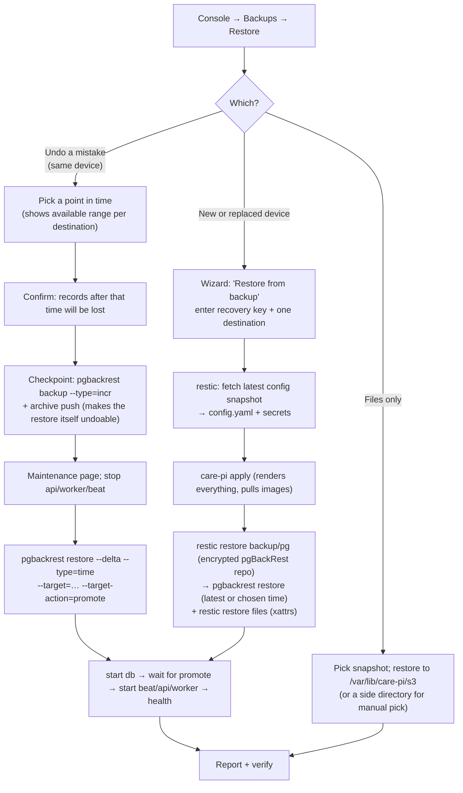

# 02 — Backups and restore

Requirements (SETTLED): no downtime, PITR with a configurable WAL interval, ≥ 1
destination mandatory, multiple destinations, types = local filesystem / "rsync"
(→ SFTP, P6) / S3-compatible, encrypted, configurable retention, easy for
non-technical operators, DB↔files consistency may be approximate.

## 1. What is protected, by which tool

| Data | Where | Tool | Why |
|---|---|---|---|
| Postgres | `/var/lib/care-pi/pg` | **pgBackRest** inside `care-db`, **one local repository** (AMENDED after SP6 — see §3) | Online base backups (full/diff/incr) + continuous WAL archiving = PITR without stopping Postgres; AES-256-CBC at rest; retention that never expires WAL still needed by a retained backup; `check`/`verify`; one-command restore. Debian trixie ships 2.55, PGDG 2.60 (SFTP supported since 2.44). SP6: 46 MB DB full backup 4 s, incr 5 s, PITR restore 8 s + 5 s recovery, db peak 233 MiB, API unaffected. |
| Uploaded files | `/var/lib/care-pi/s3` (versitygw posix; metadata in **xattrs**) | **restic** | Encrypted, deduplicated snapshots; local/SFTP/S3 (and rclone for anything else later); `restic check`; partial restores; preserves xattrs. |
| Box configuration | `/etc/care-pi/config.yaml`, `/etc/care-pi/secrets/` (minus the recovery key itself), `lock.yaml` | restic (same snapshot as files, separate path) | A new device can reproduce the whole box from a backup + the recovery key. |
| Off-site / secondary copies of the Postgres repo | the encrypted pgBackRest repo directory | restic (S40, §3) | Per-destination failure isolation; one destination model for everything. |
| FE builds, plug bundles, images | — | not backed up | Reproducible from the lock. |

Alternatives considered: WAL-G (fine, but no multi-repo and no SFTP), Barman
(needs a separate server), DIY `pg_basebackup` + restic (we would own WAL retention
and restore logic). See P1/P5.

## 2. Keys: one recovery key for the operator

- At setup the agent generates a 256-bit **recovery key**, displayed once as a word
  list + QR, downloadable as `care-recovery-<clinic>.txt`, with a "I have saved it"
  confirmation that asks the operator to re-enter three random words.
- Stored on the Pi at `/etc/care-pi/secrets/recovery.key` (0600 root), so scheduled
  backups and same-device restores never ask for it.
- Derived with HKDF: `pgbackrest repo-cipher-pass`, `restic` repository password,
  and the SSH private key seed used for SFTP destinations. Rotation = new key +
  fresh full backups to new repository paths (pgBackRest cannot re-key a repo in
  place); offered in the console, not required.
- Loss of the key + loss of the device = data unrecoverable. The console shows a
  persistent banner until the operator confirms a second copy (printed/photo).
- Compared with `care_clinic`'s asymmetric scheme (public key on the box, private
  key only with the operator): that is strictly stronger against device theft, but
  it is incompatible with pgBackRest/restic native encryption and you took physical
  attacks out of scope (S19/S21). Can be revisited.

## 3. Destinations

**Model (SETTLED, S40 — amended after SP6):** pgBackRest owns exactly one *local* repository;
every operator-configured destination is a **restic** repository fed on its own timer.

Why the original "every destination is a pgBackRest repo" design was withdrawn: SP6 showed
that pgBackRest's multi-repo `archive-push` is all-or-nothing. While *any* repo is
unreachable, WAL archiving to *every* repo stalls after the current segment (Postgres retries
the same segment; `pg_wal` grows; 2 segments reached the local repo in 4 min while 8 were
produced), and `backup` only ever targets one repo per run. `archive-async` hides latency,
not failure. So a dead USB stick or an off-site outage would have broken PITR continuity
*locally*.

**How it works now.** `repo1` = `/var/lib/care-pi/backup/pg` on the Pi's disk (posix,
AES-256, zst, bundle+block). `archive_command` only depends on local disk → never stalls on
the network. Every operator destination (local/USB, SFTP, S3) is a restic repository that
receives, on a timer, a snapshot of {`backup/pg` (already ciphertext), `s3/` files with
xattrs, `/etc/care-pi`}. Each destination runs as its own timer/unit: one failing never
touches another or Postgres. One destination concept, one credential model, one health view
("last snapshot" per destination), `restic forget/prune` retention per destination,
`restic check --read-data-subset` for verification (SP6: full `verify` over SFTP took 77 s
for 5 MB — sampling is the right remote check). Off-site RPO = restic interval (default
15 min for the WAL directory — cheap, files are immutable) + `archive_timeout`.

Costs accepted: restore from off-site is two steps (`restic restore` the repo dir, then
`pgbackrest restore` from it — needs local disk ≈ repo size); the recovery key must derive
both the pgBackRest cipher pass and the restic password (§2); a local-disk failure loses
PITR granularity finer than the last restic run. The SP6 numbers say the two-step restore
is minutes, not hours, at clinic scale, and the model matches "declarative and easy to
maintain" (S2/Q2).

*Rejected alternative (Option B):* keep off-site destinations as pgBackRest repos but
decouple them from `archive_command` — `archive_command = pgbackrest --repo=1 archive-push`
(local only), with a care-pi job re-driving `archive-push --repo=N` / `backup --repo=N` per
destination from its own queue. It keeps the direct `restore --repo=N` from SFTP/S3 (SP6:
8 s, no staging), native pgBackRest retention per repo, and no second tool for the DB. But
we would write and own a WAL re-driver (pgBackRest has none — its async queue only advances
when Postgres calls the command again for the same segment), a mistake there silently creates
gaps that only `verify` finds, and files/config still need restic anyway, so two destination
models would remain. The multi-repo pgBackRest configuration SP6 exercised is preserved in
`08` in case this is ever revisited.

| Type | pgBackRest (local repo only) | restic (every destination) | Operator input | Checks at setup |
|---|---|---|---|---|
| `posix` | `repo1-type=posix`, `/var/lib/care-pi/backup/pg` on the root disk — always present, not operator-configurable | local path; or a USB/second disk the wizard formats/labels and mounts via a generated mount unit (`x-systemd.automount`, `nofail`) | a path / a disk | writable, free space, not on the root disk (warn if it is) |
| `sftp` | — | `sftp:user@host:/path` (restic uses the host `ssh`; key generated by the agent) | host, user, path; the wizard shows the public key to add on the NAS/VPS; host key pinned on first connect (TOFU, fingerprint + key type shown — SP6) | connect, write, read back |
| `s3` | — | `s3:https://endpoint/bucket/prefix` | endpoint, region, bucket, access key, secret | list, put, get, delete; bucket created if missing (nothing else creates it — SP6); optional object-lock detection (advisory) |

Rules: ≥ 1 destination required to finish setup; the console recommends one
off-site; each destination has independent health ("last successful snapshot", "last
successful WAL archive" is local-only and therefore always green unless the disk is
failing, free space where knowable). A destination that is absent or unreachable marks
*itself* degraded and is retried on the next timer tick — it never affects Postgres or
other destinations.

**O10 (hot-plug USB) is resolved by this model:** an absent stick is just a destination
whose timer fails until it is back; the next snapshot catches up by content.

## 4. Schedules and retention (all rendered from `config.yaml`)

| Timer | Default | Knob |
|---|---|---|
| WAL archive (local repo) | `archive_timeout = 5min` in Postgres | `backups.wal_archive_timeout_min` |
| DB incremental (local repo) | daily 02:00 | `schedule.db_incr` |
| DB full (local repo) | weekly Sun 01:00 | `schedule.db_full`; `retention.db_full` (default 2) ⇒ ≈ 2 weeks of PITR |
| Snapshot to each destination (`backup/pg` + files + config) | every 15 min for `backup/pg`, daily 02:30 for files+config (both in one restic run when they coincide) | `destinations[].interval`; off-site **RPO = this interval + `archive_timeout`** |
| Retention per destination | `forget --keep-within 14d --keep-daily 14 --keep-weekly 8 --keep-monthly 6` | `destinations[].retention` |
| Verify | weekly | `pgbackrest verify` on the local repo (0.7 s at 46 MB) + `restic check --read-data-subset=5%` per destination |
| Restore drill (optional) | monthly | restore latest DB backup into a temp directory inside a throwaway container, run `pg_controldata`/start+`SELECT 1`, discard; skipped when disk < 2× DB size (SP6: 8 s + 5 s at 46 MB) |

Memory: `process-max=1`, `compress-type=zst --compress-level=3`; restic
`--pack-size` default, `GOMAXPROCS=2`. Both run at night when presets are idle;
the agent lowers them further if a backup overlaps a build.

## 5. Postgres configuration rendered by the agent

```
wal_level = replica
archive_mode = on
archive_command = 'pgbackrest --stanza=care archive-push %p'
archive_timeout = <N>min
max_wal_senders = 3
```

`pgbackrest.conf` (one local repo per S40; rendered into `/etc/care-pi/rendered/pg/` and the
**directory** is mounted, SP6 finding 3):

```
[global]
process-max=1
compress-type=zst
compress-level=3
start-fast=y
archive-async=y
spool-path=/var/spool/pgbackrest
log-path=/var/log/pgbackrest
repo1-type=posix
repo1-path=/var/lib/pgbackrest          # bind of /var/lib/care-pi/backup/pg
repo1-cipher-type=aes-256-cbc
repo1-cipher-pass=<derived>
repo1-bundle=y
repo1-block=y
repo1-retention-full=2

[care]
pg1-path=/var/lib/postgresql/data
pg1-socket-path=/var/run/postgresql
pg1-user=postgres
```

(The multi-repo variant that SP6 tested — `repo2-type=sftp` with
`repo2-sftp-host-key-check-type=fingerprint`, `repo3-type=s3` with `repo3-s3-uri-style=path`
— works mechanically and is kept in `08` for the record / the rejected Option B.)

The agent runs `pgbackrest stanza-create` once and `pgbackrest check` after every
`apply` that touches backups; failures surface in the console before the operator
leaves the page.

## 6. Restore flows



Notes:
- Same-device PITR uses `--delta` (only changed files are rewritten), so a few-GB
  clinic DB restores in minutes on SSD/NVMe (SP6: 46 MB in 8 s + 5 s recovery). Disk
  usage does not double — unlike a staging-database approach, which a 2 GB/128 GB box
  cannot afford. The restore container mounts the data dir at the **same path** the
  stanza uses, because pgBackRest bakes `--pg1-path` into `restore_command`.
- DR (new device) is two steps under S40: the pgBackRest repo is first pulled back from
  the destination by restic (size ≈ 2× DB + retained WAL), then restored. (The rejected
  Option B would have let pgBackRest stream straight from SFTP/S3.)
- Skew: files snapshot and DB point-in-time will differ by up to the schedule gap
  (default ≤ 30 min at night, up to 24 h during the day). Accepted (S18). The
  console states the file-snapshot time next to the chosen DB time.
- After any restore the agent re-runs `pgbackrest check` and takes a fresh full
  backup (new timeline), so PITR continues to work. A scratch/drill instance must run
  with `archive_mode=off` so its timeline never pollutes the stanza.

## 7. What the operator sees

- Backups page: per destination — last snapshot, size, free space, "Back up now",
  "Verify"; local PITR health — last full, last incr, last WAL archived, available
  restore window; global — RPO slider (archive timeout + destination interval),
  schedule, retention, "Show recovery key" (requires agent password), "Test restore".
- Dashboard banner states: no destination configured (blocks setup completion),
  destination unreachable for > N hours, local backup disk low, verify failed, recovery
  key not confirmed.
- Easy setup asks: "Where should backups go?" with three buttons (USB disk / network
  folder / cloud bucket) and "Add another".
