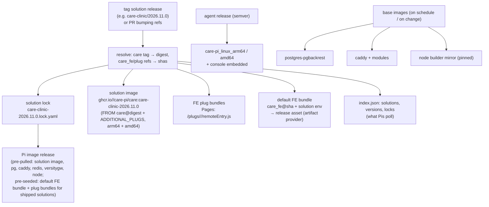

# 03 — Solutions, releases, updates

## 1. Solution format (lives in this repo under `solutions/<name>/`)

```yaml
# solutions/care-clinic/solution.yaml  (illustrative)
apiVersion: care-pi/v1
kind: Solution
name: care-clinic
title: CARE Clinic
description: Outpatient clinic — appointments, encounters, prescriptions, billing.
care:
  image: ghcr.io/ohcnetwork/care
  ref: v3.4.0                       # resolved to a digest in the lock (O8: tag policy)
care_fe:
  repo: https://github.com/ohcnetwork/care_fe
  ref: v3.4.0                       # resolved to a sha in the lock
plugs:
  - id: care_onboarding
    backend:
      name: care_onboarding
      package: git+https://github.com/<org>/care_onboarding.git
      ref: main                     # resolved to a sha; becomes "@<sha>" in ADDITIONAL_PLUGS
      configs: {}
    frontend:
      repo: https://github.com/<org>/care_onboarding_fe
      ref: main                     # built by our CI → Pages; or `url:` to use someone else's bundle
      meta: {config: {}}
    settings:                       # console form schema (same spirit as care_clinic's catalog)
      - {part: backend, key: EXAMPLE_KEY, label: Example key, type: secret}
  - id: care_multihost_files
    backend: {name: care_multihost_files, package: git+https://github.com/ohcnetwork/care_multihost_files_be.git, ref: main}
    auto: when_multihost            # agent enables it when >1 hostname is configured
env:
  backend:  {RATE_LIMIT: "5/10m"}
  frontend: {REACT_ALLOWED_LOCALES: "en,hi,ml", REACT_ALLOWED_ENCOUNTER_CLASSES: "amb"}
defaults:
  size_preset: small-clinic
  clock_policy: ntp
```

Operators pick a solution in the wizard; `custom` track lets them add/remove plugs
or override refs. The form schema in `settings` is how non-technical operators set
plug configuration without seeing JSON.

### 1.1 Proposed v1 plug set for CARE Clinic (S32 — confirm)

Derived from `care_clinic`'s `app/internal/plugins/catalog.yml` (the only curated clinic
plug list that exists today). No BE plug in this set has compiled dependencies, so P15's
builder stage is not needed for v1.

| Plug | Kind | Source today | Default | Notes |
|---|---|---|---|---|
| `care_onboarding_fe` | FE | `ohcnetwork.github.io/care_onboarding_fe` | **on** | Facility/staff/questionnaire setup inside Care; agent hands off to it after creating the superuser (P8). `redirect_after_login` setting. Needs internet (it pulls reference data). |
| `care_multihost_files_be` | BE | `github.com/ohcnetwork/care_multihost_files_be` | auto | Enabled by the agent when >1 hostname is configured (P10). `ALLOWED_HOSTS` rendered from `config.yaml`. |
| `care_fasterappointments_fe` | FE | `care-faster-appointments.pages.dev` | off | Front-desk flow; requires `REACT_MFE_REGISTERED_COMPONENTS` to include `AppointmentDetail,ScheduleResourceSelector` → an FE rebuild. The solution format must therefore let a plug contribute FE env, which the renderer merges before the build. |
| `care_filly` | BE | `github.com/ohcnetwork/care_filly` | off | AI scribe (Medispeak); needs `MEDISPEAK_API_KEY`/`MEDISPEAK_BASE_URL` and internet. |

Open points for this set: whether `care_onboarding_fe` should be *required* for Clinic (it
is the only path for a non-technical operator to create a facility), and whether to ship
`care_fasterappointments_fe`'s bundle from our Pages rather than pointing at a third-party
`pages.dev` host.

### 1.2 Making solutions cheap to add

- One directory, one file; `care-pi solution validate` checks it against the schema.
- CI discovers `solutions/*/solution.yaml` and builds a matrix: FE bundles for every plug
  with a `frontend.repo`, the solution image for every solution, and a lock per solution.
- The console lists solutions from an index our CI publishes; `custom` starts from any
  of them.

## 2. Release artefacts (CI in this repo)



Everything a Pi needs is pinned by digest/sha in a lock; the Pi never resolves a
floating tag itself unless the operator is on the `custom` track.

Versioning: solution locks are calendar-versioned (`YYYY.MM.N`); the agent and the
Pi image use semver. The Pi image embeds a specific agent + a set of solution locks.

## 3. The on-device lock and what "update" means

`/etc/care-pi/lock.yaml` records exactly what is running: care digest, solution
image digest (or local build id + its inputs), care_fe sha, FE build id (hash of
sha + env), each plug's sha and bundle location, the base image digests, the agent
version. An update = a new lock. A rollback = re-applying the previous lock (kept
in `/var/lib/care-pi/state/locks/`).

### 3.1 Refs: every component is either *tracked* or *pinned* (S33)

Each component (`care`, `care_fe`, every BE/FE plug, and the base images) has a
**source** and a **ref**. A ref is anything git/OCI can name: a branch, a tag, or an
exact sha/digest. The agent's job at update time is to *resolve* refs to immutable
identities and write them into the lock:

| Component | Source | Ref examples | Resolved to | How |
|---|---|---|---|---|
| `care` | OCI image (`ghcr.io/ohcnetwork/care`) | `latest`, `production-latest`, `latest-1284`, `v3.0.0`, `@sha256:…` | image digest (+ git sha from the `org.opencontainers.image.revision` label, for the record) | `skopeo inspect` |
| `care` | git (`ohcnetwork/care`) — *when no upstream image exists for the wanted commit* | `develop`, `<sha>` | git sha → image built from source by our CI (solution image job accepts `CARE_GIT_REF`) or, as a last resort, on the Pi | `git ls-remote` + build |
| `care_fe` | git | `develop`, `v25.2.0`, `<sha>` | git sha → FE build id | `git ls-remote`, build on Pi or fetch artefact |
| BE plug | git (pip `@ref`) | `main`, `<sha>` | git sha → `ADDITIONAL_PLUGS` entry `@<sha>` | `git ls-remote` |
| FE plug | git + our CI, **or** a bundle URL | `main`, `<sha>` / `https://…/remoteEntry.js` | sha → bundle hash / URL → content hash | `git ls-remote` / download |
| base images | OCI | `17`, `2`, `latest` | digests | `skopeo inspect` |

- **Tracked** = a branch or tag: re-resolved at every update check; if the resolved
  identity changed, an update is available. (Tags can be re-pointed upstream, so they
  are tracked like branches — the lock still holds the digest/sha actually running.)
- **Pinned** = a sha or digest: never re-resolved; the console shows "pinned" and still
  surfaces what the solution lock would give.
- A solution's `solution.yaml` supplies the *default* refs; a published solution lock
  is simply a set of pinned refs that we tested together. The operator may override
  any component's ref in `config.yaml`; that component is then shown as `custom`
  (unsupported combination), the rest keep following the solution lock.

```yaml
# /etc/care-pi/config.yaml (excerpt)
solution: care-clinic
track: stable                      # follow care-clinic locks for anything not overridden
components:                        # optional per-component overrides
  care:      {ref: latest}         # tracked image tag
  care_fe:   {ref: 9f2c1a7e}       # pinned sha
  plugs:
    care_onboarding_fe: {ref: main}
```

The immutable-artefact requirement from `08-spike-log.md` is satisfied by this model
without choosing a side: a clinic that wants upstream `develop` tracks `latest`; one
that wants semver tracks `v*` when those exist again; one that wants to freeze pins a
sha. Our locks default Clinic to tracked `latest` until upstream resumes tagging.

### 3.2 Tracks

| Track | Behaviour |
|---|---|
| `stable` | Follow the latest published lock for the chosen solution (all components pinned by us). |
| `pinned` | Stay on a chosen lock version; the console still shows "update available". |
| `custom` | One or more components have operator refs (§3.1); the agent resolves them itself and builds locally where no CI artefact exists. Marked "unsupported" in the UI. |

Auto-update: `care-update-check.timer` (daily) fetches `index.json`; if a newer lock
exists and `updates.auto` is on, `care-update-apply` runs at the next slot inside the
window; otherwise the console shows a banner with the changelog link.

## 4. Update orchestration

```mermaid
stateDiagram-v2
    [*] --> Idle
    Idle --> Staging: new lock chosen
    Staging --> Staged: images pulled, FE/plug bundles present or built\n(Care still serving)
    Staging --> Idle: failure (nothing changed)
    Staged --> Cutover: inside window / operator confirms
    Cutover --> Checkpoint: maintenance page on, api/worker/beat stopped
    Checkpoint --> Migrating: pgbackrest incr + archive push OK
    Checkpoint --> RolledBack: checkpoint failed → restart old units
    Migrating --> Starting: beat healthy (migrate, sync_* done)
    Migrating --> RolledBack: beat failed → previous lock; offer PITR to checkpoint
    Starting --> Verifying: api + worker healthy
    Starting --> RolledBack: health failed
    Verifying --> Idle: /ping OK, FE served, lock written, maintenance off
    RolledBack --> Idle
```



Details:
- "Staged" is the only long phase (pulls/builds) and happens with Care fully up;
  the FE build does the temporary scale-down described in `01` §8.
- Cutover downtime ≈ container restart + Django migrations; typically seconds to a
  few minutes (*inference*; to be measured). Caddy serves a maintenance page with
  live progress from the agent's status endpoint.
- Why checkpoint before migrate: migrations are rarely reversible, so the honest
  rollback is PITR to the moment before the update (S24). Because the app is
  stopped during migration, nothing is lost by restoring to the checkpoint if
  migration fails.
- Beat runs migrations (upstream `celery_beat.sh`); the agent starts beat first and
  only then api/worker, mirroring upstream compose `depends_on: celery-beat healthy`.
- Images of the previous lock are retained until the next successful update, then
  pruned (`podman image prune` with a keep-list).

## 5. Config-only changes (no lock change)

| Change | Action |
|---|---|
| Backend env var | rewrite `backend.env`, restart api/worker/beat (rolling: api last). Seconds of API blip; no maintenance page. |
| Frontend env var | new FE build id → build/download → flip symlink → Caddy reload. Zero downtime. |
| Sizing preset | rewrite units, `daemon-reload`, restart affected containers. |
| TLS / hostname | re-render Caddyfile, Caddy reload; update avahi; update `BUCKET_EXTERNAL_ENDPOINT`/`CSRF_TRUSTED_ORIGINS`/`DJANGO_ALLOWED_HOSTS` ⇒ backend restart; toggle multihost plug if hostname count crosses 1 (that one *is* a lock change because it changes `ADDITIONAL_PLUGS`). |
| Backup destinations | re-render `pgbackrest.conf`/restic env, `stanza-create` for new repos, `check`. No restart. |

## 6. OS updates

- `unattended-upgrades` enabled for the Debian/Pi OS security pockets only; `Unattended-Upgrade::Automatic-Reboot` **off** — the agent reboots inside the update window if `/run/reboot-required` exists and no job is running.
- Full `apt full-upgrade` (kernel, firmware, podman) via `care-pi update --os`, also offered as a step in the auto-update window, after the Care update succeeded.
- Risk: a podman/crun/netavark upgrade that breaks container start. Mitigation: `apt-mark hold` on those packages; they are bumped by our image releases after testing (**PROPOSED**).

## 7. FE build details (local provider)

Inputs: care_fe sha; merged env (solution `env.frontend` < operator `env.frontend`);
always `REACT_CARE_API_URL=""`, `REACT_PUBLIC_URL=https://<canonical host>`. Steps
inside `node:22-bookworm-slim`, as a transient unit shaped per SP4 (`MemoryHigh=768M`,
`MemoryMax=1700M`, `MemorySwapMax=1500M`, `OOMScoreAdjust=900`, `NODE_OPTIONS=--max-old-space-size=1024`;
the build's working set is ≈ 1.8–2 GiB and relies on zram — a hard 1 GiB cap is killed):
fetch the source tarball at sha from `codeload.github.com` (21 MB, no git needed) into
`/var/lib/care-pi/build/care_fe/src`, `npm install` against the persistent `node_modules`
(1.2 GB) + npm cache (0.4 GB) in the same build dir (seconds when the lockfile is unchanged,
`npm ci` semantics on a hash change), `npm run build:meta && npm run supported-browsers`,
`vite build --sourcemap false` (sourcemaps opt-in), `npm run postbuild`, copy `build/`
(13 MB) to `/var/lib/care-pi/fe/<build id>/`, render the `_headers` output into Caddy
`header` directives. Measured on Pi 5: warm ≈ 1 min, cold ≈ 3 min, API unaffected. Pi 4
2 GB: expected 2–3× slower (*inference*); acceptable per S8, but see O11 — `artifact` is the
safer default there.

Network needed for the tarball and `npm ci` on a cache miss (≈ 0.4 GB). The image
ships with the default build pre-seeded so first boot needs no build; the first
*custom* FE env change needs internet (or an artifact URL).
