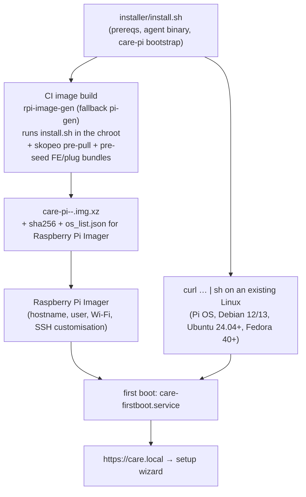

# 05 — Image and installer

## 1. One provisioning path, two entry points

The image is just "the installer already ran, images already pulled". Drift between
the two paths is structurally impossible because there is one script.

## 2. Image build

- Base: Raspberry Pi OS Lite trixie arm64. One image for Pi 4/5 (Pi OS ships
  kernels for both; Pi 5 defaults to the 16 KB-page `kernel_2712`). Imager
  customisation (hostname, first user, Wi-Fi country/creds, SSH keys, locale) is
  honoured by Pi OS's own first-boot mechanism; `care-firstboot` runs after it and
  reads the resulting hostname to pick the mDNS name (S27).
- Tool: `rpi-image-gen` (Raspberry Pi's current generator, trixie-native) —
  **SPIKE** to confirm it emits an Imager-customisable image and allows arbitrary
  chroot steps; `pi-gen` (arm64 branch) is the fallback with known behaviour.
- Pre-pull: `skopeo copy --override-arch arm64 docker://<image>@<digest>
  containers-storage:[overlay@<root>/var/lib/containers/storage+<root>/run/containers/storage]<name>`
  for every image in the shipped solution locks. No podman needs to run in the chroot.
- Pre-seed: default FE bundle(s) and plug bundles for the shipped solutions under
  `/var/lib/care-pi/{fe,plugs}`, plus the solution locks and `index.json` snapshot,
  so a fully offline first boot reaches a working Care (S25/Q36).
- Size: *inference* ≈ 2.5–3.5 GB uncompressed (care image ≈ 1 GB arm64, node
  builder ≈ 250 MB, postgres/caddy/redis/versitygw ≈ 300 MB, FE/plugs ≈ 100 MB, OS
  ≈ 1 GB); ≈ 1–1.3 GB `.img.xz`. Root partition auto-expands on first boot (Pi OS
  default); `fstrim.timer` enabled.
- Kernel page size: default kernel kept (S3). If a required image cannot run on
  16 KB pages, the Pi 5 fallback is `kernel=kernel8.img` in `config.txt`, applied
  by the installer only when a probe fails — logged and shown in the console.

## 3. First boot (`care-firstboot.service`, oneshot, once)

1. Wait for Pi OS's own customisation to finish (`After=` its unit).
2. Create `/var/lib/care-pi/*`, generate secrets that have no operator input
   (`DJANGO_SECRET_KEY`, JWKS, Postgres and versitygw credentials).
3. Set the mDNS name from the hostname (default `care`), start avahi.
4. Verify zram is active and ≥ 1× RAM (Pi OS `rpi-swap` default; fail loudly otherwise — SP4), nftables baseline, `unattended-upgrades` config.
5. `care-pi apply --phase=bootstrap`: render the pod with only Caddy (status page in
   "setup" mode) and the agent; **do not** start Care until the wizard finishes.
6. Mark done; `care-clock.service` and the rest proceed once setup completes.

Hardware checks the wizard shows before anything is written: RAM (2 GB ⇒ hide
`busy-counter`), root disk device type/size (warn on SD card, warn < 64 GB), a
10-second sequential write/read probe (warn on slow media), page size, RTC
presence, ethernet link + IP, internet reachability (needed? no; shown), clock
state, EEPROM/boot-order hints when booted from USB/NVMe (*informational*).

## 4. The setup wizard (console, served by the Pi)

Easy path (default): Clinic name → "How big is your practice?" (preset) → Solution
(cards: Clinic / Pharmacy / …) → Backups ("USB disk / network folder / cloud
bucket", at least one, test button) → Save recovery key (confirm words) → Admin
password for the box (+ recovery codes) → Care administrator (username/password for
the first superuser) → Review → Install (progress from the job stream) → Done page
with the URL, QR for phones, and "Install the certificate on this device".

Advanced path adds: hostname, static IP, TLS modes (public cert enrolment, Tailscale
enrolment with auth key or login URL), raw sizing knobs, FE/BE env editors, plug
add/remove with refs, update track/window, clock policy, telemetry, SSH.

Install step on an offline first boot takes a pre-seeded path: no pulls, no builds;
only `migrate` and superuser creation. With internet, it also checks for a newer lock
and asks.

## 5. Raspberry Pi Imager

- Publish `os_list.json` (Imager's repository format: name, description, url,
  `extract_size`, `extract_sha256`, `image_download_size`, `release_date`, icon).
  Users point Imager at it with `rpi-imager --repo <url>` (CLI flag) — *inference*:
  there is no in-app "add repository" UI; appearing in the official list requires
  an application to Raspberry Pi. Document both; ship the `.img.xz` for "Use custom"
  as well.
- Imager's OS customisation covers hostname (→ `care.local` alternative), user, Wi-Fi
  (recorded for the later Wi-Fi phase; ethernet still required for setup), SSH.

## 6. Generic-Linux installer (`curl -fsSL https://<host>/install.sh | sh`)

- Detects distro; requires podman ≥ 4.4 with quadlet (5.x preferred), systemd,
  cgroup v2. Targets: Raspberry Pi OS / Debian 12–13, Ubuntu 24.04+, Fedora 40+.
  Ubuntu 22.04 (podman 3.4) is refused with a message.
- Installs: podman, skopeo, avahi (optional, off on servers with a real DNS name),
  restic, nftables rules (only if nftables is active), the agent binary (verified
  against the sha256 in the release index), enables `care-pi.service`.
- Runs `care-pi bootstrap` — identical to first boot. Prints the URL.
- `--unattended` with a prepared `config.yaml` + secrets for IT people and for CI
  tests.

## 7. Testing the image

- CI: boot the image under QEMU (`virt` machine, Pi OS kernel) for smoke
  (services up, wizard reachable); real hardware matrix manually at first: Pi 5
  2 GB USB SSD (lumine), Pi 5 NVMe, Pi 4 2 GB USB, Pi 4 4 GB. Later: a self-hosted
  runner on a Pi for end-to-end.
- Golden-path e2e: flash → wizard easy path with a local destination → create a
  patient → "Back up now" → PITR to 5 minutes ago → verify patient gone → restore
  latest → verify patient back.
